# Manage event placement

The **Event placement** workspace at `/author/placement` controls where published
automatic-placement events appear. Fixed events keep their authored locations.
Use [Placement rules](../requirements/automatic-event-placement-policy.md) for
the selection policy, limits, rotation schedule, and catalogue.

## Prepare eligible content

Enable **Automatic placement** in the normal
[event editor](author-curation-api-contract.md#create-an-event), then prepare,
review, and publish the event. There is no separate portability-approval step.
Only use it for content that remains valid at different reviewed campus sites.

An automatically placed event has no fixed point to fall back to. Without a
valid current assignment, it is unavailable to players. Publication does not
guarantee a slot when capacity or coverage constraints prevent assignment.

## Preview and apply

1. Open Event placement and inspect the live assignments and automation status.
2. Choose **Create preview**, or **Preview another rotation** when placement is healthy.
3. Review **Changes** for current and proposed sites. Check **Coverage & sites**
   and the preview's coverage and blocked-site diagnostics.
4. If the proposed changes are suitable, choose **Review and apply**, enter a
   reason, and confirm.
5. Review the returned live assignments and **Recent history**.

```mermaid
flowchart LR
    accTitle: Placement changes are reviewed before they go live
    accDescr: The server derives a preview from current content, sites, and overrides. An Author checks proposed changes and coverage, then confirms with a reason. The server revalidates the preview and saves live assignments and history together.
    State["Current state<br/>Content, sites, overrides"] --> Preview["Server preview<br/>Proposed assignments"]
    Preview --> Check["Author review<br/>Changes and coverage"]
    Check --> Apply["Confirm apply<br/>Reason and version"]
    Apply --> Live["Live assignments<br/>Saved with history"]
    classDef source fill:#f4f0e8,stroke:#968674,color:#302820
    classDef review fill:#fff1c5,stroke:#a88124,color:#49370d
    classDef live fill:#e2f2e9,stroke:#487d63,color:#203e2d
    class State source
    class Preview,Check,Apply review
    class Live live
```

A preview is saved for inspection but does not change player locations. **Discard**
removes it from the current view; **New preview** requests another proposal.
Only the Author who requested a preview can apply it.

Apply sends the saved `planId` and current `expectedVersion`. The server checks
its expiry, policy, rotation bucket, input digest, and proposed entries again.
If the state changed, it rejects the apply without partially changing assignments.
The console reloads current state and history; review them and create a fresh
preview before another apply. It does not automatically replay the rejected change.

## Read placement feedback

The map and tables represent the same server records. The **Changes** view shows
which assignments stay, move, are added, or are removed. **Coverage & sites**
shows zone counts and reviewed candidate sites. The map can help locate a site;
all placement decisions remain available through the tables if it cannot load.

Coverage diagnostics compare actual counts with the required floor and preferred
allocation. Separation diagnostics name blocked candidate sites and whether a
fixed event or another selected site caused the conflict. Fixed-event coordinates
are not included in that diagnostic view.

A preview that leaves a required zone unserved cannot be applied. A smaller,
valid plan can be applied with a degraded status. See
[coverage rules](../requirements/automatic-event-placement-policy.md#coverage-and-separation)
for the exact distinction.

## Temporary overrides and rollback

Open **Manual controls** to create an override with a duration and reason:

| Control                  | Effect                                                                      |
| ------------------------ | --------------------------------------------------------------------------- |
| Pause automatic rotation | Stops new automatic rotations during the override.                          |
| Pin event to site        | Keeps an eligible event at a reviewed site, subject to all placement rules. |
| Exclude site             | Removes a site from selection and ends its current assignment.              |
| End an active override   | Ends it early and lets normal placement resume.                             |

The server enforces the [override limits](../requirements/automatic-event-placement-policy.md#author-overrides).
Creating or ending an override requires confirmation. A pause does not permit
invalid assignments to stay active, and a pin cannot bypass availability,
separation, or coverage checks.

**Recent history** offers rollback for eligible applied plans. Rollback requires
a reason and confirmation; it creates a new plan using historical choices
validated against current rules. It does not reopen old assignments or restore
retired content.

Site and zone lifecycle operations exist in the API, but the workspace does not
provide those controls or a site-creation editor.

## Runtime and saved gameplay

The API worker evaluates placement at startup, at the configured daily boundary,
and every 30 minutes for invalid assignments and override expiry. PostgreSQL time
and a shared placement-state lock coordinate all API instances. Scheduled plan
uniqueness prevents the same rotation from being applied twice; a later content
change can produce a reconciliation plan in that bucket.

Player discovery and eligibility read the effective assigned location. Challenge
start saves the assignment that passed eligibility, so later movement cannot
move a started attempt. Assignment-bound offline behavior and unchanged reward
identity are covered by
[Placement rules](../requirements/automatic-event-placement-policy.md#player-progress-and-privacy)
and the [offline challenge contract](offline-challenge-play.md).

## API and operations

Routes use `/api/v1` and require an active Author. Preview and state responses
are not cached. Every mutation includes `expectedVersion` and a nonblank reason;
override creation also includes an `idempotencyKey` and `durationHours`.
Reusing an override key with the same payload returns its saved result; a
changed payload is rejected.

| Route under `/author/event-placement`                 | Purpose                                                                     |
| ----------------------------------------------------- | --------------------------------------------------------------------------- |
| `GET` at the base path and `GET /history`             | Current state and recent plan history.                                      |
| `POST /previews` and `POST /apply`                    | Save a preview, then apply its identifier.                                  |
| `POST /overrides` and `POST /overrides/:id/end`       | Create or end a pause, pin, or exclusion.                                   |
| `POST /rollback`                                      | Create a new plan from `sourcePlanId`.                                      |
| `POST /sites/:id/status` and `POST /zones/:id/status` | Change reviewed site or zone lifecycle.                                     |
| `POST /events/:id/portability`                        | Operational compatibility; normal authoring uses the event-editor checkbox. |

Placement depends on the checked-in schema and reviewed catalogue seed
`database/seeds/0003_event_placement_catalogue.sql`. An empty eligible-event pool
can produce an unserved preview; publish suitable content rather than converting
landmark-specific events. There are no placement-specific environment variables.
The API process hosts the worker, so deployed instances must remain running;
Azure App Service uses **Always On**.

See [placement storage](../database/automatic-event-placement-persistence.md)
for locks, assignment history, schema, and rollout details, and the
[API reference](api-overview.md) for exact schemas.

---

This page was prepared and edited with assistance from Codex[GPT-5]
and Codex[GPT-6].
