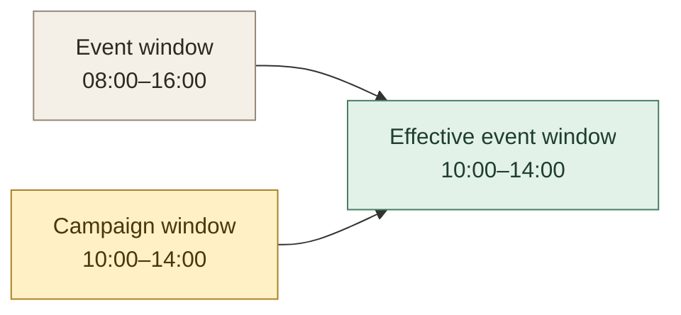

# Schedule campaigns

Campaigns give existing events and trails a shared schedule, such as a term or
Open Day. They change when content is available; they do not copy challenges
or create another reward system.

## Create and schedule a campaign

1. Open **Campaigns** at `/author/campaigns` and choose **New campaign**.
2. Enter its title and optional description, then set **Starts at** and **Ends at**
   in Johannesburg time.
3. Choose **Add content**. Search or browse the **Events** and **Trails** tabs,
   select members, and choose **Apply selection** to return them to the form.
4. Choose **Create draft campaign**, or **Save campaign** when editing a draft.
5. Use its **Review** view to submit it. Follow
   [Review and publish](diagrams/content-review.md) for independent approval and publication.

The picker changes the local selection; **Apply selection** does not save or publish the
campaign. Drafts may be saved with no members. If a stale edit is rejected,
the console preserves your form until you confirm loading the current server record.

## Membership and schedule rules

Approval and publication require at least **1 published, non-retired event or trail**.
Membership and dates are editable only while the campaign is a draft.

A directly assigned event must have an authored period that overlaps the
campaign. Its effective period is the intersection of both windows. The start
is included and the end excluded: `[startsAt, endsAt)`.

The times above illustrate a single Johannesburg date. A player cannot start
that event before 10:00 or at 14:00.

An event or trail can belong to several campaigns when their approved or
published periods do not overlap. Adjacent windows are allowed. Draft and
in-review campaigns do not reserve members; approval starts the reservation.
The server checks membership and overlap again at publication.

Event and trail membership are independent. Assigning a trail schedules the
trail experience, while its events retain their own availability unless also
assigned directly to a campaign. See [Trail rules](../requirements/ordered-trails-rules.md#availability-and-retirement).
Campaign membership does not enable automatic placement.

## Effective player availability

Draft, submitted, and approved campaigns do not change player discovery. Once
a member has published campaign history, its availability follows these rules:

| Published campaign windows              | Member availability                          |
| --------------------------------------- | -------------------------------------------- |
| A current window                        | Active, within the effective content window. |
| No current window, but a future one     | Upcoming under the nearest future window.    |
| Only ended windows remain               | Ended under the most recent window.          |
| All published windows have been retired | Removed from new discovery.                  |

Events still obey the intersection with their own periods. Unassigned content
keeps its usual availability. Player event and trail responses provide effective
times and availability, without campaign titles or identifiers.

Ending a schedule does not retire the campaign. It stays published and its
content is shown as ended until an Author retires it. A published member cannot
be retired while a published campaign still references it, even after that
campaign's end time.

Retirement preserves attempts, completions, rewards, and other saved gameplay.
Trail history follows the visibility rules linked above.

## API reference

All routes use `/api/v1` and require an active Author:

| Operation               | Route                                                                                         |
| ----------------------- | --------------------------------------------------------------------------------------------- |
| List / create campaigns | `GET` / `POST /author/campaigns`                                                              |
| Edit a draft            | `PUT /author/campaigns/:campaignId`                                                           |
| Workflow action         | `POST /author/campaigns/:campaignId/:action`, for submit, approve, return, publish, or retire |

Create and edit bodies contain title, optional description, start/end,
`eventIds`, and `trailIds`. Updates and transitions include `expectedVersion`.
Shared review, history, and errors are described in
[Review and publish](diagrams/content-review.md#versions-and-history).

There is no standalone player campaign endpoint. Effective scheduling is resolved
by the API/database when content is read; it does not depend on a browser timer
or a job that retires ended campaigns. See
[campaign storage](../database/campaign-scheduling-persistence.md) and the
[API reference](../api-reference.md) for implementation details and exact schemas.

---

This page was prepared and edited with assistance from
Codex-CLI[gpt-5.6-sol medium], Codex[GPT-5], Codex-CLI[GPT-6], and Codex[GPT-6].
