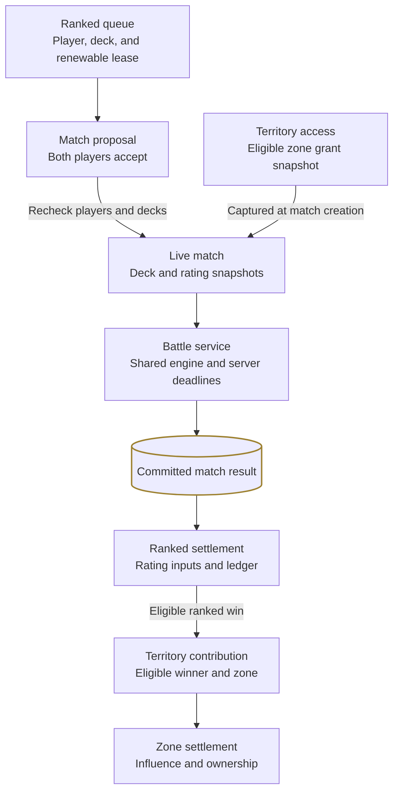
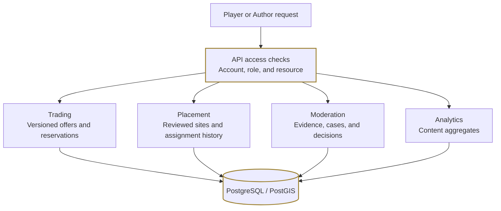

# Advanced systems

Live competition, territories, trading, placement, moderation, and analytics
use services inside the Fastify API. These views show how their responsibilities
connect through shared game state and saved results.

## Live, ranked, and territory flow

Ranked competition creates live matches after proposal acceptance. Rating
settlement uses the saved inputs and terminal result; casual live matches do
not receive ranked rating changes.

Territory influence additionally requires eligible zone access captured for
the match and an eligible ranked win. Owning a zone can provide a separate
challenge-card bonus. Season standings, territory ownership, and permanent
progression are distinct records.

## Other feature services

Trading settles both sides of an exchange in one transaction after rechecking
ownership and reservations. Placement previews a plan before applying it and
retains assignment history when events rotate.

Trust signals support human review and explicit restriction decisions.
Author reports use aggregate projections; advanced analytics suppress small
samples, while the separate question-curation report has its own reporting
rules. Neither interface exposes raw player-location trails.

## Delivery and coordination

Live WebSockets deliver participant- or spectator-safe views. The API commits
an action before distributing it; PostgreSQL notifications prompt other API
instances to reload the same state. Tickets and connection generations govern
access and reconnects independently of gameplay versions.

Upstash Redis supplies shared HTTP limits and gameplay activity coordination.
Scheduling defaults to polling; optional coordinated idle scheduling changes
worker discovery, not battle rules or database authority. See
[Integrations](../external-integrations.md#upstash-redis) for that boundary.

## Detailed references

| System             | API or policy                                                   | Storage                                                                                      |
| ------------------ | --------------------------------------------------------------- | -------------------------------------------------------------------------------------------- |
| Live battles       | [Live PvP](../live-pvp-api-contract.md)                         | [Matches and connections](../../database/live-pvp-persistence.md)                            |
| Ranked competition | [Matchmaking](../ranked-matchmaking-api-contract.md)            | [Seasons and rating history](../../database/ranked-competition-persistence.md)               |
| Territories        | [Territory API](../contested-campus-territory-api-contract.md)  | [Grants, influence, and ownership](../../database/contested-campus-territory-persistence.md) |
| Trading            | [Trading API](../card-trading-api-contract.md)                  | [Offers and exchange](../../database/card-trading-persistence.md)                            |
| Placement          | [Placement service](../automatic-event-placement-service.md)    | [Plans and assignments](../../database/automatic-event-placement-persistence.md)             |
| Moderation         | [Trust policy](../../requirements/longitudinal-trust-policy.md) | [Evidence and decisions](../../database/trust-persistence.md)                                |
| Analytics          | [Reporting API](../advanced-analytics-api-contract.md)          | [Aggregates and privacy](../../database/advanced-analytics.md)                               |

External developer access is a separate read-only boundary, described in
[System context](system-context.md) and [Developer API](../developer-api.md).

**AI declaration:** Prepared and updated with assistance from
Codex-CLI[gpt-6-sol] and Codex[GPT-6].
