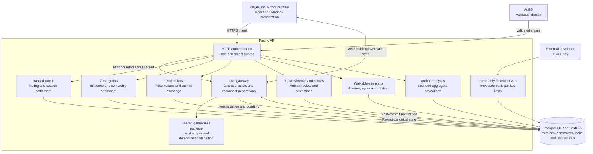

# Advanced systems and authority flow

This diagram extends the [application containers](application-containers.md)
with the implemented Sprint 3 services at main `c0fd42b`. Read it alongside
the [feature matrix](../../requirements/sprint-3-feature-matrix.md), not as
evidence that a deployed multi-client session has passed.

## How to read the boundaries

- **Live transport:** Socket memory is not battle authority. PostgreSQL retains
  match state, versions, connection generations, receipts and deadlines.
  Notifications wake receivers, which load the canonical committed projection.
- **Ranked and territory:** Ratings and influence consume eligible committed
  match outcomes. The browser cannot submit an authoritative winner, rating
  delta, zone membership, contribution or owner.
- **Trading:** Both sides negotiate versioned offers. Settlement rechecks
  ownership, reservations and policy limits inside the transaction; it cannot
  transfer one side while leaving the other unchanged.
- **Placement:** Reviewed sites and PostGIS distances constrain distribution.
  Preview is separate from apply. Versioned assignments retain history when
  events rotate; this is not randomized territory geometry.
- **Trust and analytics:** Trust uses bounded evidence and proportionate
  decisions. Operational analytics publish aggregate/suppressed results rather
  than raw player location or identity trails.
- **Developer access:** API keys cannot impersonate player/Author sessions.
  The current limiter is process-local; Upstash is a proposed extension, not
  part of this implemented diagram.

## Detailed references

| Boundary        | API/policy                                                      | Database                                                                                    |
| --------------- | --------------------------------------------------------------- | ------------------------------------------------------------------------------------------- |
| Live PvP        | [Live contract](../live-pvp-api-contract.md)                    | [Match and connection persistence](../../database/live-pvp-persistence.md)                  |
| Ranked          | [Matchmaking API](../ranked-matchmaking-api-contract.md)        | [Ratings, seasons and history](../../database/ranked-competition-persistence.md)            |
| Territory       | [Territory API](../contested-campus-territory-api-contract.md)  | [Zone and settlement persistence](../../database/contested-campus-territory-persistence.md) |
| Trade           | [Trading API](../card-trading-api-contract.md)                  | [Atomic ownership exchange](../../database/card-trading-persistence.md)                     |
| Trust           | [Trust policy](../../requirements/longitudinal-trust-policy.md) | [Evidence, cases and decisions](../../database/trust-persistence.md)                        |
| Placement       | [Placement service](../automatic-event-placement-service.md)    | [Plans and assignments](../../database/automatic-event-placement-persistence.md)            |
| Analytics       | [Analytics API](../advanced-analytics-api-contract.md)          | [Aggregate data](../../database/advanced-analytics.md)                                      |
| External access | [Developer API](../developer-api.md)                            | [Key verifiers](../../database/developer-api-keys.md)                                       |

See [third-party motivations](../third-party-software-and-services.md) for the
WebSocket and service dependencies, and the
[validation snapshot](../../testing/sprint-3-validation-status.md) for recorded
checks and outstanding deployment evidence.

## AI declaration

This diagram and its explanations were generated and edited with assistance
from Codex-CLI[gpt-6-sol] using the current contracts and persistence documents.
