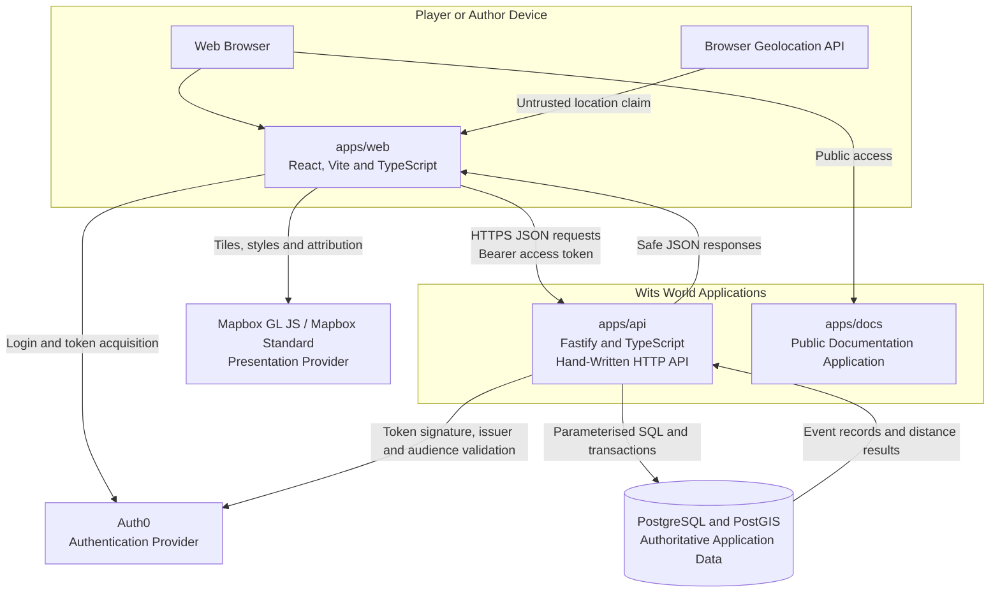

# Application Container Diagram

This diagram shows the major deployable applications, external services, and
data store.

## Container responsibilities

### `apps/web`

The web application:

- renders the mobile-first player and author interface;
- obtains browser geolocation after a clear user action;
- submits untrusted location claims to the API;
- displays API decisions;
- integrates map presentation;
- handles authentication loading and failure states; and
- provides accessible loading, error, and fallback interfaces.

The web application is not authoritative for protected decisions.

### `apps/api`

The API:

- validates access tokens;
- derives authenticated identity;
- validates request data;
- enforces role and object-level authorisation;
- coordinates event and eligibility operations;
- accesses PostgreSQL/PostGIS;
- enforces protected game rules;
- returns structured safe errors; and
- publishes OpenAPI documentation.

### PostgreSQL/PostGIS

The database:

- stores authoritative event data;
- stores authoritative geospatial points;
- performs distance calculations;
- applies constraints and indexes;
- supports transactional integrity; and
- later stores attempts, rewards, cards, decks, and matches.

### Auth0 authentication provider

The authentication provider:

- supports registration;
- supports sign-in;
- supports password reset;
- issues tokens; and
- provides account-lifecycle capabilities.

Auth0 is the selected provider under ADR-005. The API validates its access
tokens and derives the local player identity and role from validated claims.

### Map provider

The current implementation uses Mapbox GL JS and Mapbox Standard through the
provider-neutral map adapter. Formal external-service and licensing acceptance,
and any licensed project-owned campus layer, remain pending.

The map provider:

- supplies map tiles;
- supplies map styles;
- displays required attribution; and
- supports visual map presentation.

It does not decide whether an event is reachable.

### `apps/docs`

The documentation application:

- publishes version-controlled project documentation;
- explains setup, architecture, methodology, testing, and deployment; and
- contains no runtime authority over players or game operations.

---

The preceding document was planned and generated with the assistance of
ChatGPT-Web[GPT-5.6 Thinking], updated with Codex-CLI[GPT-5], and reviewed and
edited for Sprint 1 release validation with assistance from
ChatGPT-Web[GPT-5.6 Sol] and Codex[GPT-5].
