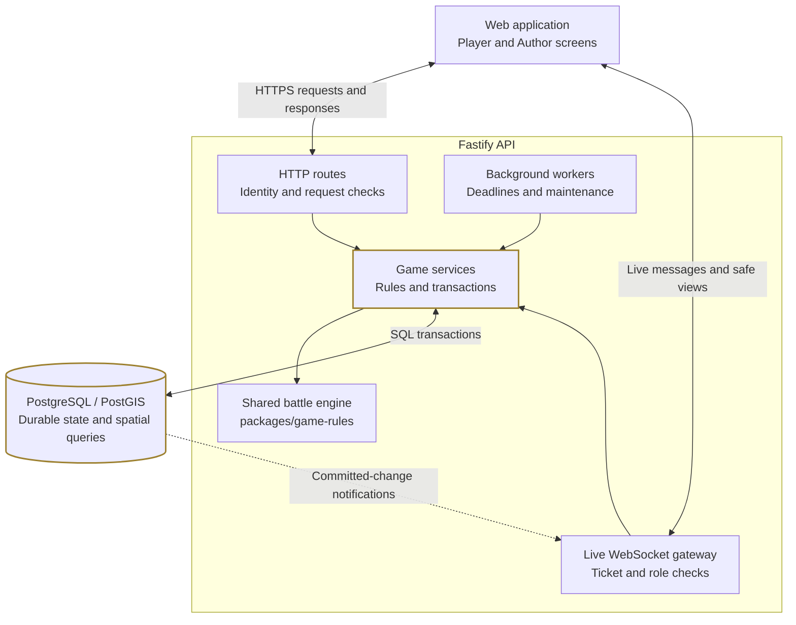

# Web, API, and database

The Web presents the game, the API applies its rules, and PostgreSQL stores
the resulting state. Feature services and background workers run within the
API application; they are not separate deployed services.

## Web application

`apps/web` contains the Player and Author interfaces, navigation, maps, and
browser interactions. It sends requested actions and displays API responses.
Browser location readings are inputs for server checks.

Issued offline packs and pending attempts live in IndexedDB. They become
accepted game results only after API reconciliation.

## API application

`apps/api` provides HTTP routes, live battle connections, feature services,
and background workers. It validates credentials and requests, checks access,
and performs database transactions.

The shared `packages/game-rules` engine resolves CPU, asynchronous, and live
battle transitions. Services supply validated inputs and persist the outcome.
`packages/account-policy` supplies Player Name validation to both Web and API.

Workers handle due battle decisions, ranked and territory work, and cleanup.
Their scheduling can use Redis coordination; the database remains authoritative.

## Database and live delivery

PostgreSQL stores accounts, content, ownership, attempts, matches, and history.
PostGIS performs spatial queries. Constraints, locks, and transactions keep
related changes consistent.

Ordinary queries use the application connection pool. PostgreSQL notifications
use a separate direct connection. A notification prompts the receiving API
process to reload committed state and send the appropriate live view.
Reconnection also restores saved state; socket memory does not replace it.

## Related views

- [System context](system-context.md): users and external services.
- [Advanced systems](advanced-systems.md): relationships between feature services.
- [Data flow](../data-flow.md): how individual requests become saved results.
- [Stack](../technology-stack.md): libraries and technology choices.

**AI declaration:** Prepared and updated with assistance from
ChatGPT-Web[GPT-5.6 Thinking], ChatGPT-Web[GPT-5.6 Sol], Codex-CLI[GPT-5],
Codex[GPT-5], Codex-CLI[GPT-6], and Codex[GPT-6].
