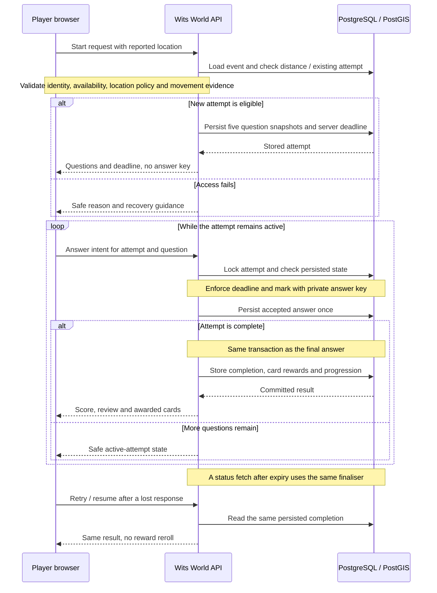

# Challenge and reward flow

This diagram follows an online challenge from a player's request to the stored
result. Authentication and active-account checks apply to protected requests;
the browser sends intent and reported location, never authoritative answers,
scores, or reward choices.

The answer loop applies only after an attempt exists. Invalid, late, or
conflicting answers are rejected according to the API contract; the diagram
condenses those error branches. Finalisation is part of the transaction that
handles the final answer or request-time expiry, not an independent browser
reward request. Expiry can be processed when the attempt is fetched; this does
not depict a guaranteed background timer.

The result can contain zero, one, or two cards under the current score policy.
The server stores the result before displaying it, which makes reconnects and
retries safe. Correct answers and review details are revealed after completion.
Reported location remains a claim, not proof of physical presence.

## Offline boundary

Offline play uses a separately issued challenge pack and queues answer intent
for reconciliation. A local completion is provisional: it cannot authoritatively
award cards, points, or an event completion. The server validates reconciliation
and returns the accepted result. See the
[offline challenge contract](../offline-challenge-play.md) for its own timing,
location, expiry and conflict rules; the online sequence above does not replace
that protocol.

## Sources

- [Challenges and answers API](../challenge-attempt-api-contract.md).
- [Challenge and reward storage](../../database/challenge-reward-persistence-design.md).
- [Reported-location eligibility](../../database/event-eligibility.md).
- [Start service](https://sdp.ms.wits.ac.za/gradient-ascent/Wits-World/src/branch/main/apps/api/src/challenges/challenge-attempt-start.ts) and [completion finaliser](https://sdp.ms.wits.ac.za/gradient-ascent/Wits-World/src/branch/main/apps/api/src/challenges/challenge-attempt-completion-finalizer.ts).

## AI declaration

Prepared from repository API contracts and implementation with assistance from
Codex-CLI[GPT-6].
