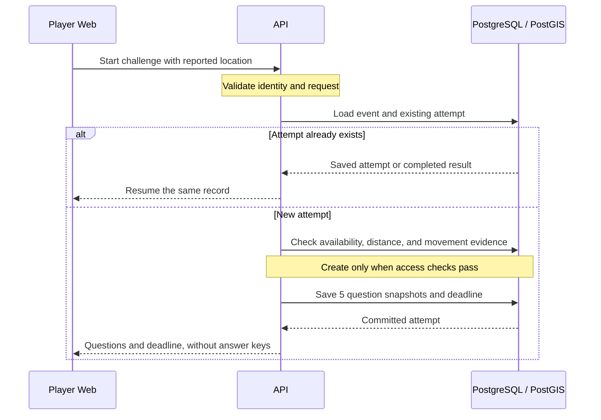
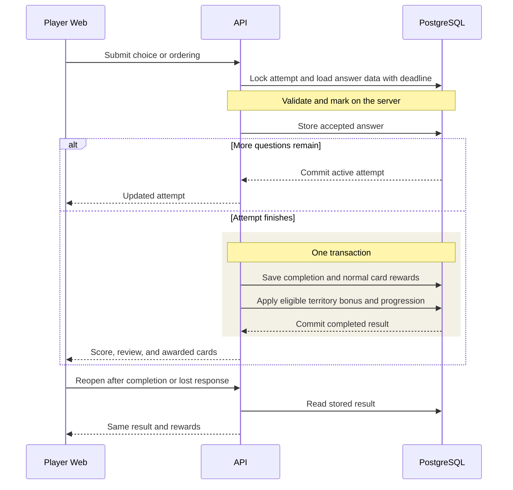
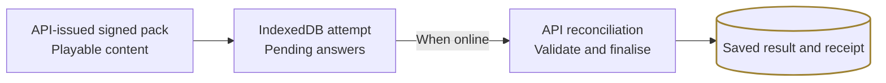

# Challenges and rewards

The API saves a challenge attempt before play begins, marks submitted answers,
and records the result and rewards together. The browser displays that saved
state and supplies answer intent.

## Start an online attempt

Starting again for the same event resumes the player's existing attempt or
result. For a new attempt, the API checks current event and challenge
availability, reported-location policy, and movement evidence. A rejected start
creates no playable attempt.

Question snapshots preserve the content selected for that attempt. Timing is
server-owned; a browser countdown only displays the deadline. Territory owner
bonus eligibility is also captured at challenge start where applicable.

## Answers and completion

Invalid, late, or conflicting submissions follow the
[attempt contract](../challenge-attempt-api-contract.md). Request-time expiry
can also finalise an attempt, including when its status is fetched; completion
does not depend on a browser timer or a guaranteed background tick.

Normal score-based rewards contain 0, 1, or 2 cards. An eligible territory owner
can receive 1 additional Common card under the
[owner-bonus policy](../../requirements/contested-campus-zone-policy.md#owner-card-bonus).
The completion, reward records, owned copies, bonus decision, and progression
changes commit together. Reopening cannot reroll the award.

## Offline reconciliation

A local completion is provisional. Reconciliation checks the signed pack,
account binding, timing, source content, location claims, and answers before
using the completion finaliser. A saved receipt makes delivery retries safe.
The [offline contract](../offline-challenge-play.md) defines its timing and
conflict rules.

See [challenge storage](../../database/challenge-reward-persistence-design.md)
for snapshots and reward records, and
[location eligibility](../../database/event-eligibility.md) for spatial checks.

**AI declaration:** Prepared and updated with assistance from Codex-CLI[GPT-6]
and Codex[GPT-6].
