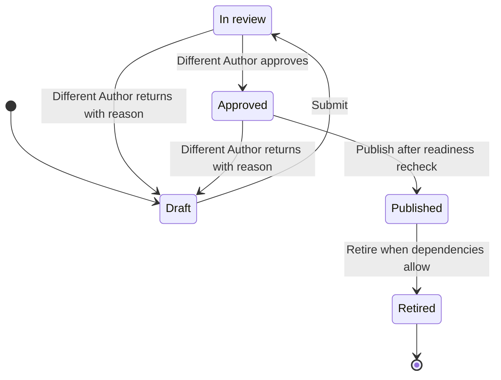

# Content review and publication

Authored game content follows a five-state review lifecycle. The API checks the
acting Author's identity, the record version, and publication readiness at the
transition boundary.

Any active Author may submit. The **current submitter cannot approve or return
that submission**; another active Author must do it. Any active Author may
publish an approved record if it is still ready. Publishing does not bypass
question completeness, event reward, or dependency checks.

Returning content to draft clears the submission/review metadata and starts a
new review cycle. Published content cannot return to draft, and retired content
has no outgoing transition. The terminal marker means the lifecycle ends; it
does not mean the database row is deleted. Edits and transitions retain their
audit history.

Player visibility depends on publication and the relevant availability rules.
Campaign timing and event eligibility still apply after content is published.
This is the implemented Author workflow, not evidence that a particular
stakeholder approved a particular content record.

Source: [content authoring API](../author-curation-api-contract.md), including
its transition permissions, optimistic concurrency, readiness checks and audit
contract; migration `0029_curate_author_content_lifecycle.sql`.

## AI declaration

Prepared from the repository Author lifecycle contract with assistance from
Codex-CLI[GPT-6].
