# Review and publish content

Events, challenges, questions, cards, and campaigns share a review lifecycle.
Editing, approval, and publication are separate actions. All require an active
Author account; hiding a button in the browser does not replace the API checks.

## Content lifecycle

```mermaid
flowchart LR
    accTitle: Content review and publication
    accDescr: Draft content is submitted for independent review, approved, published, and eventually retired. A different Author can return reviewed or approved content to draft with a reason. Retirement preserves history.
    Draft["Draft<br/>Editable content"] -->|Submit| Review["In review<br/>Independent decision"]
    Review -->|Approve| Approved["Approved<br/>Ready for publication"]
    Approved -->|Publish| Published["Published<br/>Available under game rules"]
    Published -->|Retire| Retired["Retired<br/>History retained"]
    Review -.->|Return with reason| Draft
    Approved -.->|Return with reason| Draft
    classDef preparation fill:#f4f0e8,stroke:#968674,color:#302820
    classDef review fill:#fff1c5,stroke:#a88124,color:#49370d
    classDef release fill:#e2f2e9,stroke:#487d63,color:#203e2d
    classDef history fill:#eef0f3,stroke:#7d8794,color:#303945
    class Draft preparation
    class Review,Approved review
    class Published release
    class Retired history
```

| State     | What can happen next                                                  |
| --------- | --------------------------------------------------------------------- |
| Draft     | Edit, then submit for review.                                         |
| In review | Another Author approves it or returns it to draft.                    |
| Approved  | Any Author publishes it; another Author can still return it to draft. |
| Published | Retire it when its dependencies allow.                                |
| Retired   | Read its saved history; it cannot be edited or republished.           |

The **latest submitter** cannot approve or return that submission, even if
someone else originally created the draft. Returning content requires a reason
and clears its submission and review metadata. Resubmission begins a new review cycle.

## Submit and review

1. Finish and save the draft. For an event, include its challenge and questions.
2. Choose **Submit for review**, or **Submit event and questions** for an event package.
3. A different Author opens **Content review** at `/author/review`, filters the
   queue if needed, and opens the record to inspect it.
4. The reviewer chooses **Approve** or **Return to draft** with a reason.
5. Once approved, an Author chooses the record's **Publish** action.

Your own submissions remain in the queue with a **View** action, but you cannot
review them. An event package appears as 1 queue entry; its submitted challenge
and questions are not listed again while the event is in review.

## Readiness and dependency order

Approval checks content readiness. Publication checks it again, because a
required dependency may have changed since approval. Approval alone does not
make content visible to players.

Event packages transition questions first, then the challenge, then the event,
inside 1 transaction. If any child fails its readiness or independent-review
check, the entire operation rolls back. Each child keeps its own audit history;
already-approved or published children are not submitted again.

Readiness requirements belong in the relevant guide:

- [Events and questions](../author-curation-api-contract.md#publication-readiness)
  covers complete question data and event rewards.
- [Campaigns](../campaign-scheduling-api-contract.md#membership-and-schedule-rules)
  covers published members and non-overlapping schedules.
- [Author cards](../../design/author-cards.md) covers move/effect completeness
  and retirement protections for starter and reward definitions.
- [Author trails](../../design/author-trails.md) use their separate draft,
  published, and retired lifecycle.

Retirement ends future discovery or selection. It does not erase started
attempts, saved results, owned cards, decks, or match snapshots. Published
parents can prevent a required child from being retired.

## Versions and history

Every edit and transition submits `expectedVersion`. A successful operation
increments the record version and saves an audit entry atomically. A stale
version is rejected; reload the current record before deciding what to do next.

**History** shows actions, versions, timestamps, and safe Author labels. Deleted
accounts appear as **Deleted author**. Access tokens, email, and private answer
bodies are not included in audit responses.

Publication provenance distinguishes migrated `legacy` records, repeatable
`controlled_seed` content, and newly `reviewed` publication. A published record's
provenance does not establish stakeholder acceptance.

All API paths below use `/api/v1`:

| Operation          | Route                                                                                      |
| ------------------ | ------------------------------------------------------------------------------------------ |
| Review queue       | `GET /author/review-queue`                                                                 |
| Record history     | `GET /author/content/:entityType/:entityId/history`                                        |
| Shared transitions | `POST` to the resource's `/submit`, `/approve`, `/return`, `/publish`, or `/retire` action |
| Event package      | `POST /author/events/:eventId/package/:action`, for submit, approve, return, or publish    |

Transition notes are optional and limited to 1,000 characters. Return requires
a nonblank reason of up to 1,000 characters. Common responses are
`403 SELF_REVIEW_FORBIDDEN`, `409 CONTENT_STATE_CONFLICT`,
`409 STALE_CONTENT_VERSION`, and `422 CONTENT_NOT_READY`.
The [API reference](../api-overview.md) provides exact request and response schemas.

---

This page was prepared and edited with assistance from Codex-CLI[GPT-6]
and Codex[GPT-6].
