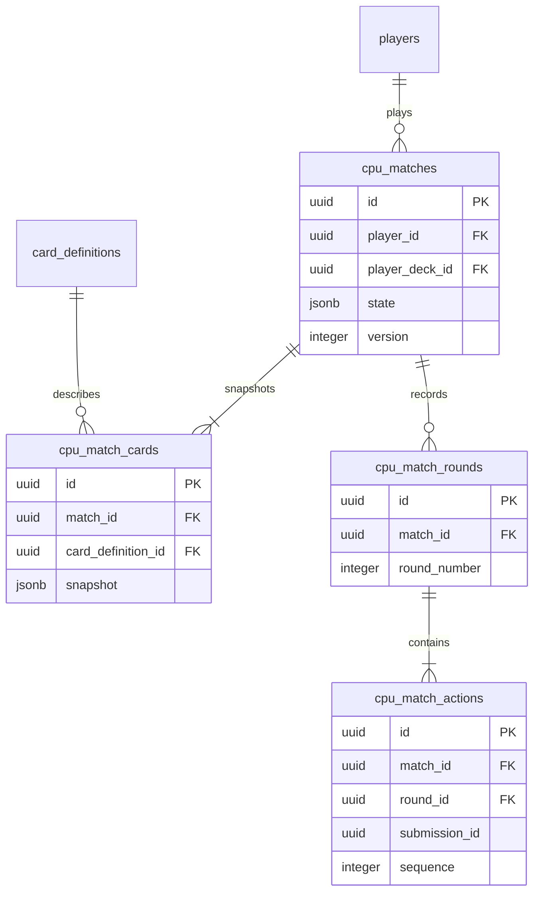
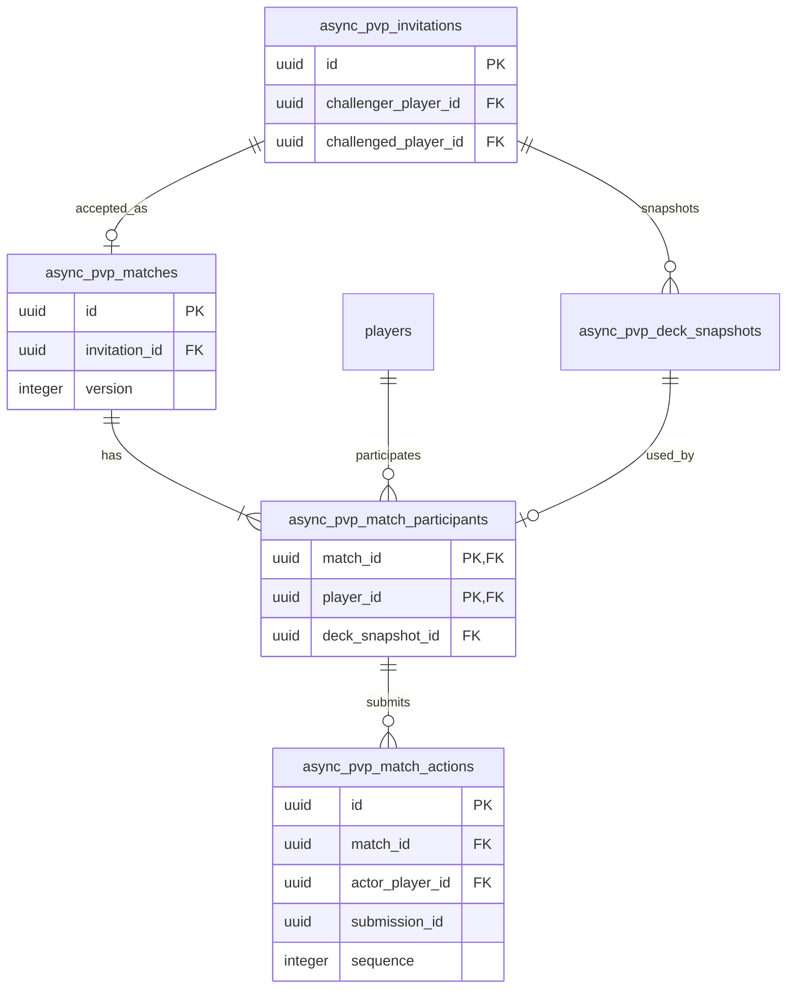
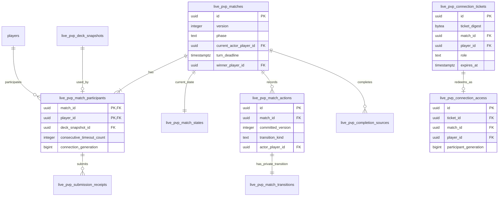

# Battle database relationships

CPU battles, asynchronous player battles, and live player battles have
separate persistence models. Each keeps match-owned snapshots and
server-controlled state, so changing a saved deck or consuming an owned card
does not rewrite a running match.

These views show selected tables and foreign-key relationships. `||` means one,
`o|` means zero or one, `o{` means zero or many, and `|{` means one or many.
Exact constraints and lifecycle rules remain in the linked storage references.

## 1. CPU matches, snapshots and action history

The match stores current state and its version. Its card snapshots retain the
battle inputs; rounds and actions preserve what happened. The action's compound
round/match foreign key prevents it from being attached to another match's
round. The direct action-to-match link is omitted from the picture for clarity.

The source `player_deck_id` can become null when the saved deck is deleted.
Snapshot `owned_card_id` values are historical identifiers, not foreign keys to
current ownership rows. A player's active-match uniqueness constraint and
transactional row locking prevent conflicting updates. Repeating a submission
returns its recorded response instead of applying the action again.

Source: [CPU match storage and API](../../database/cpu-match-persistence-design.md)
and migration `0012_create_cpu_matches.sql`. Cardinalities describe committed
game records; the server also checks roster and battle rules.

## 2. Player invitations, participants and actions

An invitation identifies the challenger and challenged player through separate
foreign keys to `players`. Acceptance creates one match with two participants.
The participant's compound snapshot/player foreign key binds its deck snapshot
to the correct player, and an action's compound match/actor key binds the action
to a participant in that match.

`async_pvp_deck_snapshots` is in the **private** schema; the other relations
shown here are in `public`. Private card snapshots, match state, transitions,
and submission receipts are omitted to keep this overview readable. A `public`
schema name does not make a table publicly accessible through the API: routes
still enforce authentication, ownership and safe response projections.

Server deadlines, expected versions, row locks and submission receipts govern
progress and retries. The browser does not choose the winner or disclose the
opponent's private deck. Internal engine side names are implementation labels;
both participants in this model are human players.

Source: [asynchronous player battle storage](../../database/asynchronous-pvp-persistence.md),
[the API contract](../asynchronous-pvp-api-contract.md), and migration
`0028_create_asynchronous_pvp_persistence.sql`.

## 3. Live player matches, connections and transition history

`live_pvp_matches`, `live_pvp_match_participants`, and the spectator-safe
`live_pvp_match_actions` history are in `public`. Deck/card snapshots, current
full state, authoritative transitions, ticket digests, connection access,
idempotency receipts, and completion sources are in `private`. A database
schema name is not an API authorization decision; the future realtime gateway
must still derive the connection role and construct a role-safe projection.

Gameplay `version` and participant `connection_generation` are intentionally
separate. A committed battle transition advances the gameplay version and
appends one public/private transition pair. Redeeming a newer participant ticket
advances only that participant's connection generation and supersedes the old
connection without changing battle state or the one-minute deadline.

Source: [live player battle storage](../../database/live-pvp-persistence.md),
[the live PvP contract](../live-pvp-api-contract.md), and migration
`0044_create_live_pvp_persistence.sql`.

## Related diagrams

- [Players, challenges, cards, decks and progression](database-relationships.md).
- [Events and ordered-trail membership](../../database/event-schema.md).
- [All diagrams](index.md).

## AI declaration

Prepared from repository migrations and battle persistence contracts with
assistance from Codex-CLI[GPT-6] and ChatGPT-Web[GPT-5.6 Sol].
