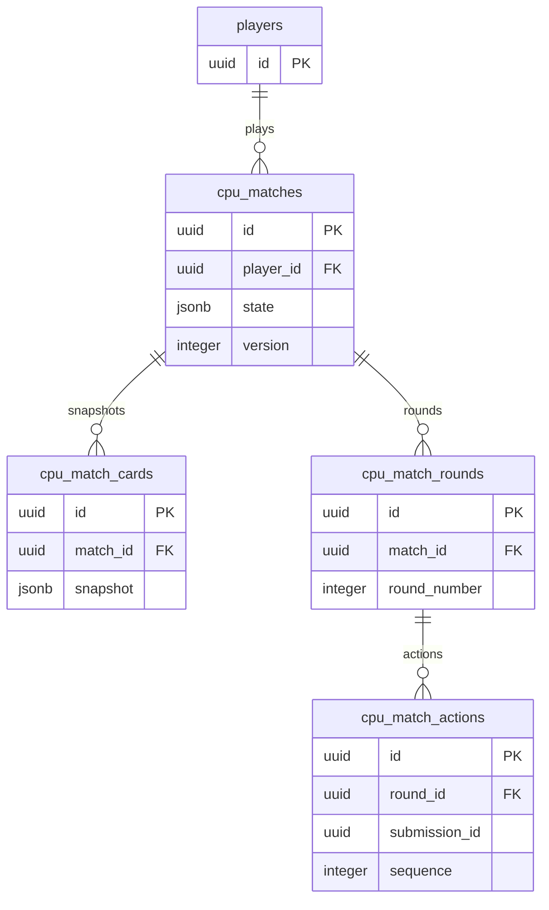
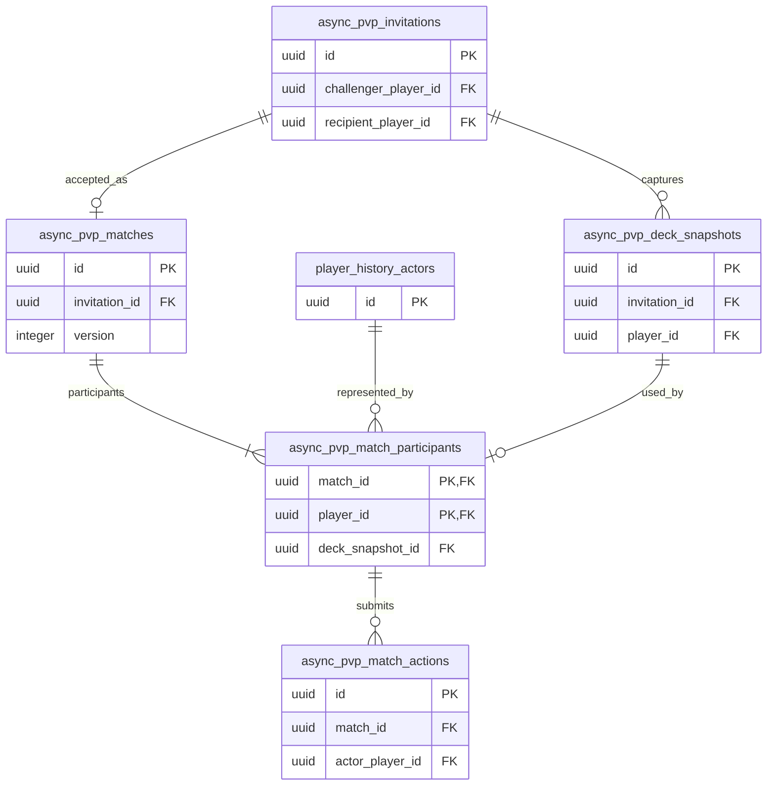
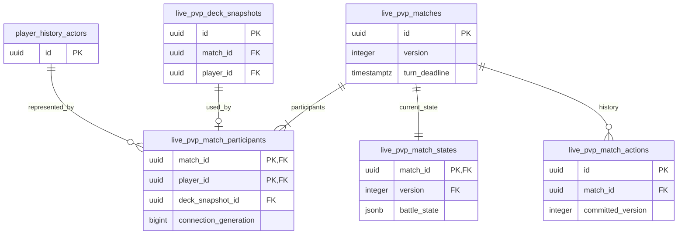
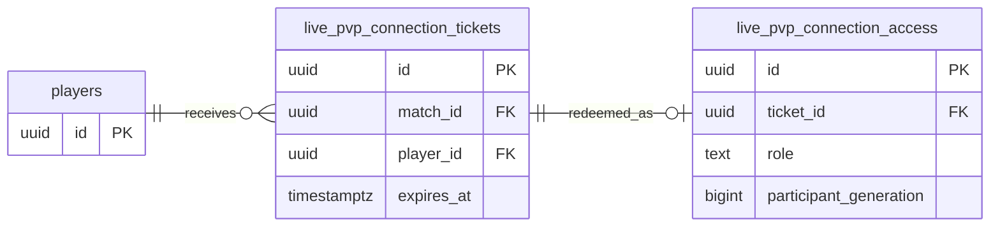
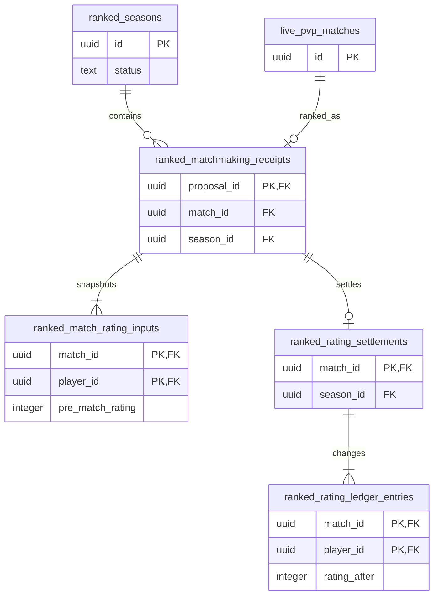

# Battle relationships

CPU, asynchronous, and live battles have separate match records. Each snapshots
its battle inputs and saves server-controlled state, so later changes to a
collection or deck do not rewrite a running match.

These diagrams show selected tables and columns. `||` means exactly 1, `o|`
means 0 or 1, `o{` means 0 or more, and `|{` means 1 or more. `PK` and
`FK` mark primary and foreign keys. Where a match requires exactly 2
participants, the text states that rule.

## CPU battles

The match stores current state and a version. Snapshot rows preserve the cards
used, while rounds and actions record play. An action's compound round/match
reference prevents it from belonging to another match's round.

The optional source deck can be deleted without removing the match snapshots.
Snapshot ownership IDs identify the original copies rather than current
ownership rows. Row locks, active-match uniqueness, and submission receipts
prevent conflicting or repeated actions.

See [CPU match storage](../../database/cpu-match-persistence-design.md).

## Asynchronous player battles

Acceptance creates a match with exactly 2 participants. Compound references
bind each participant's private snapshot to the correct actor and each action
to a participant in that match. Server deadlines, expected versions, locks,
and saved receipts govern turns and retries.

`player_history_actors` and the deck snapshots are in the `private` schema.
Retained PvP records reference the historical actor rather than requiring a
permanent player profile. Account deletion replaces that actor key with a
profile-free surrogate. Historical participation grants no authentication or
gameplay access.

See [asynchronous battle storage](../../database/asynchronous-pvp-persistence.md),
[the API contract](../asynchronous-pvp-api-contract.md), and
[deletion retention](../../database/account-deletion-retention.md).

## Live player battles

A committed transition advances the match and private state versions together.
It also appends a viewer-safe action record and a corresponding private
transition containing the full resolution. The gateway constructs participant
or spectator views from committed state.

Match state, snapshots, and historical actor anchors are private. A table in
the `public` schema still requires the API's access checks and response
projection; the schema name does not grant public access.

See [live battle storage](../../database/live-pvp-persistence.md) and
[the live API contract](../live-pvp-api-contract.md).

## Live connection access

Tickets and access rows are private, temporary records tied to a current
player account and match. Ticket digests are stored instead of raw tickets.
Spectator access cannot submit battle actions.

Redeeming a newer participant ticket advances its connection generation and
supersedes the previous connection. It does not advance the gameplay version
or restart the turn deadline. Account deletion closes connections and removes
these access records.

## Ranked result settlement

An accepted ranked proposal creates a receipt linking its season and live match.
Each ranked match has exactly 2 saved rating inputs. A terminal result produces
at most 1 settlement with exactly 2 ledger entries, preventing repeat settlement.

Player season ratings and closed-season standings are stored separately from
this retained match evidence. Historical queue entries now refer directly to
the season and historical actor; they no longer depend on retaining the
player's season-rating row. The [deletion contract](../../database/account-deletion-retention.md)
defines which personal standings are removed and which shared history remains.

See [ranked storage](../../database/ranked-competition-persistence.md) and
[ranked rules](../../requirements/ranked-competition-policy.md). Territory
contributions consume eligible settled results through their
[separate storage model](../../database/contested-campus-territory-persistence.md).

[Data relationships](database-relationships.md) covers owned cards, saved
decks, challenge completions, and permanent progression.

**AI declaration:** Prepared and updated with assistance from Codex-CLI[GPT-6],
ChatGPT-Web[GPT-5.6 Sol], Codex[GPT-5.6 Sol], and Codex[GPT-6].
