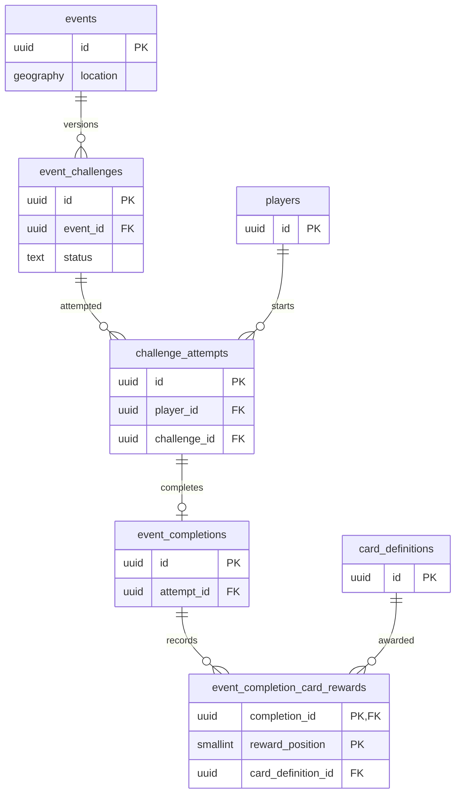
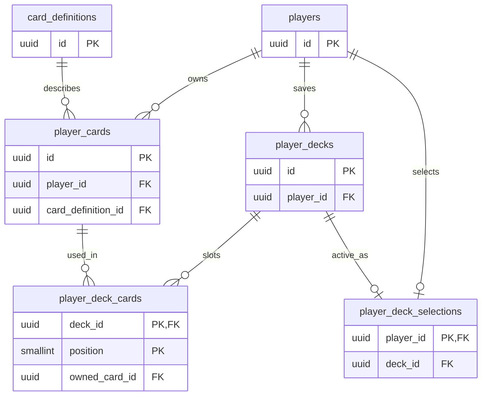
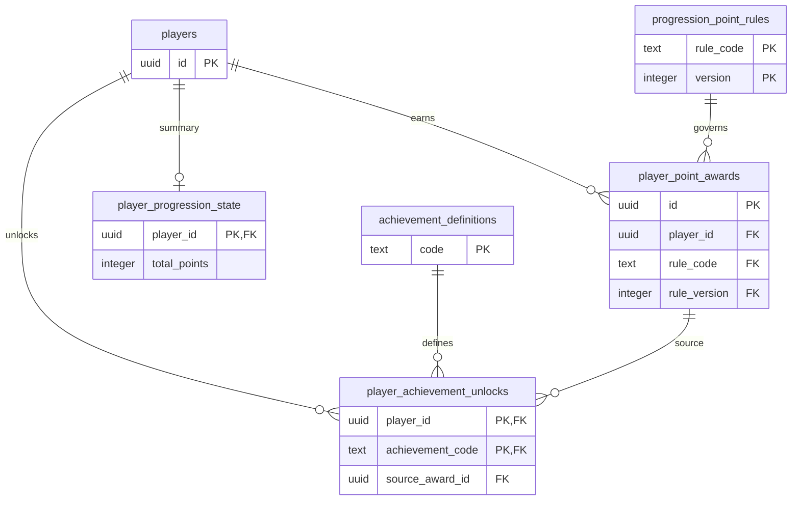
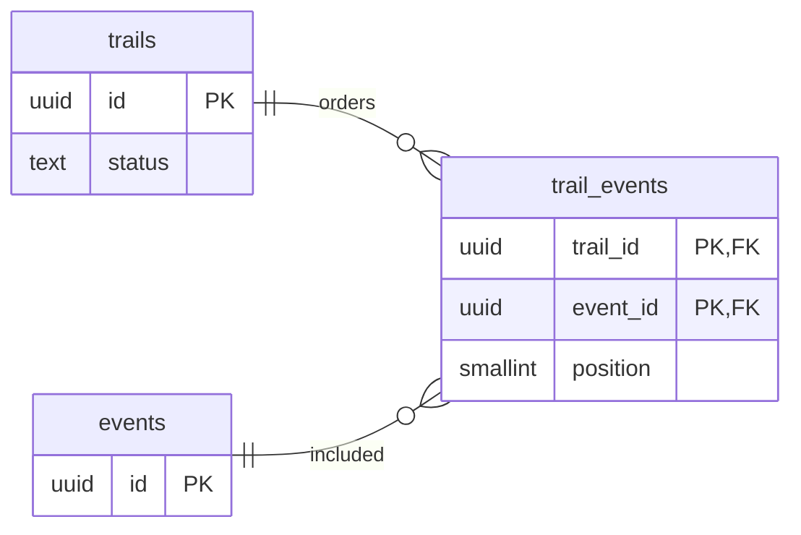

# Data relationships

These views show the main relationships behind events, cards, decks, and
progression. Each includes selected columns; the linked database references
define the full schema and constraints.

In the notation below, `||` means exactly 1, `o|` means 0 or 1, and `o{`
means 0 or more. `PK` marks a primary key and `FK` marks a foreign key.
Compound references are simplified in the diagrams and explained in the text.

## Events and challenge results

An event can retain several challenge versions, with at most 1 published
version. A player has at most 1 attempt and 1 completion per event. Compound
foreign keys bind each attempt to the correct event and challenge, and each
completion to the same player and event.

Finalisation stores the normal reward records and owned card copies together.
The reward record preserves the original award if a copy is later consumed or
traded. Territory owner bonuses use separate decision records linked to the
completion.

See [challenge and reward storage](../../database/challenge-reward-persistence-design.md)
and [territory storage](../../database/contested-campus-territory-persistence.md).

## Card ownership and decks

A definition describes a card; `player_cards` identifies a particular owned
copy. Copies of the same definition remain separate assets. Compound foreign
keys ensure that a deck and its referenced copies belong to the same player.

A copy can appear in several saved decks, but only once in a particular deck.
The API checks current ownership and deck legality before battle; a saved deck
is not automatically playable. Battle snapshots preserve the cards used even
when later collection changes affect the source deck.

See [saved decks](../../database/saved-deck-persistence-design.md),
[evolution](../../requirements/card-evolution-rules.md), and
[trading storage](../../database/card-trading-persistence.md).

## Progression and achievements

The point-award ledger records each earned award; progression summaries support
all-time totals, monthly views, and streaks. Versioned rules and source
uniqueness prevent a repeated request from earning the same award twice.

Permanent points are separate from ranked seasonal ratings. The current game
does not use the legacy coin economy.

See [progression storage](../../database/player-progression-persistence.md)
and [progression rules](../../requirements/player-progression-rules.md).

## Ordered trails

Trail progress is derived from ordered membership and the player's completed
events. Campaigns group events and trails through separate membership tables
and apply their own publication and schedule rules. Automatically placed
events also have assignment history; their effective location can differ from
the authored location or exist when that location is unset.

See [trail storage](../../database/ordered-trails-persistence.md),
[campaign storage](../../database/campaign-scheduling-persistence.md), and
[placement storage](../../database/automatic-event-placement-persistence.md).

## Related data

[Battle relationships](database-battles.md) covers match snapshots, actions,
connections, and ranked settlements. The [database guide](../../database/overview.md)
links the remaining domains, including profile, identity, moderation, and analytics.

Account deletion removes player-owned records according to the
[deletion contract](../../database/account-deletion-retention.md). Retained shared
history uses a separate, profile-free historical actor; a historical actor is
not an active player account.

**AI declaration:** Prepared and updated with assistance from Codex-CLI[GPT-6]
and Codex[GPT-6].
