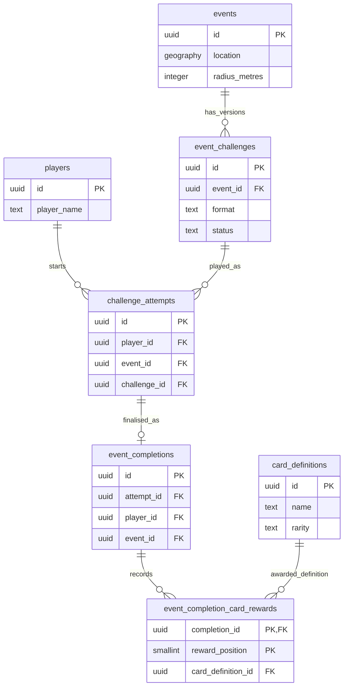
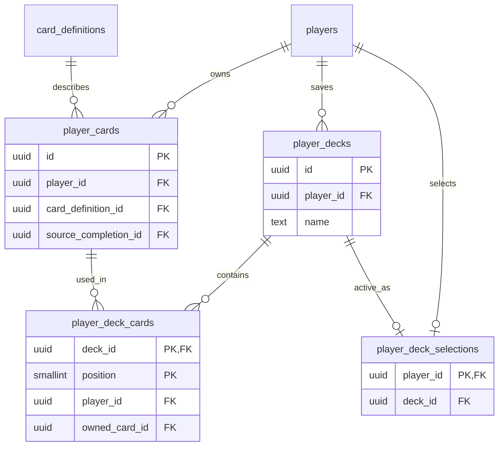
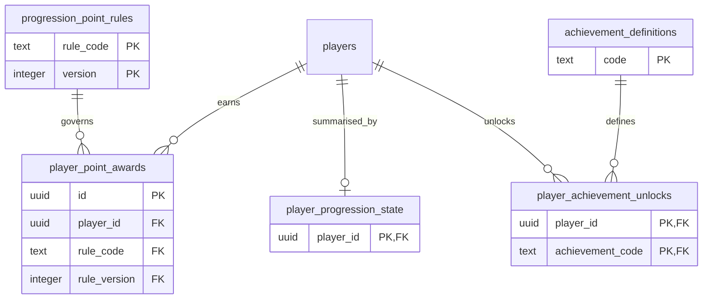

# Database relationships

The database stores authoritative game state in PostgreSQL, with PostGIS for
reported-location distance checks. These three views select important tables
and foreign-key relationships for a presentation. They are **not a complete
schema dump**: private answer keys, audit rows, campaign membership, battle
snapshots, and other detail remain in the linked schema guides and migrations.

**Legend:** `||` means exactly one, `o|` means zero or one, and `o{` means zero
or many. `PK` marks a primary key; `FK` marks a foreign key. Only selected
columns are shown. Compound keys and business limits are explained below each
view rather than implied by the arrow alone.

## 1. Events, challenges and completions

An event may retain several challenge versions, but only one may be published.
A player has at most one attempt and one completion per event. Composite foreign
keys keep the attempt's event/challenge and the completion's player/event tied
together. The corresponding direct event/player links are omitted from the
picture to keep it readable.

The API snapshots the selected questions and locks accepted answers. It creates
the completion, reward record, owned copies, and progression changes atomically.
A completion may award zero, one, or two cards under the current score policy.
The reward record preserves what was awarded even if an owned copy is later
consumed by evolution.

Sources: [challenge and reward schema](../../database/challenge-reward-persistence-design.md),
[attempt contract](../challenge-attempt-api-contract.md), and migrations
`0005`–`0008`, `0024` (retained reward records), and later reviewed-content changes.

## 2. Card definitions, owned copies and decks

A definition describes a card; `player_cards` represents a particular owned
copy. Two copies of the same definition remain separate assets. Deck slots
reference copy IDs, with compound foreign keys enforcing that the deck and the
copy belong to the same player. One copy may appear in several saved decks, but
only once in any one deck.

The diagram shows storage relationships. Battle validity additionally requires
five cards: three Creatures, two Powers, and at most ten rarity points. A saved
deck's current usability must be checked by the server. Card evolution uses its
own transaction and consumption history, documented in the
[evolution rules](../../requirements/card-evolution-rules.md); historical
consumed-copy IDs should not be mistaken for live ownership rows.

Sources: [deck schema and API](../../database/saved-deck-persistence-design.md),
[card storage](../../database/challenge-reward-persistence-design.md), and
migrations `0011` and `0042`.

## 3. Permanent progression and achievements

The point-award ledger is distinct from the player's progression summary.
Rules are versioned, and source relationships plus uniqueness constraints
prevent repeat requests from earning the same award twice. Current progression
uses permanent points. Applied legacy coin tables remain in migration history;
they are not the current game economy.

Sources: [progression storage](../../database/player-progression-persistence.md),
[progression rules](../../requirements/player-progression-rules.md), and
migration `0026`.

## More database diagrams

- [Events, challenges and ordered-trail membership](../../database/event-schema.md).
- [CPU and asynchronous player battle relationships](database-battles.md).

## Other important data

| Area                  | Storage model and reference                                                                                                                                                                                                                                                              |
| --------------------- | ---------------------------------------------------------------------------------------------------------------------------------------------------------------------------------------------------------------------------------------------------------------------------------------- |
| Ordered trails        | `trail_events` links `trails` to `events` in order. Progress is derived from the player's event completions; there is no authoritative browser progress cursor. See [trail storage](../../database/ordered-trails-persistence.md).                                                       |
| Battles               | CPU matches and asynchronous PvP use match-owned state and snapshots so later collection/deck edits do not rewrite a running match. See [CPU match storage](../../database/cpu-match-persistence-design.md) and [player battle storage](../../database/asynchronous-pvp-persistence.md). |
| Identity and deletion | Players are identified by validated issuer and subject, with local role/lifecycle controls. See [player identity](../../database/player-schema.md) and [deletion retention](../../database/account-deletion-retention.md).                                                               |

For exact column types, constraints and later changes, use the
[database guide](../../database/overview.md) and the checked-in
[migration directory](https://sdp.ms.wits.ac.za/gradient-ascent/Wits-World/src/branch/main/database/migrations).
These diagrams describe structure, not proof that production migrations or a
recovery rehearsal passed.

## AI declaration

Prepared from repository migrations and persistence contracts with assistance
from Codex-CLI[GPT-6].
