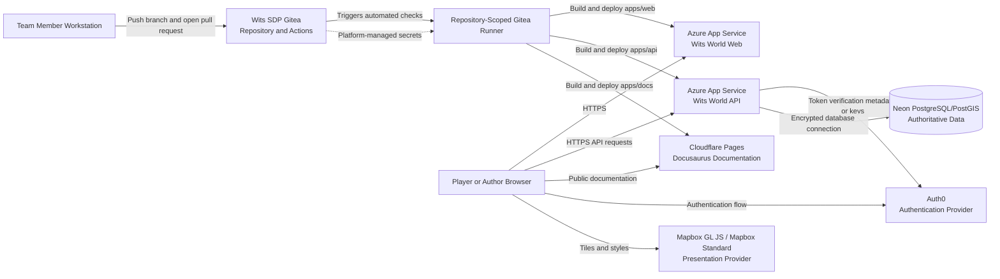

# Current Deployment Diagram

This diagram records the currently implemented deployment architecture. The
services are selected and deployed, while release-specific verification and
some operational acceptance decisions remain separate gates.

## Deployment requirements

- The web application, API, and documentation site are independently buildable.
- The web application and API are independently deployable.
- The API and database are not bundled into the browser application.
- Deployment credentials remain outside the repository.
- Production browser traffic uses HTTPS.
- The deployed API connects to a PostGIS-capable database.
- The static web host supports browser-history routing or an equivalent
  fallback to `index.html`.
- CI checks formatting, linting, type checking, tests, and builds before
  deployment.
- Deployment smoke tests verify that the web application and API are reachable.
- Browser-facing configuration contains only public values.
- Private database and authentication credentials are supplied only to trusted
  deployment environments.

## Expected CI/CD flow

1. A team member pushes a short-lived branch.
2. A pull request is opened in Gitea.
3. CI installs dependencies.
4. CI checks formatting.
5. CI runs linting.
6. CI runs TypeScript type checking.
7. CI runs automated tests.
8. CI builds the web, API, and documentation applications.
9. The pull request is reviewed.
10. The branch is merged into the target branch.
11. The approved applications are deployed through the documented process.
12. Smoke tests verify the deployed services.
13. The merged branch is deleted.

## Remaining deployment and operational decisions

The current hosts, Auth0 provider, Mapbox team technology choice, production
origins, and platform-managed secret boundaries are selected. The following
still require operational review or evidence:

- Mapbox licensing/terms, production-token/CSP/privacy, usage/cost ownership,
  and campus-data readiness;
- operational approval and evidence for database backup and recovery;
- credential rotation and ongoing least-privilege review; and
- production observability tooling.

Not every current hosting selection has a dedicated accepted ADR. Operational
documentation and deployed workflow configuration are the current evidence;
future material changes should receive an ADR rather than rewriting history.

---

The preceding document was planned and generated with the assistance of
ChatGPT-Web[GPT-5.6 Thinking], updated with Codex-CLI[GPT-5], and reviewed and
edited for Sprint 1 release validation with assistance from
ChatGPT-Web[GPT-5.6 Sol] and Codex[GPT-5].
