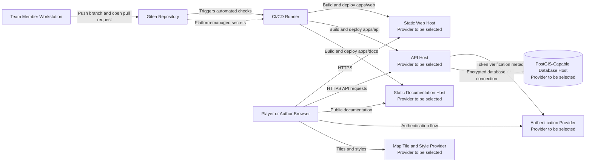

# Initial Deployment Diagram

The final service providers have not yet been selected.

This diagram records the required deployment boundaries without assigning a
specific platform prematurely.

## Deployment requirements

- The web application, API, and documentation site are independently buildable.
- The web application and API are independently deployable.
- The API and database are not bundled into the browser application.
- Deployment credentials remain outside the repository.
- Production browser traffic uses HTTPS.
- The deployed API connects to a PostGIS-capable database.
- The static web host supports browser-history routing or an equivalent
  fallback to `index.html`.
- CI checks formatting, linting, type checking, tests, and builds before
  deployment.
- Deployment smoke tests verify that the web application and API are reachable.
- Browser-facing configuration contains only public values.
- Private database and authentication credentials are supplied only to trusted
  deployment environments.

## Expected CI/CD flow

1. A team member pushes a short-lived branch.
2. A pull request is opened in Gitea.
3. CI installs dependencies.
4. CI checks formatting.
5. CI runs linting.
6. CI runs TypeScript type checking.
7. CI runs automated tests.
8. CI builds the web, API, and documentation applications.
9. The pull request is reviewed.
10. The branch is merged into the target branch.
11. The approved applications are deployed through the documented process.
12. Smoke tests verify the deployed services.
13. The merged branch is deleted.

## Open deployment decisions

The following still require review and selection:

- web hosting provider;
- API hosting provider;
- PostgreSQL/PostGIS hosting provider;
- documentation hosting provider;
- authentication provider;
- map tile and style provider;
- production domain names;
- production CORS origins;
- secret-management approach;
- database backup and recovery approach; and
- production observability tooling.

No provider shown in this document should be interpreted as selected until its
decision has been recorded.

---

The preceding document was planned and generated with the assistance of:
ChatGPT-Web[GPT-5.6 Thinking].
