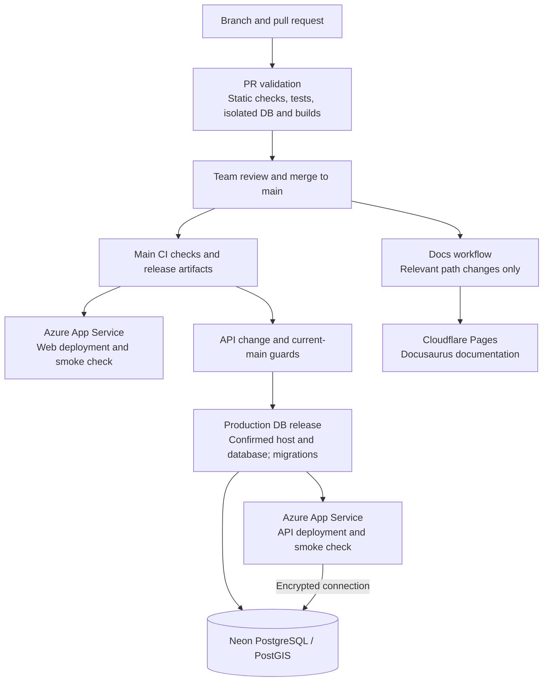

# Hosting and deployment diagram

This diagram records the currently implemented deployment architecture. The
services are selected and deployed, while release-specific verification and
some operational acceptance decisions remain separate gates.

This is a workflow map, not a claim that the latest run passed. Use the
[dated release status](../../testing/sprint-2-validation-status.md) for evidence.
The separate [automated verification gate](../../testing/automated-verification.md)
is still present on this branch; it is not shown as a prerequisite of every deploy.

## Deployment requirements

- The web application, API, and documentation site are independently buildable.
- The web application and API are independently deployable.
- The API and database are not bundled into the browser application.
- Deployment credentials remain outside the repository.
- Production browser traffic uses HTTPS.
- The deployed API connects to a PostGIS-capable database.
- The static web host supports browser-history routing or an equivalent
  fallback to `index.html`.
- CI checks formatting, linting, type checking, tests, and builds before
  deployment.
- Deployment smoke tests verify that the web application and API are reachable.
- Browser-facing configuration contains only public values.
- Private database and authentication credentials are supplied only to trusted
  deployment environments.

## Expected CI/CD flow

1. A team member opens a pull request targeting `main`.
2. `pr-validation.yml` runs static checks, application/package tests, isolated
   database tests, and builds. The team reviews the change before merge.
3. `ci.yml` runs on `main`, prepares release artifacts, and deploys eligible Web
   and API changes through separate jobs. API deployment rejects stale commits
   and runs the guarded production database release before deploying the API.
4. `docs-deploy.yml` independently builds and publishes documentation when its
   configured paths change on `main`. A Web/API deployment is not proof that
   the documentation deployment succeeded.
5. Deployment jobs perform their configured smoke checks. Authenticated player
   journeys and operational recovery require their own evidence.

Sources: [main CI workflow](https://sdp.ms.wits.ac.za/gradient-ascent/Wits-World/src/branch/main/.gitea/workflows/ci.yml),
[PR validation](https://sdp.ms.wits.ac.za/gradient-ascent/Wits-World/src/branch/main/.gitea/workflows/pr-validation.yml),
[docs deployment](https://sdp.ms.wits.ac.za/gradient-ascent/Wits-World/src/branch/main/.gitea/workflows/docs-deploy.yml),
and [database release procedure](../../database/database-release-procedure.md).

## Remaining deployment and operational decisions

The current hosts, Auth0 provider, Mapbox team technology choice, production
origins, and platform-managed secret boundaries are selected. The following
still require operational review or evidence:

- Mapbox licensing/terms, production-token/CSP/privacy, usage/cost ownership,
  and campus-data readiness;
- operational approval and evidence for database backup and recovery;
- credential rotation and ongoing least-privilege review; and
- production observability tooling.

Not every current hosting selection has a dedicated accepted ADR. Operational
documentation and deployed workflow configuration are the current evidence;
future material changes should receive an ADR rather than rewriting history.

---

The preceding document was planned and generated with the assistance of
ChatGPT-Web[GPT-5.6 Thinking], updated with Codex-CLI[GPT-5], and reviewed and
edited for Sprint 1 release validation with assistance from
ChatGPT-Web[GPT-5.6 Sol] and Codex[GPT-5].

Page title and diagram updated against the current repository with assistance
from Codex-CLI[GPT-6].
