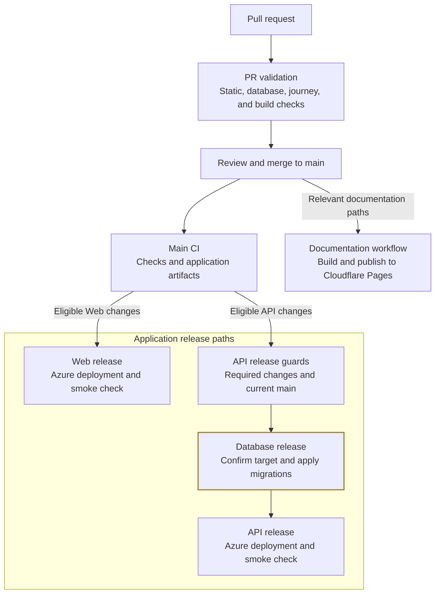

# Deployment

The Web and API deploy to separate Azure App Services. Neon hosts the database,
and Cloudflare Pages hosts the documentation. Gitea Actions validates changes
and delivers the application builds.

## Release flow

## Application delivery

`pr-validation.yml` checks formatting, linting, types, tests, isolated PostGIS
databases, Basic browser journeys, and builds. Review and merge lead to
`ci.yml`, whose validation jobs prepare the release artifacts on `main`.

Web and API deployment jobs check whether a release is needed and reject stale
commits. The API release verifies the production database target and applies
migrations before deploying the API. Content seeding is a separate operation.

Configured smoke checks confirm basic reachability and release responses.
Full player journeys and operational recovery have their own validation scope.

## Documentation delivery

`docs-deploy.yml` runs independently for relevant changes on `main`, or through
its manual trigger. It builds Docusaurus and publishes the static output to
Cloudflare Pages. An application deployment does not publish the documentation.

## Runtime hosting

| Component     | Host                       | Connection                                                                |
| ------------- | -------------------------- | ------------------------------------------------------------------------- |
| Web           | Azure App Service          | Browser requests to the API over HTTPS; live battles also use WebSockets. |
| API           | Separate Azure App Service | Server-side database, authentication-management, and Redis connections.   |
| Database      | Neon                       | PostgreSQL/PostGIS over TLS, with a direct endpoint for notifications.    |
| Documentation | Cloudflare Pages           | Public static pages and browser-local search.                             |

Browser builds contain public configuration. Database URLs, Management API
credentials, and Redis credentials stay in server configuration. Azure serves
the Web application's history routes through its configured fallback.

See [Continuous integration](../../testing/continuous-integration.md),
[Azure deployment](../../deployment/azure-deployment-setup.md),
[database releases](../../database/database-release-procedure.md), and
[documentation publishing](../../development/documentation-site.md) for
commands and operating procedures. Executed checks are recorded in the
[validation records](../../testing/basic-tier-release-validation.md).

**AI declaration:** Prepared and updated with assistance from
ChatGPT-Web[GPT-5.6 Thinking], ChatGPT-Web[GPT-5.6 Sol], Codex-CLI[GPT-5],
Codex[GPT-5], Codex-CLI[GPT-6], and Codex[GPT-6].
