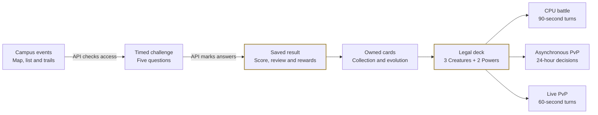
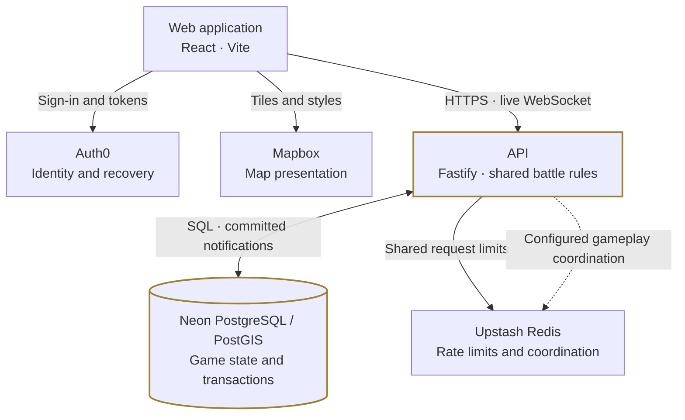

# Visual guide to Wits World

These diagrams explain the Wits Quest player journey and the systems that
support it. Use the overview below, then follow the links for detailed flows
and database relationships.

## The player journey

The Basic loop ends in a CPU battle. Trails, evolution, asynchronous PvP, and
live PvP are later extensions. Players can also claim a one-time starter set
and open existing collections, decks, or matches directly.

The API checks event availability and reported location before a new challenge
starts. It marks answers and saves rewards transactionally; a completed
challenge may award no cards. Decks use owned copies and have a ten-point
rarity cap. Match snapshots preserve their card values across later edits.

Challenge results, CPU matches, and asynchronous PvP feed permanent progression
under their defined award rules. Ranked live competition uses a separate
seasonal rating. See the [game rules](../../requirements/basic-game-rules.md),
[progression rules](../../requirements/player-progression-rules.md), and
[ranked policy](../../requirements/ranked-competition-policy.md).

## The system at a glance

The API validates Auth0 tokens, resolves local identity and permissions, and
applies protected game rules. The browser's actions and location readings are
untrusted inputs. Mapbox supplies presentation; PostGIS supplies spatial checks.

Live matches persist state, versions, and deadlines in PostgreSQL. Notifications
prompt API instances to reload committed state. The notification listener uses
a dedicated direct database connection, separate from the application query
pool. WebSocket memory is not match authority.

Production request limiting uses Upstash. Gameplay scheduling defaults to
`polling`; optional Upstash coordination requires a staged rollout across
producers sharing the database. See [rate limiting](../rate-limiting.md) and
[scheduler operations](../../deployment/ranked-operations.md).

The Web and API deploy separately to Azure App Service. Docusaurus publishes
these docs to Cloudflare Pages. External developer applications use a separate,
read-only `X-API-Key` boundary; they cannot act as player or Author sessions.

## Detailed diagrams

| Topic                  | Diagram                                             | What it explains                                                                      |
| ---------------------- | --------------------------------------------------- | ------------------------------------------------------------------------------------- |
| Users and integrations | [System context](system-context.md)                 | Players, Authors, external developers, and service boundaries.                        |
| Application structure  | [Web, API, and database](application-containers.md) | Runtime components and their responsibilities.                                        |
| Later gameplay systems | [Advanced systems](advanced-systems.md)             | Live play, ranked competition, territories, trading, trust, placement, and analytics. |
| Core data model        | [Database relationships](database-relationships.md) | Players, events, attempts, rewards, owned cards, decks, and progression.              |
| Battle persistence     | [Battle relationships](database-battles.md)         | CPU and player matches, snapshots, actions, and results.                              |
| Challenge completion   | [Challenge and reward flow](challenge-flow.md)      | Deadlines, private marking, and atomic rewards.                                       |
| Author publication     | [Content review](content-review.md)                 | Independent review and publication dependencies.                                      |
| Delivery               | [Hosting and deployment](deployment.md)             | CI checks, guarded database releases, and application deployments.                    |

The [database guide](../../database/overview.md) explains constraints and
migrations. The [event schema](../../database/event-schema.md) covers event,
challenge, and trail relationships in more detail.

## Reading the diagrams

Rectangles represent applications or steps; cylinders represent persistent
data stores. Arrow labels name the interaction. Solid arrows show the main
flow; the dashed arrow above identifies configurable coordination. Database
diagrams provide their own relationship notation.

Diagrams retain readable label sizes. On narrower screens, scroll within the
diagram region; it can also receive keyboard focus. Each diagram includes an
accessible title and description, with its main points explained in nearby text.

The diagrams describe architecture and rules. Executed checks and release
acceptance are recorded separately in the
[Sprint 1](../../planning/scrum/sprint-1/evidence.md),
[Sprint 2](../../planning/scrum/sprint-2/evidence.md) and
[Sprint 3](../../planning/scrum/sprint-3/evidence.md) validation records.

---

This guide was prepared and edited with assistance from Codex-CLI[GPT-6],
Codex-CLI[gpt-6-sol], and Codex[GPT-6].
