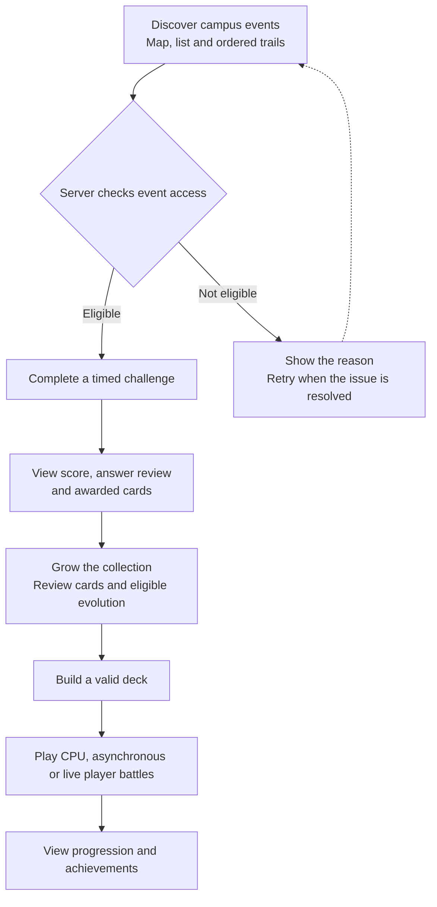

# Visual guide to Wits World

Start here for a visual explanation of the product, database, and technical
design. These diagrams describe the implementation on this branch; they do not
replace the [Sprint 3 validation evidence](../../testing/sprint-3-validation-status.md).
The [Sprint 2 validation record](../../testing/sprint-2-validation-status.md)
remains the historical reference for the previous increment.

## The player experience

Rewards and points follow the server's rules. Completing a challenge does not
promise a particular card, and the browser never chooses a score or reward.
The diagram shows the main journey, not a required screen order: players can
return to their existing collection, decks, or matches.

## Choose a diagram

| What you want to explain          | Diagram                                                 | Main takeaway                                                                                 |
| --------------------------------- | ------------------------------------------------------- | --------------------------------------------------------------------------------------------- |
| The product and external services | [System and external services](system-context.md)       | What Wits World owns, and what Auth0, Mapbox and the hosts provide                            |
| How the applications fit together | [Frontend, API and database](application-containers.md) | The browser presents; the API validates and controls database access                          |
| How Advanced services coordinate  | [Advanced systems and authority](advanced-systems.md)   | Realtime, ranked, territory, trading, trust, placement and analytics share server-owned state |
| How game data relates             | [Database relationships](database-relationships.md)     | Players, events, attempts, rewards, owned cards, decks and progression                        |
| How an answer becomes a result    | [Challenge and reward flow](challenge-flow.md)          | Server deadlines, private marking and atomic, retry-safe rewards                              |
| How content becomes visible       | [Content review and publication](content-review.md)     | A different Author reviews content before publication                                         |
| How changes reach production      | [Hosting and deployment](deployment.md)                 | PR checks, main deployments, guarded migrations and a separate docs publish                   |

For a short meeting walkthrough, use the player journey above, the system
context, the three database views, and the challenge flow. The written
[database guide](../../database/overview.md) explains constraints, migrations,
and the reasons for PostgreSQL/PostGIS.

For more database detail, use the [battle database diagrams](database-battles.md)
and [event/trail relationships](../../database/event-schema.md).

## Reading the diagrams

Boxes represent systems, steps, or tables; labelled arrows explain the
relationship. Database diagrams have a separate relationship legend. On a
narrow screen, focus a diagram and scroll horizontally to read it at full size.
Each diagram also has a nearby explanation for readers who prefer text.

## AI declaration

Prepared from repository contracts, migrations, and implementation with
assistance from Codex-CLI[GPT-6].

Sprint 3 references and the live-battle journey were added with assistance from
Codex-CLI[gpt-6-sol].
