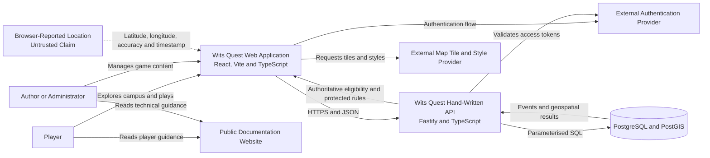

# System Context Diagram

This diagram shows Wits Quest, its users, and its principal external systems.

## Interpretation

- The web application and API are separate applications.
- Browser-reported location is untrusted input.
- The API is authoritative for authenticated operations and eligibility.
- PostgreSQL/PostGIS is authoritative for stored event locations and distance
  calculations.
- The authentication provider authenticates users.
- The API validates tokens before trusting identity.
- The map provider is used for presentation only.
- The public documentation site is separate from the runtime game applications.

## Open decisions

The following external providers have not yet been selected:

- authentication provider;
- map tile and style provider;
- web host;
- API host;
- database host; and
- documentation host.

---

The preceding document was planned and generated with the assistance of:
ChatGPT-Web[GPT-5.6 Thinking].
