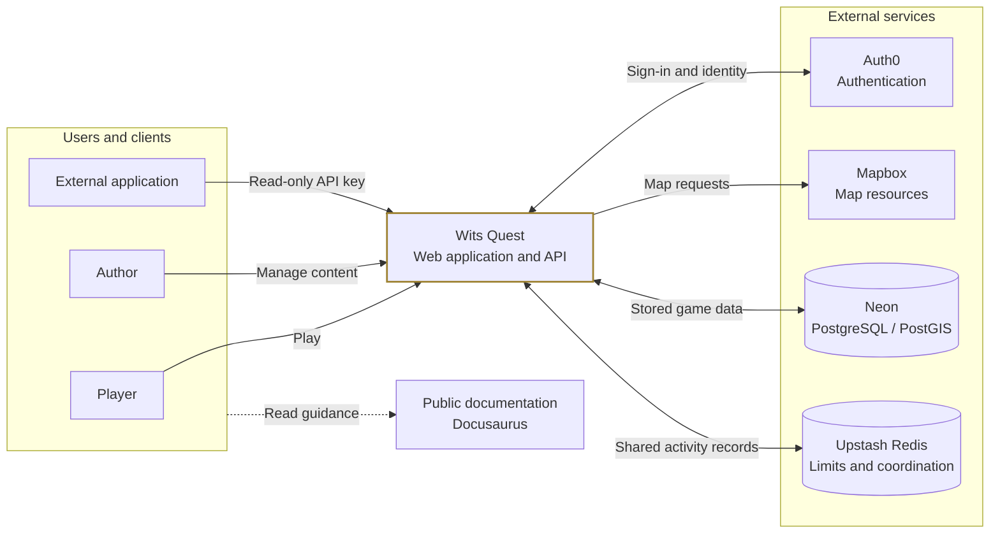

# System context

Wits Quest connects Players, Authors, and external developer applications to
the game and its supporting services. This view shows those external
relationships; the [application diagram](application-containers.md) shows the
components inside the game.

## Users and access

Players explore events, complete challenges, manage cards, and play battles.
Authors use the same Web application with additional content, placement,
moderation, and reporting permissions.

External applications use the Developer API with a separate API key. They can
read its public event, card-catalogue, and progression-leaderboard projections.
That key cannot perform gameplay actions or grant Author access.

## Service boundaries

Auth0 supplies authentication; the API resolves local accounts and permissions.
Mapbox supplies map presentation; the API and PostGIS determine location
eligibility. Neon stores durable application records, while Redis supports
shared request limits and gameplay coordination.

The documentation site runs separately from the game. Its readers do not need
a game session.

See [Integrations](../external-integrations.md) for connections and data sharing,
[Security](../trust-boundaries.md) for access rules, and
[Deployment](deployment.md) for hosting and release delivery.

**AI declaration:** Prepared and updated with assistance from
ChatGPT-Web[GPT-5.6 Thinking], ChatGPT-Web[GPT-5.6 Sol], Codex-CLI[GPT-5],
Codex[GPT-5], Codex-CLI[GPT-6], and Codex[GPT-6].
