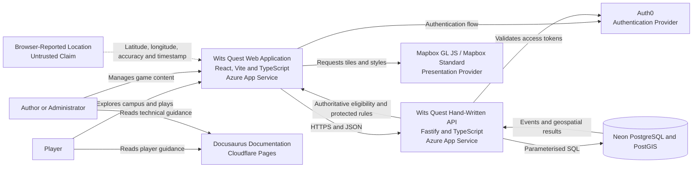

# System Context Diagram

This diagram shows Wits Quest, its users, and its principal external systems.

## Interpretation

- The web application and API are separate applications.
- Browser-reported location is untrusted input.
- The API is authoritative for authenticated operations and eligibility.
- PostgreSQL/PostGIS is authoritative for stored event locations and distance
  calculations.
- The authentication provider authenticates users.
- The API validates tokens before trusting identity.
- The map provider is used for presentation only.
- The public documentation site is separate from the runtime game applications.

## Current providers and remaining decisions

Auth0 is selected under ADR-005. The Web and API are deployed independently to
Azure App Service, production PostgreSQL/PostGIS is hosted by Neon, and the
Docusaurus documentation site is deployed to Cloudflare Pages.

The current map implementation uses Mapbox GL JS with Mapbox Standard through
the provider-neutral presentation boundary. It is a confirmed team-selected
integration within the project's implementation discretion; this does not
claim an explicit client or lecturer approval by name. Licensing/terms,
production-token/CSP/privacy, usage/cost ownership, and campus-data evidence
remain review items. Mapbox remains presentation-only and never determines
event eligibility; the API and PostgreSQL/PostGIS retain that authority.

---

The preceding document was planned and generated with the assistance of
ChatGPT-Web[GPT-5.6 Thinking], updated with Codex-CLI[GPT-5], and reviewed and
edited for Sprint 1 release validation with assistance from
ChatGPT-Web[GPT-5.6 Sol] and Codex[GPT-5].
