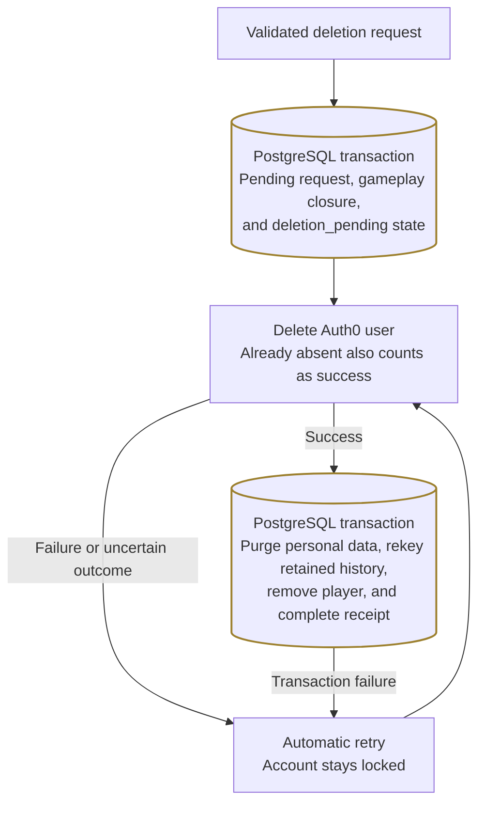

# Account deletion and retained data

Voluntary deletion removes the Auth0 user, the local player row, and personal
gameplay data. Required shared history remains under a profile-free historical
actor. A later registration receives a new UUID and normal starting state.

## Request and transaction boundaries

`POST /api/v1/auth/account-deletion` requires an authenticated interactive
account, confirmation `DELETE_MY_ACCOUNT`, and a recent Auth0 ID token for
the same issuer and subject. The default recent-authentication window is
**5 minutes**.

The first transaction closes dependent gameplay and commits the deletion request
with `deletion_pending`. Normal account and developer-key access then stops.
Precise movement evidence and active trust signals are removed at this boundary.

Auth0 and PostgreSQL do not share a transaction. An Auth0 failure leaves the
locked request for retry; a provider `404` counts as successful deletion.
Local cleanup is atomic: if it fails after Auth0 deletion, the purge rolls back
and the worker retries both boundaries.

Request and identity locks serialise concurrent completion. Completed requests
return their saved state without repeating cleanup. Signing out or closing the
browser does not cancel a committed deletion request.

## Personal data removed

| Data                             | Purge scope                                                                                                |
| -------------------------------- | ---------------------------------------------------------------------------------------------------------- |
| Account and profile              | Player row, Auth0 mapping, Player Name, role, showcase fields, favourites, and visibility preferences.     |
| Cards and decks                  | Owned cards, starter grants, decks, selections, and personal evolution/consumption records.                |
| Challenges and CPU battles       | Attempts, answers, snapshots, completions, rewards, and active/completed CPU match records.                |
| Progression and competition      | Points, activity, streaks, achievements, personal seasonal ratings, archive entries, and standings caches. |
| Location and territories         | Precise movement and derived journey decisions, territory grants, and personal owner-bonus state.          |
| Credentials and retired currency | All developer keys and verifiers, retired wallet, and personal coin-ledger rows.                           |

Database cleanup requires the matching pending player and deletion request.
Normal writes retain their immutability and foreign-key protections.

## Shared history retained

Deletion closes pending PvP invitations, active matches, ranked queues, open
trade offers, and current territory ownership through their normal terminal
transitions. Counterparties keep coherent outcomes.

Completed async and live PvP results, ranked settlement evidence, consumed
territory contributions and ownership history, and completed trade provenance
can remain. Published content and its review/audit history also remain.

At completion, retained actor references change from the old player UUID to
a fresh random UUID in `private.player_history_actors`. That table stores no
profile, Auth0 identity, or old-to-new mapping. The original actor row is removed.
Player-facing history resolves the absent account as **Deleted player**;
retained async retry responses redact copied Player Names and player IDs.

These records do not restore ownership, progression, ratings, or restrictions
to a later registration. Historical content or external copies may still be
pseudonymous; a profile-free actor is not a guarantee of anonymity.

## Moderation retention

Open formal trust cases retain safe evidence, structured decisions, restriction
and appeal history, and required score snapshots. They become read-only because
review actions require an active target account. Free-text reviewer reasons and
appeal text are redacted at completion.

Unfinished retained cases expire **90 days after deletion completion**.
Finalised cases retain their existing **12-month governance** boundary.
Retained restrictions are audit history and cannot enforce capabilities without
an active account. A case does not preserve personal progression or precise
movement evidence.

[Trust storage](trust-persistence.md) defines the case graph and retention anchors.
Permanent banning is separate and is not implemented by this deletion workflow.

## Receipts and scope

A completed `account_deletion_requests` receipt retains its random request ID,
timestamps, status, and safe failure category for **12 months**. It has no
player foreign key.

A private token-denial marker retains a salted issuer/subject digest, issue-time
cutoff, and **30-day** expiry. It prevents pre-deletion access tokens from
provisioning another account while they may remain valid. Cleanup removes
expired markers and completed receipts.

These rules describe application database behaviour. Backup copies, provider
logs, exported case files, and device-local data have separate retention
boundaries; completing the database purge does not delete those copies.

**AI declaration:** Prepared and updated with assistance from Codex[GPT-6].
