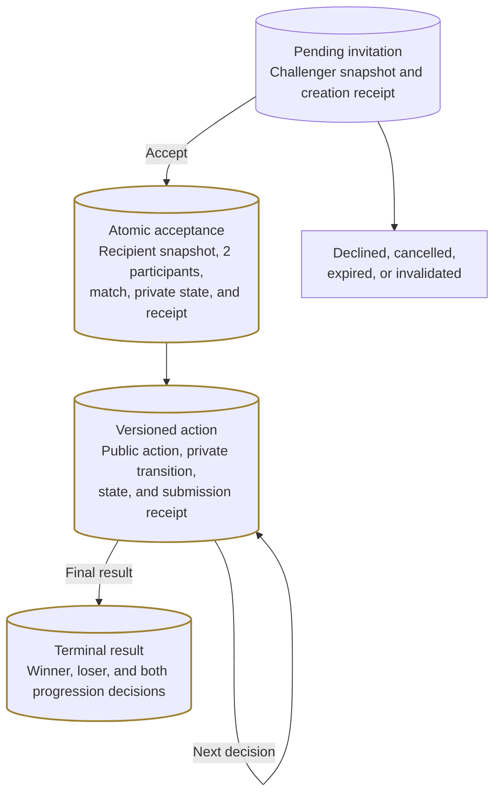

# Asynchronous player battle storage

Async PvP persists invitations, complete deck snapshots, authoritative battle
state, and retry receipts. The API resolves deadlines and serves a separate
projection for each participant; polling reads committed state.

[Player battles](../requirements/player-asynchronous-pvp-journey.md) compares
async and live play. The [async API contract](../architecture/asynchronous-pvp-api-contract.md)
owns routes and response formats.

## Stored model

| Relations                                 | Responsibility                                                                |
| ----------------------------------------- | ----------------------------------------------------------------------------- |
| `async_pvp_invitations`                   | Challenger, recipient, status, version, expiry, and accepted match reference. |
| `async_pvp_matches`                       | Current actor, deadline, version, winner, and terminal result.                |
| `async_pvp_match_participants`            | Exactly 2 participants, engine sides, snapshot references, and outcomes.      |
| `async_pvp_match_actions`                 | Ordered legally revealed actions and results.                                 |
| Private deck snapshots and snapshot cards | Complete battle-ready decks, including unrevealed cards.                      |
| `private.async_pvp_match_states`          | Full current battle state at the match version.                               |
| `private.async_pvp_match_transitions`     | Immutable before/after state and authoritative action result.                 |
| `private.async_pvp_submission_receipts`   | Canonical payload hash and committed actor-relative response.                 |

A `public` schema name does not grant API access. Private relations have
`PUBLIC` privileges revoked, and participant responses omit hidden opponent
cards, full state, and private transition data.

## Invitation and match creation

Invitations start `pending` at version 0 with a **24-hour** expiry. A unique
unordered-player-pair key prevents reverse concurrent invitations from both
committing. Terminal invitation states cannot reopen.

Acceptance creates the complete match graph in one transaction. Deferred checks
require both valid deck snapshots, 2 participants, private state, and a matching
receipt. Cancellation is challenger-owned and creates a cancellation receipt
without a recipient snapshot or match.

Source deck and owned-copy IDs in snapshots are historical values, rather than
restrictive foreign keys to mutable player configuration.

## Actions, deadlines, and replay

An active match has 1 current participant and a **24-hour decision deadline**.
Match and private-state versions advance together by 1. Every public action has
a matching private transition and submission receipt.

Receipts are unique by authenticated actor, operation, and submission UUID.
The canonical payload hash distinguishes identical retries from conflicting
reuse. A retry returns the committed actor-relative response instead of applying
the action again.

The service locks the authoritative resource and rechecks its deadline before
accepting a mutation. Deadline workers select bounded due candidates and recheck
after locking; reads also reconcile elapsed deadlines where required.

Terminal reasons are `defeat`, `turn_forfeit`, `voluntary_resignation`, and
`account_deletion_forfeit`. A completed match has 1 winner and 1 loser.
Snapshots, terminal state, actions, transitions, and receipt history are immutable
during normal operation.

## Progression

Completion invokes `recordAsynchronousPvpCompletion` inside the terminal match
transaction. It records 1 award decision per participant in canonical player-ID
order under per-player locks. A progression failure rolls back the match result.

Both decisions count as activity, including a zero-point result. Unique
match/participant sources prevent repeat awards. Async results do not update
live-ranked ratings or territory influence.

[Progression storage](player-progression-persistence.md) owns award integrity;
[Progression rules](../requirements/player-progression-rules.md#asynchronous-pvp-progression)
owns values and achievement behaviour.

## Deletion and retention

Account deletion closes pending invitations and completes active matches before
removing personal data. An already-elapsed deadline takes precedence: the current
actor loses by `turn_forfeit`; otherwise the deleting participant forfeits.

Completed shared matches retain profile-free historical actors and immutable
battle snapshots. History displays **Deleted player** after account removal,
and retained replay responses redact copied Player Names and old player IDs.

There is no routine purge of terminal invitations. Account deletion has its
separate cleanup boundary. See
[Account retention](account-deletion-retention.md) for personal-data removal
and shared records.

**AI declaration:** Prepared and updated with assistance from
Codex-CLI[gpt-5.6-sol medium], Codex[GPT-5], Codex-CLI[GPT-6], and Codex[GPT-6].
