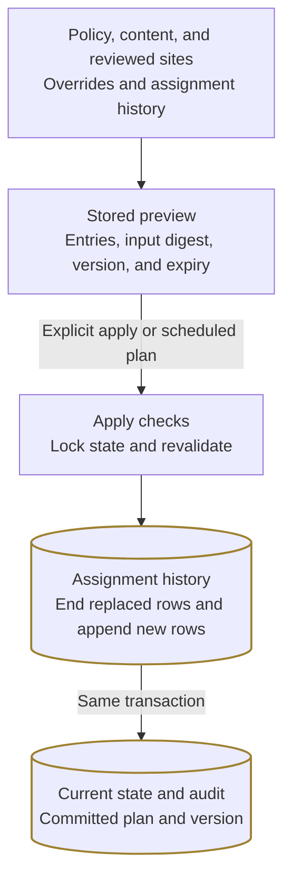

# Event placement storage

Automatic placement stores reviewed sites, event portability, planning
decisions, and assignment history in PostgreSQL/PostGIS. An assignment supplies
an event's effective point without changing its published content.

The [placement rules](../requirements/automatic-event-placement-policy.md)
define coverage, separation, rotation, and override limits. The
[Author placement guide](../architecture/automatic-event-placement-service.md)
covers preview and apply controls.

## Stored model

| Relation                          | Responsibility                                                              |
| --------------------------------- | --------------------------------------------------------------------------- |
| `event_placement_policy_versions` | Immutable policy values used by decisions.                                  |
| `event_placement_zones`           | Reviewed coverage geometry and lifecycle.                                   |
| `event_placement_sites`           | Reviewed points, zone membership, radius limits, and lifecycle.             |
| `event_placement_portability`     | Event opt-in and effective-period history under a policy.                   |
| `event_placement_state`           | Current policy, committed plan, and state version.                          |
| `event_placement_plans`           | Preview decisions, input digest, version, expiry, outcome, and predecessor. |
| `event_placement_plan_entries`    | Proposed event, site, and zone relationships.                               |
| `event_placement_assignments`     | Committed event-to-site periods and end reasons.                            |
| `event_placement_overrides`       | Temporary pins, exclusions, and pauses.                                     |
| `event_placement_audit`           | Author and scheduler operation history.                                     |

Plan entries use foreign keys rather than a free-form list of assignments.
Policy values, reviewed geometry, committed decision fields, and audit records
retain their original meaning.

## Spatial constraints

Sites use `geography(Point, 4326)`; zones use
`geometry(MultiPolygon, 4326)`. GiST indexes support distance and coverage
queries.

An active site must have completed review evidence and belong to an active zone
under the same policy. Its point must lie inside exactly 1 active zone for that
policy. A current assignment must also match the event's portability, publication,
and radius constraints.

Suspending or retiring a site or zone requires affected assignments to end in
the same transaction. Their historical references remain intact. Placement
coverage zones are separate from player-owned territory zones.

## Portability and event authoring

The event editor's automatic-placement choice updates portability history,
placement state, and audit records within the event transaction. Publication
and retirement also update placement eligibility.

An automatically placed event may have no authored coordinate. Deferred
validation requires a non-retired event with `events.location = null` to
retain active portability. Changing draft content still follows the event's
own version and lifecycle contract.

Landmark-specific content remains fixed unless a suitable replacement is
reviewed. Campaign membership alone does not enable automatic placement.

## Preview, apply, and concurrency

Previews retain the policy, rotation bucket, requesting actor, input digest,
expected state version, and proposed entries. Applying locks the singleton
state row and rejects stale or expired inputs before committing changes.

Uniqueness constraints permit at most 1 current assignment per event and per
site. Unchanged valid assignments can remain; replaced assignments receive an
end time and reason, and new assignments are appended. Scheduled retries
cannot create duplicate plans for the same policy and rotation bucket.

Overrides use an Author-scoped idempotency key and request hash. Plan application,
overrides, and lifecycle changes advance placement state and retain audit
records. Rollback creates a new decision under current rules rather than
rewriting past assignments.

## Effective location and saved gameplay

`resolve_event_placement_location(event_id, evaluated_at)` returns the effective
point, assignment ID, and availability. An event with placement history needs
an assignment and portability valid at that time; losing them does not cause
a fallback to an authored point.

Assignment periods include their start and exclude their end. Challenge attempts
retain the assignment used at start. Offline reconciliation can resolve a
historical assignment at its original evaluation time, subject to the
[offline contract](../architecture/offline-challenge-play.md).

Moving an event does not reset its event ID, player completion, or reward
entitlement. Placement tables contain curated sites, content relationships,
and decision history; planning does not use player movement or attendance data.
Player responses expose effective event locations rather than private review
notes or planning internals.

**AI declaration:** Prepared and updated with assistance from Codex[GPT-5.6 Sol],
Codex[GPT-5], and Codex[GPT-6].
