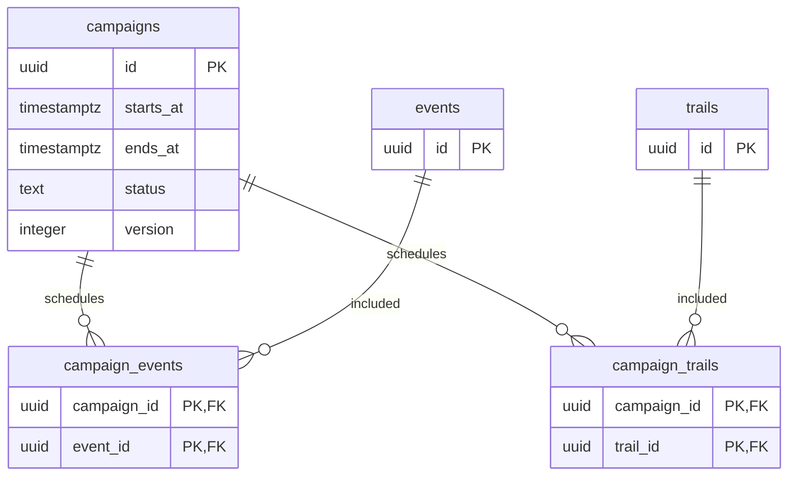

# Campaign schedule storage

Campaigns schedule existing events and trails without copying their content.
PostgreSQL stores reviewed membership and resolves effective availability at the
requested time. Campaigns add no separate player progress or reward ledger.

The [Campaign guide](../architecture/campaign-scheduling-api-contract.md)
owns Author controls and endpoint details. [Review and publish](../architecture/diagrams/content-review.md)
defines the shared approval lifecycle.

## Stored relationships

`||` means exactly 1 and `o{` means 0 or more. Selected columns are shown.

`campaigns` stores title, optional description, schedule, version, lifecycle,
review actors, provenance, and timestamps. Composite membership keys prevent
duplicates; restrictive foreign keys preserve referenced content.

Drafts can replace dates and membership. Reviewed content is immutable outside
the permitted lifecycle transitions. Published campaigns retain their definitions
and memberships after retirement. Each edit or transition saves
`author_content_audit` in the same transaction.

## Readiness and concurrency

Approval and publication invoke `validate_campaign_schedule`. A campaign needs:

- At least 1 published, non-retired event or trail.
- A nonempty schedule with end after start.
- An overlap between each directly assigned event's authored window and the campaign.
- No overlapping approved or published campaign sharing the same directly assigned member.

Windows include their start and exclude their end. Adjacent windows are valid;
draft and in-review campaigns do not reserve a member's schedule.

Mutations lock the campaign and compare `expectedVersion`. Approval also takes
member-scoped advisory locks and stable event/trail row locks. Concurrent
overlapping approvals cannot both commit.

Event and trail retirement uses the same member-lock boundary. A member cannot
retire beneath a published campaign. Service checks provide safe Author errors;
database triggers enforce the final boundary.

## Effective availability

| Resolver                                             | Contract                                                                                 |
| ---------------------------------------------------- | ---------------------------------------------------------------------------------------- |
| `resolve_event_availability(event_id, evaluated_at)` | Combines event publication and authored dates with direct published campaign membership. |
| `resolve_trail_availability(trail_id, evaluated_at)` | Applies published campaign windows to trail guidance independently of event schedules.   |

Before any published campaign history, an event uses its authored dates and a
published trail remains active with no effective schedule dates.

After published campaign history exists, the resolver selects an active window,
the nearest upcoming window, or the most recently ended window. Event windows
intersect the authored event period with campaign dates. Trail windows use the
campaign dates.

If all relevant campaigns are retired, the event becomes `unpublished` and the
trail resolver returns `retired`. It does not restore the earlier standalone
availability or change the member's stored publication status.

Trail membership does not schedule its events indirectly. To schedule an event,
it must also be a direct campaign member. Automatic event placement is resolved
separately from campaign timing.

Discovery, eligibility, trail guidance, and nearby queries consume these
functions. Challenge start rechecks effective availability. Schedule boundaries
are evaluated by the query, so a worker need not change lifecycle at each start
or end time.

## Indexes, history, and privacy

Indexes support review queues, approved/published schedule checks, published
history, and reverse member lookup. PostGIS indexes still handle spatial queries.

Campaign retirement changes availability without deleting attempts, completions,
rewards, owned cards, progression, or battle history. Existing challenge deadlines
and rewards follow their own saved contracts.

Player event/trail responses expose effective dates and availability rather than
campaign identity or Author metadata. Campaign definitions belong to protected
Author APIs. Account deletion preserves shared campaign history with profile-free
actor references.

See [Event access](event-eligibility.md), [Trail storage](ordered-trails-persistence.md),
and [Account retention](account-deletion-retention.md).

**AI declaration:** Prepared and updated with assistance from
Codex-CLI[gpt-5.6-sol medium], Codex-CLI[GPT-6], and Codex[GPT-6].
