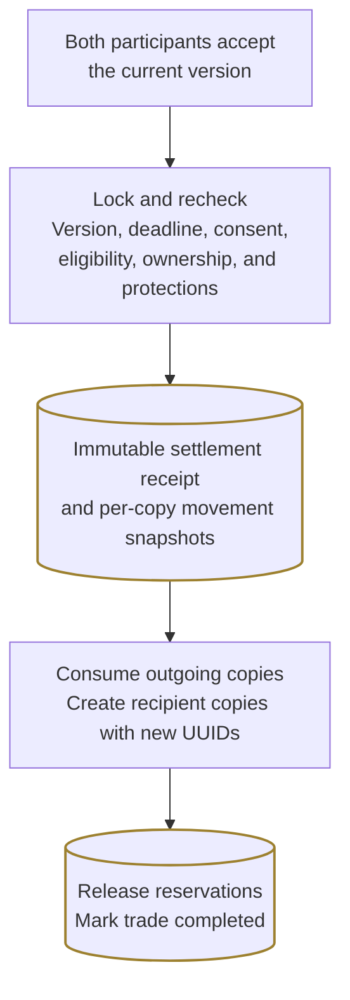

# Card trading persistence

Trading stores versioned offers, exact-copy reservations, participant approvals,
and immutable settlement provenance in the `private` schema. PostgreSQL makes
the exchange atomic; participant collections remain separate.

The [Trading guide](../requirements/card-trading-policy.md) owns player journeys,
numeric limits, and consent rules. This page covers persistence and concurrency.

## Offer model

| Relation                                                 | Responsibility                                                           |
| -------------------------------------------------------- | ------------------------------------------------------------------------ |
| `card_trade_policy_versions`                             | Immutable limits used by an offer and its settlement.                    |
| `card_trades`                                            | Participants, current version, policy, original deadline, and lifecycle. |
| `card_trade_versions`                                    | Immutable published revisions of the offer.                              |
| `card_trade_version_items`                               | Exact offered copies and acquisition snapshots.                          |
| `card_trade_version_requests`                            | Requested definitions and quantities.                                    |
| `card_trade_acceptances`                                 | Participant approvals for a particular version.                          |
| `card_trade_imbalance_acknowledgements`                  | Version-specific rarity-warning consent.                                 |
| `card_trade_reservations`                                | Current open offer's reserved owned copies.                              |
| `card_trade_submission_receipts`                         | Durable command-idempotency keys and digests.                            |
| `card_trade_settlement_receipts`, `card_trade_movements` | Completed exchange and per-copy transfer provenance.                     |

An open offer can become `completed`, `declined`, `cancelled`, `expired`,
or `invalidated`. Terminal offers cannot reopen. Participant identity, policy,
creation time, and original expiry remain fixed.

Each counteroffer appends a version. Approvals and warning acknowledgements are
keyed by trade, version, and participant, so an old approval cannot authorise a
new offer. Earlier versions remain as history.

The web's confirmed-offer flow records proposal consent when Send offer or Send
counter is confirmed. A counter version contains only its proposer's selections,
requests, reservations, and consent. Accepting binds matching available own
copies under ownership locks and appends a complete settlement version; it does
not update immutable rows from the proposal. The server carries forward the
unchanged proposer's confirmed intent and records the accepting player's consent
and rarity acknowledgement in the same transaction as the exchange. Missing,
protected, stale, or otherwise invalid selections cannot partially transfer.
Legacy per-side versions remain readable and supported.

## Reservations and cross-feature locks

`card_trade_reservations.owned_card_id` is the primary key. One live copy can
therefore be reserved by at most 1 offer. Closing an offer releases its
reservations.

The trade service locks participants and owned copies in stable order. Before
reserving or settling it rechecks saved-deck membership, pending async invitations,
active CPU/async/live battle commitments, and other reservations. Completed
battle snapshots do not lock a copy.

Deck mutation, evolution, and battle commitment lock the same ownership rows
before checking trade reservations. This prevents a copy from being reserved
while another transaction commits it to an incompatible operation.

[Deck storage](saved-deck-persistence-design.md) and
[Evolution rules](../requirements/card-evolution-rules.md) define those related
boundaries.

## Settlement transaction

All steps after acceptance share one transaction. Settlement rechecks effective
trade holds, rolling completion caps, matching requests, reservations, definition
availability, and post-exchange inventory minimums.

Version items, requests, reservations, approvals, transfer movements, and
recipient grants use bulk writes. The locked version state is reused during
settlement; reservation and protection checks still run against the database.
Offer responses load policy, participants, version state, and settlement details
in one statement snapshot. Participant and expiry checks still precede that
projection on the same transaction client.

A transfer consumes the outgoing `player_cards` row and creates a new
recipient-owned row with `acquisition_kind = 'trade'` and
`source_trade_movement_id`. It does not change the original row's owner.

Each movement snapshots the source copy ID, definition, acquisition time and
kind, and original provenance, including any territory owner bonus. The source
copy ID is historical data, not a foreign key to live ownership.

A unique settlement receipt per trade and unique recipient copy per movement
prevent duplicate settlement. Deferred validation requires each committed
movement to produce exactly 1 matching new copy. A failure rolls back ownership,
receipt, movements, triggering acceptance, reservation release, and terminal
transition together.

## Command idempotency

Submission receipts are unique by actor, operation, and submission UUID. An
advisory transaction lock serialises requests for that key.

The receipt saves a SHA-256 command digest and affected trade. An identical retry
returns the canonical trade; conflicting intent under the same key is rejected.
Receipts store no access or reauthentication tokens.

These command receipts differ from settlement receipts: command replay identifies
the operation, while settlement records the completed ownership exchange.

## Holds and account deletion

The schema supports `card_trade_hold` under `trust-v2`. Automated scoring and
the current Author review API still use `trust-v1`; the review API cannot create
a trade hold. A valid governance decision must use the matching policy.

An immediately effective trade hold invalidates open offers and releases their
reservations in the restriction transaction. Trade operations also check
effective holds. Completed exchanges are not reversed.

Entering `deletion_pending` invalidates unfinished offers before personal owned
cards are removed. Completed provenance remains against a fresh profile-free
historical actor. It stores no Player Name, Auth0 identity, email, or precise
location.

See [Trust storage](trust-persistence.md) and
[Account retention](account-deletion-retention.md) for governance and deletion.

## Retention and reads

The maintenance worker expires overdue offers and purges non-completed terminal
offer detail after **30 days**. It starts immediately and runs every **30 minutes**
by default. Reads and actions enforce the original deadline transactionally;
a delayed sweep cannot extend the offer.

Completed versions, approvals, command receipts, settlement receipts, and
movements remain as ownership provenance, with no automatic expiry. Purged
non-completed trades also remove their command receipts.

Only participants can read an offer and its history. Settlement projections
identify exchanged copies and movements, but omit their original completion,
starter-grant, evolution, and territory-bonus source IDs. The
[Trading API](../architecture/card-trading-api-contract.md) owns route and response details.

**AI declaration:** Prepared and updated with assistance from
ChatGPT-Web[GPT-5.6 Sol] and Codex[GPT-6].
