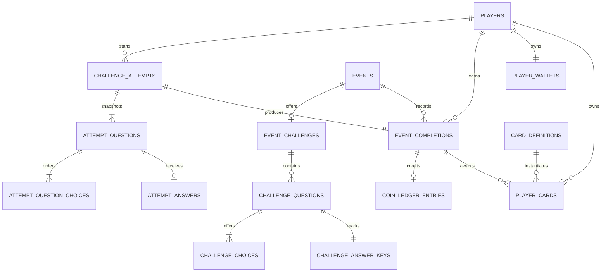

# Challenge, Reward, and Card Persistence Design

## Status and scope

This document records the Sprint 2 persistence foundation for event quizzes,
reward issuance, player wallets, and owned card copies. Issue #49 was the design
input; issue #64 implements the migration layer described here. Challenge and reward routes and finalization services are implemented by their
respective Sprint 2 issues. Protected Author content management is implemented
by issue #77, including event, challenge, question, and card lifecycle
operations and audit persistence.

The HTTP behavior is defined by the
[challenge and attempt API contract](../architecture/challenge-attempt-api-contract.md).
This design extends the existing `events` relation; it does not replace or alter
the Sprint 1 event columns and eligibility rules.

The catalogue vocabulary, duplicate-ownership policy, coin bands, reward odds,
and selection behavior used below were confirmed by the team in the
[issue #49 product decision record](https://sdp.ms.wits.ac.za/gradient-ascent/Wits-World/issues/49#issuecomment-2748).
They are inputs to this persistence proposal rather than rules chosen by the
schema design.

Battles, selling, and evolution remain later work. The Basic starter grant is
implemented by migrations `0009` and `0010` and the protected
`POST /api/v1/cards/starter` endpoint.

Saved deck persistence and selection are implemented by migration `0011` and
the protected `/api/v1/decks` operations. Their schema and authority boundary
are documented in the
[saved deck persistence and API design](saved-deck-persistence-design.md).

The ownership model continues to distinguish an individual `player_cards` copy
from its shared card definition.

## Required invariants

- A player is identified by the validated token's `(issuer, subject)` pair.
- An event has at most one active challenge definition.
- A published challenge question has exactly four choices and one private
  accepted choice.
- One player can have only one attempt and one completion for an event.
- An attempt stores five distinct questions and their shuffled choice order.
- A question can be answered at most once; accepted answers cannot be changed.
- Completion, coin credit, card awards, and the completion response are one
  atomic, retry-safe operation.
- Each awarded duplicate is a separate owned-card row.
- Browser input never determines correctness, score, coin value, rarity, or
  awarded card definition.
- Marking is server-authoritative. While a timed attempt is active, Player
  routes do not expose correct choices, per-question correctness, private
  answer-key relationships, or explanations.
- After authoritative completion, the Player review may expose the player's
  selected choice, the correct choice, and per-question correctness. The review
  is reconstructed from immutable question/choice snapshots, persisted locked
  answers, and the private answer key; private answer-key source identifiers
  remain private and explanations remain excluded from Player responses.
- Author content mutations derive the acting Author from the authenticated
  server context and record create, edit, publish, and retire actions in the
  audit trail.
- Published questions, challenges, cards, and newly authored events cannot
  silently return to draft.
- A newly authored event becomes player-visible only after publication verifies
  one valid published challenge and at least one active Common reward card.

## Relationship view



## Proposed relations

All identifiers are UUIDs. All timestamps are `timestamptz`. Foreign keys use
`ON DELETE RESTRICT` unless retention policy later requires archival behavior.

### `players`

`players` stores `id`, canonical `auth_issuer`, `auth_subject`, and audit
timestamps. `UNIQUE (auth_issuer, auth_subject)` prevents two local
players from representing the same external identity. No access token is stored.

### `event_challenges`

An event challenge stores `id`, `event_id`, `format`, `status`, and lifecycle
timestamps. `format` is initially `multiple_choice`; `status` is `draft`,
`published`, or `retired`. A partial unique index on `event_id` where status is
`published` permits challenge history but allows only one published challenge
per event. Only a published challenge may be started, and publishing requires at
least five valid published questions.

### `challenge_questions` and `challenge_choices`

A question stores its challenge, nonblank prompt, difficulty from `1` through
`3`, optional draft explanation, status, and audit timestamps. Publication
requires a nonblank explanation. Each choice stores its question, nonblank
text, and an authoring position from `1` through `4`.

`UNIQUE (question_id, authoring_position)` and a deferred publish-time check
ensure exactly four choices. Published questions and choices are immutable;
editing creates replacement rows so active attempts retain stable source data.

Draft questions may replace their choices and accepted-answer relationship
transactionally. Once published, their authored content, choices, answer key,
and explanation are immutable; later authoring uses replacement content rather
than mutating the published definition.

### `private.challenge_answer_keys`

The answer-key row contains `question_id` as its primary key and an
`accepted_choice_id`. A composite relationship or trigger proves that the choice
belongs to the same question.

This table lives in a restricted schema. Public read queries have no direct
`SELECT` permission; marking uses a narrowly scoped service query or database
function. Player-facing responses, logs, player fixtures, and analytics exports
must never expose accepted-answer relationships. Protected Author endpoints may
return the accepted answer required to create and manage question content only
after authentication, active-account validation, and Author authorization.

### `challenge_attempts`

An attempt stores:

- `id`, `player_id`, `event_id`, and `challenge_id`;
- `status` as `in_progress` or `completed`;
- `started_at`, `deadline`, and `time_limit_seconds`;
- the selected questions' `average_difficulty`;
- nullable `completed_at`, `completion_reason`, and `score_correct`.

Completion reason is `answered` or `timeout`; score is from `0` through `5`.
Checks tie completion-only fields to status and require the deadline to match the
stored time limit. `UNIQUE (player_id, event_id)` makes start/resume idempotent
and enforces one attempt per player and event.

### Attempt question snapshots and answers

`attempt_questions` stores an API-facing ID, attempt, source question, position
from `1` through `5`, prompt snapshot, and difficulty snapshot. Constraints on
`(attempt_id, position)` and `(attempt_id, source_question_id)` guarantee five
ordered, non-repeating questions when combined with deferred attempt-readiness
validation that requires exactly five rows before creation commits.

`attempt_question_choices` stores an API-facing ID, attempt question, source
choice, display position from `1` through `4`, and text snapshot. Unique
constraints on display position and source choice persist one shuffled order.
Snapshot rows are immutable once their parent attempt is completed; database
triggers reject inserts, updates, and deletes that would change a finalized
attempt's question or choice snapshot.

`attempt_answers` uses `attempt_question_id` as its primary key and stores the
selected attempt choice plus server receipt time. A composite relationship proves
that the choice belongs to the question. The primary key locks one answer, and
database triggers prevent updates or deletes after submission and reject new
answers after the parent attempt is finalized. Correctness is calculated only
during finalization and is not stored here.

### `card_definitions`

A card definition stores `id`, nonblank `name`, `category`, `affinity`, `rarity`,
active state, and audit timestamps. Creature definitions also store positive
`hp` and non-negative `power`; Power definitions keep both stats null.

Issue #77 adds `authoring_status` with `draft`, `published`, and `retired`
states. Draft cards are inactive and editable. Publication changes the card to
published and active only after the persisted definition passes the same
Creature/Power validation used by the application. Published and retired
definition content, moves, and effects are immutable. Retirement makes the card
inactive but preserves the definition so existing `player_cards` ownership rows
continue to resolve their shared catalogue data. Retired cards cannot be
republished.

- Category is `creature` or `power`.
- Affinity is `wit`, `grit`, `spark`, `spirit`, or `mystic`.
- Rarity is `common`, `rare`, `epic`, or `legendary`.

Creature moves are stored in `card_moves` with an ordered position, name, move
type, effect type, optional effect value, modifier target/operation metadata,
optional damage-modifier duration, and non-negative Power cost. Power-card
effects are stored in `card_effects` with the same ordered effect and modifier
fields. Buff and Debuff rows require an authored modifier target and operation;
HP/Power modifiers use `add`, damage-strength modifiers use `multiply`, and only
damage-strength modifiers may define a positive duration. Damage and Heal rows
cannot define modifier metadata. Child-table triggers enforce that moves belong
to Creatures and effects belong to Power cards. A category-change trigger
prevents an existing Creature from being changed into a Power card, or vice
versa, while its child rows remain.

The move/effect vocabulary is `basic`, `wit`, `grit`, `spark`, `spirit`, and
`mystic` for move types, and `damage`, `debuff`, `heal`, and `buff` for effect
types. Damage is the only effect affected by the affinity multiplier; the
server-side type rule is implemented in `apps/api/src/cards/card-rules.ts`.
Reward and starter selection use only active definitions.

### Event authoring lifecycle

Issue #77 extends the existing event relation with nullable `retired_at` while
preserving `is_published` as the player-facing visibility flag.

The Author lifecycle is:

- draft: `is_published = false` and `retired_at is null`;
- published: `is_published = true` and `retired_at is null`;
- retired: `is_published = false` and `retired_at is not null`.

A newly authored draft may be published only when it has exactly one published
challenge and the catalogue contains at least one active Common card required
by the Basic reward policy. Challenge publication already proves that at least
five valid published questions exist.

Published event content is immutable and cannot return to draft. Retirement
removes the event from player discovery without deleting it, and retirement is
irreversible. The published challenge associated with a live published event
cannot be retired until the event itself has been retired.

The original Sprint 1 published demonstration event remains a compatibility
fixture. The new publication-readiness checks guard Author-driven draft-to-
published transitions rather than retroactively invalidating that legacy row.

### `event_completions`

A completion stores `id`, unique `attempt_id`, player, event, score, average
difficulty, non-negative coins awarded, `reward_policy_version`, and completion
time. `UNIQUE (player_id, event_id)` independently protects the player/event
boundary. Finalized completion rows and their matching completed attempts are
immutable. Policy inputs are snapshots so historical rewards stay explainable
after balance changes.

### Wallet and coin ledger

`player_wallets` uses `player_id` as its primary key and stores a non-negative
balance and update time. `coin_ledger_entries` is immutable and stores player,
signed amount, reason, timestamp, and an optional completion reference.

The completion reference is unique for event-reward ledger rows. A positive
award inserts one entry and increments the locked wallet in one transaction. A
zero-coin completion inserts no ledger row.

### `player_cards`

Each row represents one owned copy and stores `id`, player, card definition,
nullable source completion, optional starter grant, acquisition kind, and
acquisition time. Acquisition kind supports `event_reward` and `starter`.

Starter rows must reference `player_starter_grants`, while event-reward rows
must reference a completion. A partial unique index prevents the same card
definition from being inserted twice for one starter grant without preventing
duplicate copies from later events.

There is deliberately no uniqueness constraint on player and card definition.
The event-reward completion index allows the one- or two-card reward result to
store multiple owned-card rows for one completion while keeping lookups fast.
Duplicate card definitions remain valid across separate acquisitions, such as
two starter copies or rewards from different events.

The protected `GET /api/v1/cards/collection` endpoint exposes this ownership
model directly. It derives the player only from the validated authenticated
context and returns one response entry for every matching `player_cards` row.
Two rows that reference the same `card_definition_id` therefore remain two
distinct owned copies through their different owned-card IDs.

The collection joins each ownership row to the shared definition and its
Creature moves or Power-card effects. `acquisition_kind` and `acquired_at` are
safe collection metadata. Raw ownership provenance such as
`source_completion_id` and `source_starter_grant_id`, as well as reward-policy
and challenge-answer internals, are not exposed by the collection response.
Inactive definitions remain visible when already owned even though reward and
starter selection use only active definitions.

## Attempt creation transaction

Starting an attempt performs these operations atomically:

1. Resolve or provision the local player from `(issuer, subject)`.
2. Serialize the player/event attempt boundary and return an existing attempt.
3. Verify publication, activity, fresh reachability, and challenge health.
4. Randomly select five distinct published questions.
5. Calculate average difficulty and choose the time limit.
6. Insert the attempt, question snapshots, and one shuffled choice snapshot per
   question.

The unique player/event constraint is the final concurrency guard. A conflicting
insert loads the winner instead of creating a second quiz.

For example, if two start requests arrive together, both may initially observe
no attempt. Only one insert can satisfy `UNIQUE (player_id, event_id)`. The other
transaction catches that conflict and returns the persisted attempt, including
the same deadline and question order.

## Completion and reward policy

Coins use a deterministic difficulty adjustment within each score band:

```text
coins = min + round(((averageDifficulty - 1) / 2) * (max - min))
```

| Correct | Coin band | Card award                     |
| ------- | --------- | ------------------------------ |
| `0`     | `0`       | None                           |
| `1`     | `10-20`   | None                           |
| `2`     | `20-30`   | None                           |
| `3`     | `30-40`   | One Common                     |
| `4`     | `40-50`   | One card: 75% Common, 25% Rare |
| `5`     | `50-75`   | 80% one card, 20% two cards    |

Issue #67 persists one or two event-reward card rows per completion according to
the approved Basic reward policy. The completion and coin-ledger uniqueness
constraints remain the idempotency boundary, while the ownership query returns
all cards linked to the persisted completion.

Each card awarded for five correct answers rolls rarity independently: 45%
Common, 40% Rare, 14% Epic, and 1% Legendary. After rarity selection, one active
creature or power definition in that rarity is selected uniformly. Affinity and
category are not weighted.

If a positive-probability rarity has no active definitions, its probability is
redistributed proportionally across the other available positive-probability
rarities. A guaranteed Common reward requires at least one active Common card; otherwise
completion fails and retries after catalogue repair. Issue #77 therefore
requires at least one active Common definition before a newly authored event may
be published.

Random decisions use a server-side cryptographically secure source. Award count,
rarity, and definitions become durable through completion and ownership rows, so
retries return the same reward instead of rerolling.

## Atomic finalization

The fifth-answer path, timeout worker, and defensive request finalizer call the
same transaction:

1. Lock the attempt and return its existing completion if already completed.
2. Load answers and private keys; unanswered questions count as wrong.
3. Calculate score and rewards from the attempt snapshots.
4. Insert the event completion.
5. Insert and apply a positive coin ledger credit.
6. Insert zero, one, or two event-reward ownership rows.
7. Mark the attempt completed with its reason, score, and timestamp.
8. Commit, then return the persisted score/reward result with the review derived
   from the same authoritative attempt state.

Any failure rolls back every effect. Constraints make retries converge on one
completion instead of issuing additional coins or cards. The expiry worker
claims bounded batches with `FOR UPDATE SKIP LOCKED`, allowing concurrent workers
without duplicate processing.

For example, a fifth-answer request and the timeout worker can race for the same
attempt. The first transaction obtains the attempt lock and commits one
completion. The second then observes the completed state and returns that same
persisted reward. `UNIQUE (player_id, event_id)` on completions and the unique
completion reference on event coin credits provide independent backstops.

## Completed API representation

The completed attempt gains a server-generated reward result:

```json
{
  "scoreCorrect": 5,
  "reward": {
    "coinsAwarded": 63,
    "cards": [
      {
        "ownedCardId": "51000000-0000-4000-8000-000000000001",
        "cardDefinitionId": "50000000-0000-4000-8000-000000000009",
        "name": "Campus Spark",
        "category": "creature",
        "affinity": "spark",
        "rarity": "rare"
      }
    ]
  }
}
```

It also gains exactly five review entries in persisted question order:

```ts
review: Array<{
  attemptQuestionId: string;
  position: number;
  prompt: string;
  selectedChoice: { choiceId: string; text: string } | null;
  correctChoice: { choiceId: string; text: string };
  isCorrect: boolean;
}>;
```

The selected and correct choice IDs are attempt-choice snapshot IDs, so they
match the choices shown during the attempt without exposing source authoring IDs
or the private `accepted_choice_id`. `selectedChoice` is read from the immutable
`attempt_answers` row and is `null` when timeout leaves a question unanswered.
The correct snapshot is selected by joining the attempt question's source row to
`private.challenge_answer_keys`, then matching the accepted source choice back
to that attempt's persisted shuffled choices. The server derives `isCorrect`;
unanswered entries are false and the number of true entries must equal the
persisted `score_correct`. An `answered` completion must have five non-null
selected choices. The completed Player review has no explanation field; Author-only question
explanations are not exposed through Player challenge responses.

No review, correct choice, correctness, score, or reward field is returned while
the attempt is `in_progress`.

The response is reconstructed from persisted rows. The browser never submits
any field in `reward`.

## Starter-card grant

The protected `POST /api/v1/cards/starter` endpoint derives the player from the
validated access token. The request contains only the selected affinity. One
transaction locks or creates the player's `player_starter_grants` row, selects
three distinct active Common Creatures and two distinct active Common Power
cards of that affinity, inserts five owned copies, and returns the persisted
grant.

The same affinity can be submitted again safely: the API returns the original
grant and cards with HTTP `200`. A different affinity returns a conflict, and
the database's unique player constraint prevents concurrent requests from
creating two starter selections. The seed contains the minimum five Common
cards for each of the five affinities; the starter API refuses an affinity if
its catalogue is incomplete.

## Migration and implementation order

Issue #64 adds the migration layer in dependency order:

1. `0003_create_players.sql` stores the local identity boundary.
2. `0004_create_account_deletion_requests.sql` adds the account-lifecycle
   relationship required by the existing player model.
3. `0005_create_challenge_definitions.sql` adds event challenges, questions,
   choices, private answer keys, publication validation, and content
   immutability.
4. `0006_create_challenge_attempts.sql` adds attempts, five-question snapshots,
   shuffled four-choice snapshots, and locked answers.
5. `0007_create_cards_rewards_and_ownership.sql` adds card definitions,
   completions, wallets, coin ledger entries, and owned card copies.
6. `0008_allow_multiple_event_reward_cards.sql` allows the approved perfect
   score reward to persist two event-reward card copies for one completion.
7. `0009_create_card_catalogue_and_starter_grants.sql` adds Creature stats,
   normalized moves/effects, starter grants, starter ownership provenance, and
   the constraints that keep those records consistent.
8. `0010_add_card_modifier_metadata.sql` adds authored Buff/Debuff modifier
   targets, operations, durations, and battle-readiness constraints.
9. `0011_create_saved_decks.sql` adds saved decks, exact owned-copy
   memberships, ownership-safe composite relationships, deterministic positions,
   and one active deck selection per player.
10. `0012_create_cpu_matches.sql` adds server-authoritative CPU match state,
    immutable card snapshots, ordered rounds/actions, and private completed
    history.
11. `0013_add_author_content_foundation.sql` adds question explanations,
    immutable Author-content audit records, and database enforcement that audit
    actors are active Authors.
12. `0014_harden_author_challenge_lifecycle.sql` hardens question and challenge
    immutability and lifecycle transitions used by protected challenge
    authoring.
13. `0015_add_card_authoring_lifecycle.sql` adds explicit draft, published, and
    retired card states, active-state consistency, and published-card content
    immutability.
14. `0016_add_event_authoring_lifecycle.sql` adds event retirement, publication
    readiness validation, published-event immutability, and protection against
    retiring the challenge beneath a live published event.

The database integration suite applies all sixteen migrations to an empty
PostgreSQL/PostGIS database and checks that a second run is a no-op.
PostgreSQL/PostGIS database and checks that a second run is a no-op. The
`0002_basic_card_catalogue.sql` seed is repeatable and provides deterministic
demonstration cards for all starter affinities plus non-Common examples for
catalogue/reward testing. The seed does not claim to be final production card
artwork or balance.

The existing Sprint 1 demo event carries over as an unchanged `events` row.
For local development, `0003_sprint_1_demo_challenge.sql` supplies one
deterministic published challenge with five valid questions, immutable private
answer keys, and the existing seeded reward catalogue. It makes the real
challenge flow demonstrable without changing event discovery or eligibility
rules. The fixture is non-production content; authoring changes to published
questions still require replacements rather than mutation.

Schema-only migrations may be reversed before challenge data is written. After
attempts or rewards exist, rollback cannot safely drop ownership, ledger, or
answer-snapshot records. A production rollback must instead stop new starts and
finalization, preserve immutable history, and deploy a forward corrective
migration. Removing a published challenge must use retirement rather than
deletion while attempts reference it.

Repository tests must cover concurrent start, duplicate answers, deadline races,
concurrent timeout workers, completion retry, rollback, unavailable rarity pools,
and duplicate awards. API tests must prove answer keys and correctness details
never cross the response boundary while an attempt is active, and that only the
defined review fields reveal them after completion.

The event rule remains `starts_at < ends_at`; this design does not introduce an
unapproved one-to-three-hour duration limit. Exact retention periods for answers,
attempt snapshots, and completed rewards remain unresolved. Account deletion
also needs a policy that removes or pseudonymizes identity data without breaking
the immutable coin and reward audit trail. These decisions must be made before
production migration rollout and are tracked as `BASIC-12` in the
[Basic-tier decision register](../requirements/basic-tier-decision-register.md).

This design was planned, generated, edited, and reviewed with the assistance of
Codex[GPT-5.6 Sol], Codex-CLI[gpt-5.6-sol medium], Codex[GPT-5], and
ChatGPT-Web[GPT-5.6 Sol].
