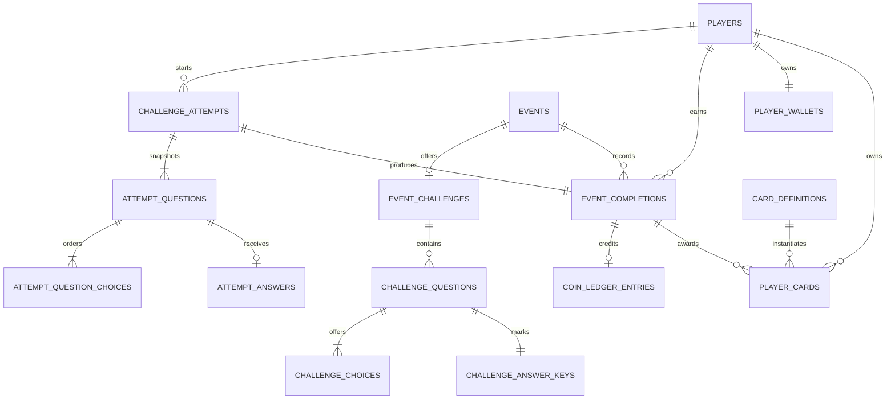

# Challenge, Reward, and Card Persistence Design

## Status and scope

This document proposes the Sprint 2 persistence foundation for event quizzes,
reward issuance, player wallets, and owned card copies. It resolves issue #49 as
a design artifact only: no migration, worker, or API implementation is included.

The HTTP behavior is defined by the
[challenge and attempt API contract](../architecture/challenge-attempt-api-contract.md).
This design extends the existing `events` relation; it does not replace or alter
the Sprint 1 event columns and eligibility rules.

The catalogue vocabulary, duplicate-ownership policy, coin bands, reward odds,
and selection behavior used below were confirmed by the team in the
[issue #49 product decision record](https://sdp.ms.wits.ac.za/gradient-ascent/Wits-World/issues/49#issuecomment-2748).
They are inputs to this persistence proposal rather than rules chosen by the
schema design.

Decks, battles, selling, evolution, and starter-card assignment remain future
work. The schema keeps enough identity and ownership information to add those
features without treating a card definition as an owned card.

## Required invariants

- A player is identified by the validated token's `(issuer, subject)` pair.
- An event has at most one active challenge definition.
- A published challenge question has exactly four choices and one private
  accepted choice.
- One player can have only one attempt and one completion for an event.
- An attempt stores five distinct questions and their shuffled choice order.
- A question can be answered at most once; accepted answers cannot be changed.
- Completion, coin credit, card awards, and the completion response are one
  atomic, retry-safe operation.
- Each awarded duplicate is a separate owned-card row.
- Browser input never determines correctness, score, coin value, rarity, or
  awarded card definition.

## Relationship view



## Proposed relations

All identifiers are UUIDs. All timestamps are `timestamptz`. Foreign keys use
`ON DELETE RESTRICT` unless retention policy later requires archival behavior.

### `players`

`players` stores `id`, canonical `identity_issuer`, `identity_subject`, and audit
timestamps. `UNIQUE (identity_issuer, identity_subject)` prevents two local
players from representing the same external identity. No access token is stored.

### `event_challenges`

An event challenge stores `id`, `event_id`, `format`, `status`, and lifecycle
timestamps. `format` is initially `multiple_choice`; `status` is `draft`,
`published`, or `retired`. A partial unique index on `event_id` where status is
`published` permits challenge history but allows only one published challenge
per event. Only a published challenge may be started, and publishing requires at
least five valid published questions.

### `challenge_questions` and `challenge_choices`

A question stores its challenge, nonblank prompt, difficulty from `1` through
`3`, status, and audit timestamps. Each choice stores its question, nonblank
text, and an authoring position from `1` through `4`.

`UNIQUE (question_id, authoring_position)` and a deferred publish-time check
ensure exactly four choices. Published questions and choices are immutable;
editing creates replacement rows so active attempts retain stable source data.

### `private.challenge_answer_keys`

The answer-key row contains `question_id` as its primary key and an
`accepted_choice_id`. A composite relationship or trigger proves that the choice
belongs to the same question.

This table lives in a restricted schema. Public read queries have no direct
`SELECT` permission; marking uses a narrowly scoped service query or database
function. Keys must never appear in browser responses, logs, client fixtures, or
analytics exports.

### `challenge_attempts`

An attempt stores:

- `id`, `player_id`, `event_id`, and `challenge_id`;
- `status` as `in_progress` or `completed`;
- `started_at`, `deadline`, and `time_limit_seconds`;
- the selected questions' `average_difficulty`;
- nullable `completed_at`, `completion_reason`, and `score_correct`.

Completion reason is `answered` or `timeout`; score is from `0` through `5`.
Checks tie completion-only fields to status and require the deadline to match the
stored time limit. `UNIQUE (player_id, event_id)` makes start/resume idempotent
and enforces one attempt per player and event.

### Attempt question snapshots and answers

`attempt_questions` stores an API-facing ID, attempt, source question, position
from `1` through `5`, prompt snapshot, and difficulty snapshot. Constraints on
`(attempt_id, position)` and `(attempt_id, source_question_id)` guarantee five
ordered, non-repeating questions when combined with deferred attempt-readiness
validation that requires exactly five rows before creation commits.

`attempt_question_choices` stores an API-facing ID, attempt question, source
choice, display position from `1` through `4`, and text snapshot. Unique
constraints on display position and source choice persist one shuffled order.

`attempt_answers` uses `attempt_question_id` as its primary key and stores the
selected attempt choice plus server receipt time. A composite relationship proves
that the choice belongs to the question. The primary key locks one answer;
correctness is calculated only during finalization and is not stored here.

### `card_definitions`

A card definition stores `id`, nonblank `name`, `category`, `affinity`, `rarity`,
active state, and audit timestamps.

- Category is `creature` or `power`.
- Affinity is `wit`, `grit`, `spark`, `spirit`, or `mystic`.
- Rarity is `common`, `rare`, `epic`, or `legendary`.

Gameplay stats, moves, effects, and evolution links are deferred. Reward
selection uses only active definitions.

### `event_completions`

A completion stores `id`, unique `attempt_id`, player, event, score, average
difficulty, non-negative coins awarded, `reward_policy_version`, and completion
time. `UNIQUE (player_id, event_id)` independently protects the player/event
boundary. Policy inputs are snapshots so historical rewards stay explainable
after balance changes.

### Wallet and coin ledger

`player_wallets` uses `player_id` as its primary key and stores a non-negative
balance and update time. `coin_ledger_entries` is immutable and stores player,
signed amount, reason, timestamp, and an optional completion reference.

The completion reference is unique for event-reward ledger rows. A positive
award inserts one entry and increments the locked wallet in one transaction. A
zero-coin completion inserts no ledger row.

### `player_cards`

Each row represents one owned copy and stores `id`, player, card definition,
nullable source completion, acquisition kind, and acquisition time. Acquisition
kind initially supports `event_reward` and later `starter`.

There is deliberately no uniqueness constraint on player and card definition.
Two identical rewards create two ownership rows, and one completion may award
multiple rows.

## Attempt creation transaction

Starting an attempt performs these operations atomically:

1. Resolve or provision the local player from `(issuer, subject)`.
2. Serialize the player/event attempt boundary and return an existing attempt.
3. Verify publication, activity, fresh reachability, and challenge health.
4. Randomly select five distinct published questions.
5. Calculate average difficulty and choose the time limit.
6. Insert the attempt, question snapshots, and one shuffled choice snapshot per
   question.

The unique player/event constraint is the final concurrency guard. A conflicting
insert loads the winner instead of creating a second quiz.

For example, if two start requests arrive together, both may initially observe
no attempt. Only one insert can satisfy `UNIQUE (player_id, event_id)`. The other
transaction catches that conflict and returns the persisted attempt, including
the same deadline and question order.

## Completion and reward policy

Coins use a deterministic difficulty adjustment within each score band:

```text
coins = min + round(((averageDifficulty - 1) / 2) * (max - min))
```

| Correct | Coin band | Card award                     |
| ------- | --------- | ------------------------------ |
| `0`     | `0`       | None                           |
| `1`     | `10-20`   | None                           |
| `2`     | `20-30`   | None                           |
| `3`     | `30-40`   | One Common                     |
| `4`     | `40-50`   | One card: 75% Common, 25% Rare |
| `5`     | `50-75`   | 80% one card, 20% two cards    |

Each card awarded for five correct answers rolls rarity independently: 45%
Common, 40% Rare, 14% Epic, and 1% Legendary. After rarity selection, one active
creature or power definition in that rarity is selected uniformly. Affinity and
category are not weighted.

If a positive-probability rarity has no active definitions, its probability is
redistributed proportionally across the other available positive-probability
rarities. A guaranteed Common reward requires at least one active Common card;
otherwise completion fails and retries after catalog repair. Catalog readiness
should alert before an event is published.

Random decisions use a server-side cryptographically secure source. Award count,
rarity, and definitions become durable through completion and ownership rows, so
retries return the same reward instead of rerolling.

## Atomic finalization

The fifth-answer path, timeout worker, and defensive request finalizer call the
same transaction:

1. Lock the attempt and return its existing completion if already completed.
2. Load answers and private keys; unanswered questions count as wrong.
3. Calculate score and rewards from the attempt snapshots.
4. Insert the event completion.
5. Insert and apply a positive coin ledger credit.
6. Insert zero, one, or two owned-card rows.
7. Mark the attempt completed with its reason, score, and timestamp.
8. Commit, then return the persisted result.

Any failure rolls back every effect. Constraints make retries converge on one
completion instead of issuing additional coins or cards. The expiry worker
claims bounded batches with `FOR UPDATE SKIP LOCKED`, allowing concurrent workers
without duplicate processing.

For example, a fifth-answer request and the timeout worker can race for the same
attempt. The first transaction obtains the attempt lock and commits one
completion. The second then observes the completed state and returns that same
persisted reward. `UNIQUE (player_id, event_id)` on completions and the unique
completion reference on event coin credits provide independent backstops.

## Completed API representation

The completed attempt gains a server-generated reward result:

```json
{
  "scoreCorrect": 5,
  "reward": {
    "coinsAwarded": 63,
    "cards": [
      {
        "ownedCardId": "51000000-0000-4000-8000-000000000001",
        "cardDefinitionId": "50000000-0000-4000-8000-000000000009",
        "name": "Campus Spark",
        "category": "creature",
        "affinity": "spark",
        "rarity": "rare"
      }
    ]
  }
}
```

The response is reconstructed from persisted rows. The browser never submits
any field in `reward`.

## Future starter-card extension

Starter assignment can reuse definitions and owned copies. After affinity
selection, one transaction selects three distinct active Common creatures and
two distinct active Common power cards of that affinity, inserts five owned
copies, and records a separate one-time starter grant. The catalog must have
enough qualifying definitions before offering an affinity.

## Migration and implementation order

A future implementation should add migrations in dependency order:

1. Players and identity uniqueness.
2. Challenge authoring tables and restricted answer keys.
3. Attempts, snapshots, and locked answers.
4. Card definitions and owned copies.
5. Event completions, wallets, and ledger entries.
6. Roles, grants, indexes, checks, and publication validation.

The existing Sprint 1 demo event carries over as an unchanged `events` row. It
has no challenge until a separate draft `event_challenges` row and at least five
valid questions are deliberately authored and published. Applying these future
migrations therefore must not make the seed discoverable as a challenge or
change its current discovery and eligibility behavior.

Schema-only migrations may be reversed before challenge data is written. After
attempts or rewards exist, rollback cannot safely drop ownership, ledger, or
answer-snapshot records. A production rollback must instead stop new starts and
finalization, preserve immutable history, and deploy a forward corrective
migration. Removing a published challenge must use retirement rather than
deletion while attempts reference it.

Repository tests must cover concurrent start, duplicate answers, deadline races,
concurrent timeout workers, completion retry, rollback, unavailable rarity pools,
and duplicate awards. API tests must prove answer keys and correctness details
never cross the response boundary.

The event rule remains `starts_at < ends_at`; this design does not introduce an
unapproved one-to-three-hour duration limit. Exact retention periods for answers,
attempt snapshots, and completed rewards remain unresolved. Account deletion
also needs a policy that removes or pseudonymizes identity data without breaking
the immutable coin and reward audit trail. These decisions must be made before
production migration rollout.

This design was planned, generated, edited, and reviewed with the assistance of
Codex[GPT-5.6 Sol].
