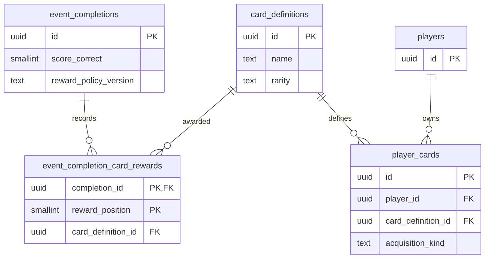

# Challenge, reward and card storage

Challenge attempts preserve the questions a player received. Completion records
preserve the score and reward outcome. Owned-card rows track the copies currently
in a collection; they are separate from shared catalogue definitions.

The [challenge API contract](../architecture/challenge-attempt-api-contract.md)
owns request and response details. [Game rules](../requirements/basic-game-rules.md#card-rewards)
define reward odds, while this page covers storage and transaction boundaries.

## Questions and attempts

| Relations                                            | Stored responsibility                                                                               |
| ---------------------------------------------------- | --------------------------------------------------------------------------------------------------- |
| `event_challenges`                                   | Versioned challenge format and reviewed publication state; at most 1 published challenge per event. |
| `challenge_questions`                                | Prompt, difficulty, explanation, sources, and publication state.                                    |
| `challenge_choices`, `challenge_ordering_items`      | Format-specific authored choices or items.                                                          |
| Private answer-key tables                            | Accepted choice or correct ordering positions.                                                      |
| `challenge_attempts`                                 | Player/event identity, status, start, deadline, selected average difficulty, and final result.      |
| `attempt_questions` and format-specific child tables | Saved prompts, shuffled choices/items, and locked submitted answers.                                |
| `event_completions`                                  | Immutable completion, score, difficulty, reward-policy version, and completion time.                |

Published questions have 4 choices with 1 accepted choice, or 4 ordering items
with unique correct positions. Published definitions and their marking data
cannot be edited in place.

Starting an attempt selects **5 distinct published questions**, saves their
prompts and shuffled presentation, and derives the deadline. Unique
`(player_id, event_id)` constraints allow only 1 attempt and 1 completion for
that player/event, including concurrent starts.

Each question accepts 1 locked answer. Ordering answers contain all 4 distinct
attempt-item IDs. Membership and format checks prevent an answer from using
another question's choices or items.

Active player responses omit answer keys and correctness. After completion,
review uses the saved attempt and answers, exposing attempt-facing IDs rather
than private source relationships. [Offline play](../architecture/offline-challenge-play.md)
defines pack snapshots and reconciliation through the same completion boundary.

## Catalogue definitions

`card_definitions` stores shared identity, category, rarity, stats, artwork,
publication state, pool eligibility, and optional evolution relationships.

| Data               | Contract                                                                                            |
| ------------------ | --------------------------------------------------------------------------------------------------- |
| Name               | Globally unique under `lower(btrim(name))`, including retired definitions.                          |
| Category and stats | Creatures have HP, Power, and an affinity; current Power cards are typeless with no Creature stats. |
| `catalogue_class`  | `ordinary` or `special`; distinguishes catalogue content from historical/special definitions.       |
| Eligibility flags  | Separate `starter_eligible`, `reward_eligible`, and `cpu_eligible` selection permissions.           |
| Evolution fields   | Defined source relationship and required copy count on an evolved Creature.                         |
| Artwork metadata   | Image URL, alternative text, and attribution.                                                       |

`card_moves` stores ordered Creature moves. `card_move_effects` stores each
move's ordered executable effects, including effect code, configuration, and
readable rules. `card_effects` stores Power-card effects and their execution
metadata. A move can have several effects.

Creature drafts can be incomplete; publication requires exactly **4 valid
moves**. Published content is immutable, and retirement preserves references
and saved battle history. Historical affinity-bearing Power records remain
readable without changing the current typeless catalogue.

See [Author cards](../design/author-cards.md) for authoring and
[Card catalogue](../design/basic-card-roster.md) for the current roster.

## Reward outcomes and current ownership

`||` means exactly 1 and `o{` means 0 or more. Selected relationships and
columns are shown; owned copies also carry acquisition provenance.

Each `player_cards` row has its own UUID. There is no unique player/definition
constraint, so duplicates remain separate copies. Supported acquisition kinds
are `starter`, `event_reward`, `evolution`, and `trade`.

Source fields link the copy to its starter grant, completion, evolution, or trade
movement as appropriate. A territory owner bonus uses `event_reward` with an
additional `source_territory_bonus_id`; it does not add an acquisition kind.

`event_completion_card_rewards` stores immutable ordered base reward outcomes.
Those rows describe what was awarded, rather than what is still owned.
Territory bonuses have separate decision/provenance records; see
[Territory storage](contested-campus-territory-persistence.md).

The default collection read returns individual owned copies and player-visible
catalogue data. It includes inactive definitions that are still owned, but omits
raw acquisition-source IDs and private marking data.

## Completion transaction

Answer completion, timeout handling, and defensive finalisation share the same
transaction boundary:

1. Lock the attempt and return its saved completion if already finalised.
2. Mark locked answers using private keys; unanswered questions count as wrong.
3. Derive the score and select base rewards from the current eligible pool.
4. Save the completion, ordered reward outcomes, and matching owned copies.
5. Finalise any snapshotted territory owner-bonus decision.
6. Mark the attempt completed and save progression.
7. Commit the result used by completed-attempt responses.

Selection uses server-side cryptographic randomness. The default reward-policy
identifier is `points-cards-v2`. Only active, published, reward-eligible
definitions enter the base reward pool. Empty weighted rarities are removed and
remaining weights are normalised; a guaranteed Common reward requires an eligible
Common definition.

Retries read the persisted result without rerolling or adding copies. A failure
rolls back the completion and all awards together. Concurrent answer and timeout
finalisers serialise on the attempt. Progression values belong to
[Progression storage](player-progression-persistence.md).

## Starter grants and evolution

`player_starter_grants` has a unique player key. Grant creation and its 5 owned
copies commit together, so repeat or concurrent selection cannot issue another
package. New choices are Wit, Grit, and Spark; historical grants remain readable.
The [starter rules](../requirements/basic-game-rules.md#starter-grant) define
package contents.

Evolution uses `card_evolution_transactions` and `card_evolution_consumptions`
to retain the recipe, submitted operation, 3 consumed-copy snapshots, and granted
copy identity. Ownership rows are locked before saved-deck and trade-reservation
checks. Consumption, grant, and receipt commit together; a repeated submission
cannot consume another set.

The [evolution guide](../requirements/card-evolution-rules.md) owns recipe and
selection rules. [Deck storage](saved-deck-persistence-design.md) and
[Trading storage](card-trading-persistence.md) define related copy protections.

## Privacy and retention

Public card reads do not expose ownership provenance or Author review metadata.
Active attempts do not expose private answers; completed review has its own
authenticated projection.

Account deletion removes personal attempts, completions, reward outcomes, starter
grants, owned cards, and evolution records. Shared catalogue definitions and
required trade/battle history remain under the
[account retention contract](account-deletion-retention.md).

The retired coin schema is compatibility history. New completions store 0 coins,
and current rewards use cards and progression points.

**AI declaration:** Prepared and updated with assistance from Codex[GPT-5.6 Sol],
Codex-CLI[gpt-5.6-sol medium], Codex[GPT-5], ChatGPT-Web[GPT-5.6 Sol],
Codex-CLI[GPT-5.6 Sol], Codex[gpt-5.6-sol], Codex-CLI[GPT-6], and Codex[GPT-6].
