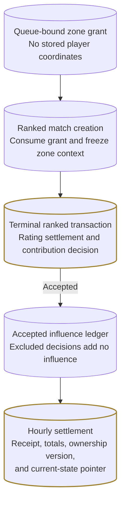

# Territory storage

Territories connect reviewed campus boundaries to ranked results and versioned
ownership. They use the ranked settlement as their battle authority, then derive
influence and hourly ownership. Challenge owner bonuses have a separate saved
eligibility and award boundary.

[Territory rules](../requirements/contested-campus-zone-policy.md) owns thresholds,
limits, and player controls. The [territory API contract](../architecture/contested-campus-territory-api-contract.md)
defines location claims and safe read projections.

## Stored model

| Relations                                        | Responsibility                                                             |
| ------------------------------------------------ | -------------------------------------------------------------------------- |
| `private.territory_policy_versions`              | Immutable eligibility, influence, settlement, and bonus policy.            |
| `territory_zones`                                | Reviewed geometry, sources, definition version, and lifecycle.             |
| `private.territory_zone_grants`                  | Short-lived queue-bound eligibility and one-time consumption.              |
| `private.territory_ranked_match_snapshots`       | Immutable per-participant zone/policy context at match creation.           |
| `private.territory_contribution_decisions`       | Exactly 1 accepted or excluded decision per ranked source match.           |
| `private.territory_influence_contributions`      | Append-only accepted influence.                                            |
| Private settlement receipts and totals           | Zone/season/window result, immutable counts, tie inputs, and input digest. |
| Private ownership versions and current ownership | Authoritative append-only history and a rebuildable latest-state pointer.  |
| `private.territory_season_close_receipts`        | Exactly-once season contribution/settlement seal.                          |
| Private owner-bonus snapshots and decisions      | Challenge-start eligibility and exactly-once completed bonus outcome.      |

Private tables have `PUBLIC` privileges revoked. Public-schema zone storage
still requires authenticated, shaped API reads.

## Reviewed boundaries and lifecycle

Zones store nonempty, valid WGS 84 `MultiPolygon` geometry in SRID 4326.
GiST indexes support containment. Active zones cannot overlap in positive area;
shared boundaries are permitted, but do not establish unambiguous eligibility.

Only 1 active or suspended definition of a logical zone can exist. Boundary
replacement creates a new reviewed version and retires the old definition.
Copied placement provenance does not link territory lifecycle to later
placement edits.

Activation creates unowned state. Suspension and retirement append unowned
versions without removing history. Reactivation starts unowned; retirement
is terminal.

`territory_ownership_versions` is the authority. `territory_current_ownership`
points to the latest version and can be rebuilt from history. Deferred checks
reject a pointer to an older state.

## Grants and ranked contribution

The API evaluates the reported point and accuracy envelope with PostGIS. Accepted
grants save the player, queue, zone, policy/lifecycle version, timing, and use
state. They save no submitted latitude, longitude, accuracy, or movement path.

Match creation requires a valid, unconsumed grant and unchanged eligible zone
context. Grant consumption and the ranked match snapshot commit together.
Matchmaking itself continues to use rating rather than zone proximity.

The contribution decision references the authoritative ranked settlement and
winner. CPU, async, casual live, and unfinished battles cannot supply influence.
An excluded result saves a reason and cannot later become accepted.

Contribution checks use the winner's saved pre-match placement status and zone,
then recheck account, zone, completion reason, and daily cap. An accepted decision
has exactly 1 influence row; an excluded decision has none. All of this commits
with the ranked result.

## Settlement and concurrency

Contribution and settlement paths use player locks before the same zone lock.
Accepted influence receives its database timestamp after that zone lock, so a
contribution waiting behind settlement falls into the next half-open window.
Daily-cap dates use `Africa/Johannesburg`.

A unique zone/season/window key identifies each settlement receipt. It saves
before/after owner, expected/resulting state version, policy, and input digest.
Immutable totals retain accepted counts, earliest contribution, and account
eligibility. Deferred checks compare those facts with the ledger.

The service applies the policy's threshold and deterministic tie rules, then
commits the receipt, totals, new ownership version, and current pointer together.
A retained owner still produces a new state version without implying a transfer.

Maintenance catches up fixed hourly windows in order, using separate transactions
per window. Season closure first drains ranked sources, settles any final partial
window to one close instant, seals contributions, and appends unowned reset state
before the ranked season closes.

## Challenge owner bonuses

Challenge start resolves the event's effective location, current active zone
ownership, and Johannesburg start date. It saves a private eligibility snapshot
under the same player/zone locking boundary.

Completion saves an immutable outcome and, when eligible, an extra Common card
with `source_territory_bonus_id`. A partial unique player/date index permits at
most 1 awarded bonus across all zones. Starting an eligible attempt does not
reserve that day's award.

Later ownership or placement changes do not rewrite saved eligibility. Bonus
decisions and cards commit with normal challenge completion and progression.
[Reward storage](challenge-reward-persistence-design.md) defines that transaction;
[Territory rules](../requirements/contested-campus-zone-policy.md#owner-card-bonus)
owns the award conditions.

## Privacy, retention, and deletion

Player views use named owners, anonymous leading influence counts, and the
caller's own allowance. They omit other players' grants, queues, contribution
source matches, and private evidence. Ownership describes past participation,
not a player's current location.

Expired grants become cleanup-eligible **24 hours after expiry**; ranked
maintenance runs their cleanup. Consumed context remains in immutable match
snapshots. Territory storage retains curated geometry, but no submitted player
coordinate or path history.

Deletion immediately appends unowned state for any currently owned zone.
Completion removes personal grants and owner-bonus records, while shared
contributions, settlement facts, and ownership history retain profile-free actors.
History displays **Deleted player**. Zone retirement preserves that history.

See [Ranked storage](ranked-competition-persistence.md) and
[Account retention](account-deletion-retention.md).

**AI declaration:** Prepared and updated with assistance from
ChatGPT-Web[GPT-5.6 Sol] and Codex[GPT-6].
