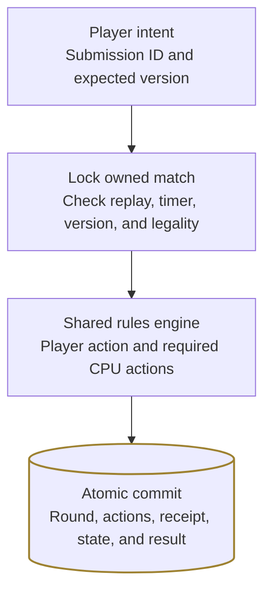

# CPU battle storage

CPU battles persist authoritative state, immutable card snapshots, and ordered
action history. The API applies player intent and all required CPU actions through
`@wits-world/game-rules`, then commits the complete transition.

The [CPU battle guide](../requirements/player-cpu-battle-journey.md) owns player
controls, and [Battle rules](../requirements/battle-rules.md) defines combat.

## Stored model

| Relation            | Responsibility                                                           |
| ------------------- | ------------------------------------------------------------------------ |
| `cpu_matches`       | Owner, state, status, version, turn timer, winner, and timestamps.       |
| `cpu_match_cards`   | Immutable player and CPU card/stat/move/effect snapshots.                |
| `cpu_match_rounds`  | Before/after state and the results of one submitted transition.          |
| `cpu_match_actions` | Ordered player and CPU actions, results, and player submission receipts. |

A partial unique index permits **1 active CPU match per player**. The optional
source deck reference becomes null when that saved deck is deleted; snapshots
remain unchanged.

JSONB stores rules-engine state and results. Database checks require object-shaped
states, card snapshots, and action inputs/results, with array-shaped round
results. SQL-nullable response and submitted-intent objects remain optional.
These checks validate outer shape; the rules engine validates battle semantics.

## Action transaction

The match row lock serialises writers. After acquiring it, a fresh statement
checks for an existing submission receipt so a request waiting behind another
writer can see that writer's commit. Identical retries return the saved response.

New actions reject stale versions, enforce the **90-second** player-turn timer,
and apply server-owned CPU randomness. Action sequences use the latest action
number rather than match version, because a round can contain several actions.

The service writes the round, all ordered actions, receipt, and updated match
together. Terminal transitions also save progression. Any failure rolls back the
entire operation; unique match/submission keys prevent duplicate application.

Modern receipts retain the cumulative `battleLog`, avoiding repeated full-history
reads during action processing. Older receipts can reconstruct their log from
persisted actions without rewriting historical outcomes.

## Reads and recovery

Active recovery and direct owned-match reads use one PostgreSQL statement for
state, card names, and ordered history. Each response therefore represents one
committed snapshot. Reads do not lock or advance gameplay.

`GET /api/v1/matches/cpu` finds the authenticated player's active match without
accepting a player or match ID. No visible active match returns
`404 CPU_MATCH_NOT_FOUND`; completed matches belong to history.

After an uncertain create response, this lookup recovers a committed match.
An immediate not-found response cannot exclude a creation still in flight.
A repeated create remains protected by the one-active-match constraint.

## API and privacy

| Operation                 | Route                                   |
| ------------------------- | --------------------------------------- |
| Create from selected deck | `POST /api/v1/matches/cpu`              |
| Recover active match      | `GET /api/v1/matches/cpu`               |
| Read owned match          | `GET /api/v1/matches/:matchId`          |
| Submit action             | `POST /api/v1/matches/:matchId/actions` |
| Read completed history    | `GET /api/v1/matches/history`           |

The API derives ownership and returns legal actions and a player-safe projection.
Unrevealed CPU reserves remain hidden. Battle logs use persisted action results;
legacy records do not gain invented expiry events.

Completed results never recalculate from later decks or catalogue data.
Account deletion removes personal CPU matches and their snapshots/history.
See [Progression storage](player-progression-persistence.md),
[Account retention](account-deletion-retention.md), and the
[API reference](../architecture/api-overview.md).

**AI declaration:** Prepared and updated with assistance from
ChatGPT-Web[GPT-5.6 Sol], Codex[GPT-5], Codex-CLI[gpt-5.6-sol],
Codex-CLI[GPT-6], and Codex[GPT-6].
