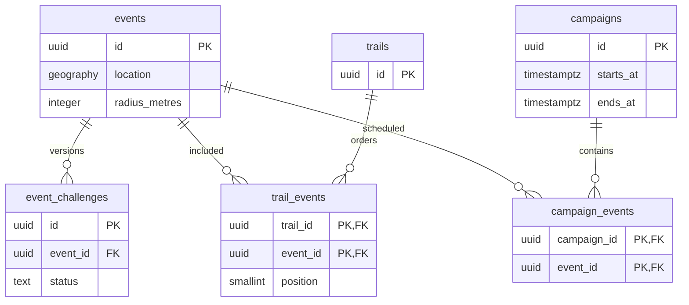

# Event fields and relationships

`public.events` stores an event's authored content, interaction radius,
schedule, and publication state. Campaigns can narrow its schedule; automatic
placement can supply its effective location. Player queries resolve those
relationships before returning an event.

## Relationships

<div className="diagram-scroll" role="region" aria-label="Events, challenge versions, trails, and campaigns" tabIndex={0}>



</div>

`||` means exactly 1 and `o{` means 0 or more. An event can retain several
challenge versions, but at most 1 can be published. Membership tables reuse
the same event rather than copying its content.

## Content and location fields

| Column                     | Type                     | Contract                                                                  |
| -------------------------- | ------------------------ | ------------------------------------------------------------------------- |
| `id`                       | `uuid`                   | Primary key, generated by default.                                        |
| `title`                    | `text`                   | Required and nonblank.                                                    |
| `description`              | `text`                   | Optional; nonblank when present.                                          |
| `location`                 | `geography(Point, 4326)` | Authored WGS 84 point; may be null for automatic placement.               |
| `radius_metres`            | `integer`                | Positive interaction radius.                                              |
| `starts_at`, `ends_at`     | `timestamptz`            | Required authored window; the end must follow the start.                  |
| `source_urls`              | `text[]`                 | Source metadata; non-null entries validated as HTTPS URLs after trimming. |
| `created_at`, `updated_at` | `timestamptz`            | Record timestamps; update time cannot precede creation.                   |

PostGIS point construction uses **longitude, latitude**. Geography calculations
return distances in metres, and a GiST index supports spatial searches.

A non-retired event with no authored point must retain active portability.
The database checks this at transaction commit. Automatic placement is derived
from `event_placement_portability`, rather than stored as an
`automatic_placement` column on the event. Assignment history supplies the
current point; it does not overwrite `events.location`.

## Publication and review fields

| Column                                   | Type                  | Contract                                                        |
| ---------------------------------------- | --------------------- | --------------------------------------------------------------- |
| `authoring_status`                       | `text`                | `draft`, `in_review`, `approved`, `published`, or `retired`.    |
| `version`                                | `integer`             | Non-negative version used for optimistic concurrency.           |
| `submitted_by_player_id`, `submitted_at` | `uuid`, `timestamptz` | Current submission actor and time.                              |
| `reviewed_by_player_id`, `reviewed_at`   | `uuid`, `timestamptz` | Independent review actor and time.                              |
| `publication_provenance`                 | `text`                | Publication origin: `legacy`, `controlled_seed`, or `reviewed`. |
| `is_published`                           | `boolean`             | Compatibility flag constrained to the published state.          |
| `retired_at`                             | `timestamptz`         | Set for retired content.                                        |

Draft content can change. Non-draft content is immutable; published events can
be retired while their historical references remain. Versioned edits and
transitions save an audit record in the same transaction. Review actor
references use the historical-actor model so retained content survives account
deletion.

Publication readiness includes a valid published challenge and an active,
published Common reward candidate. The [content-review guide](../architecture/diagrams/content-review.md)
defines the Author workflow.

## Effective availability

The active interval includes the start and excludes the end:

```text
effective start <= server time < effective end
```

`resolve_event_availability` combines the authored window with published
campaign membership. `resolve_event_placement_location` supplies the location
and assignment, where applicable. An active time window alone does not make a
placement-managed event available when it has no valid assignment.

The end of a schedule changes availability without deleting the event.
See [campaign storage](campaign-scheduling-persistence.md),
[event eligibility](event-eligibility.md), and
[placement storage](automatic-event-placement-persistence.md).

[Challenge storage](challenge-reward-persistence-design.md) covers attempts,
question snapshots, completions, and rewards.
[Trail storage](ordered-trails-persistence.md) covers ordered membership.

**AI declaration:** Prepared and updated with assistance from Codex-CLI[GPT-5],
Codex[GPT-5], Codex[GPT-5.6 Sol], Codex[gpt-5.6-sol], Codex-CLI[GPT-6], and
Codex[GPT-6].
