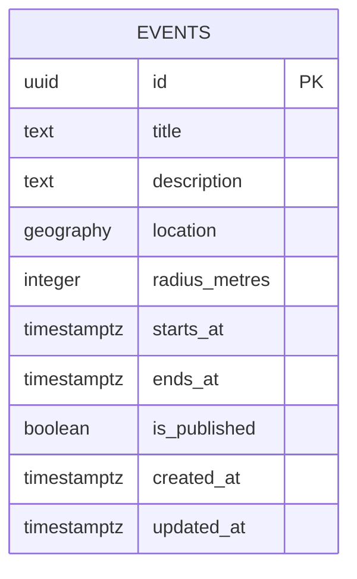

# Initial Event Schema

The Sprint 1 event schema stores the minimum authoritative event data required
for server-side discovery and location eligibility. It does not include
challenges, rewards, campaigns, or a full publication workflow.

## Entity relationship view



## Column contract

| Column          | PostgreSQL type          | Rules                                         |
| --------------- | ------------------------ | --------------------------------------------- |
| `id`            | `uuid`                   | Primary key; generated by default             |
| `title`         | `text`                   | Required and not blank                        |
| `description`   | `text`                   | Optional; not blank when present              |
| `location`      | `geography(Point, 4326)` | Required, non-empty WGS 84 point              |
| `radius_metres` | `integer`                | Required and greater than zero                |
| `starts_at`     | `timestamptz`            | Required                                      |
| `ends_at`       | `timestamptz`            | Required and later than `starts_at`           |
| `is_published`  | `boolean`                | Required; defaults to `false`                 |
| `created_at`    | `timestamptz`            | Required; defaults to the insertion time      |
| `updated_at`    | `timestamptz`            | Required; cannot be earlier than `created_at` |

PostGIS point constructors receive coordinates as longitude then latitude. All
distance values are metres because `location` uses the PostGIS `geography`
type. `events_location_gist_idx` is a GiST index supporting spatial queries.

Availability uses a half-open interval: an event is active when
`starts_at <= now()` and `now() < ends_at`. The row remains stored after its end
timestamp; it is not deleted automatically.

Named check constraints are:

- `events_title_not_blank`
- `events_description_not_blank`
- `events_location_not_empty`
- `events_radius_metres_positive`
- `events_availability_valid`
- `events_timestamps_valid`

## Sprint 1 demonstration fixture

`database/seeds/0001_sprint_1_demo_event.sql` defines one provisional,
non-production event:

| Field      | Fixture value                          |
| ---------- | -------------------------------------- |
| Identifier | `00000000-0000-4000-8000-000000000018` |
| Title      | `Sprint 1 Demo - Wits Great Hall`      |
| Longitude  | `28.03038`                             |
| Latitude   | `-26.19205`                            |
| Radius     | `75` metres                            |
| Starts     | `2026-08-01 00:00:00+02`               |
| Ends       | `2026-08-26 00:00:00+02` exclusive     |
| Published  | `true`                                 |

The fixture is available throughout 25 August 2026 and becomes inactive at
midnight on 26 August in South African Standard Time. Its coordinates and
radius are provisional Sprint 1 integration values, not approved production
event placement. The Great Hall location can be cross-checked against the
[official Wits Braamfontein campus map](https://www.wits.ac.za/media/wits-university/about-wits/documents/2025-Braamfontein-Campus-map.pdf).

The seed uses an upsert on the fixed UUID. Running it repeatedly restores the
documented fixture values and does not create additional rows for this event.

## Commands and review evidence

Run migrations and seeds from the repository root:

```bash
npm run db:migrate --workspace @wits-world/api
npm run db:seed --workspace @wits-world/api

npm run db:migrate:test --workspace @wits-world/api
npm run db:seed:test --workspace @wits-world/api
```

Run the empty-database integration test:

```bash
npm run test:database --workspace @wits-world/api
```

Query safe review evidence without exposing the connection URL:

```bash
set -a
source apps/api/.env
set +a

psql "$TEST_DATABASE_URL" -c \
  "select id, title, st_y(location::geometry) as latitude, st_x(location::geometry) as longitude, radius_metres, starts_at, ends_at, is_published from public.events where id = '00000000-0000-4000-8000-000000000018';"

psql "$TEST_DATABASE_URL" -c \
  "select indexname, indexdef from pg_indexes where schemaname = 'public' and tablename = 'events';"
```

Do not paste database URLs, passwords, or other secrets into issue evidence.

The preceding document was generated and edited with the assistance of:
Codex-CLI[GPT-5].
