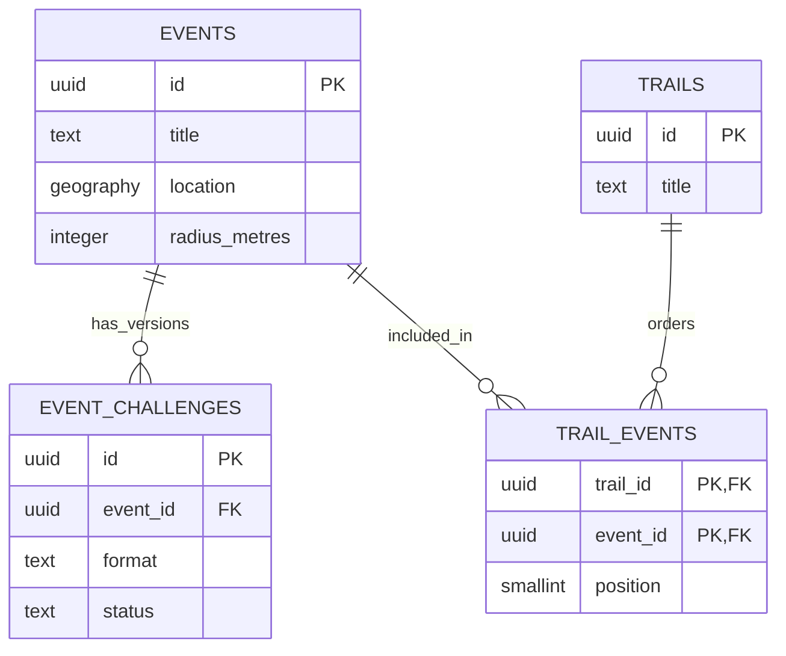

# Event fields and relationships

The Sprint 1 event schema introduced the authoritative event data required for
server-side discovery and location eligibility. Issue #182 preserves those
columns and extends the relation with the reviewed Author lifecycle.

The
[challenge, reward, and card persistence design](./challenge-reward-persistence-design.md)
adds the related challenge and reward model. Player discovery continues to use
the existing `is_published` visibility boundary.

## Entity relationship view

<div className="diagram-scroll" role="region" aria-label="Event fields and relationships — diagram 1" tabIndex={0}>



</div>

The view shows selected fields and actual foreign-key relationships. `||` means
one and `o{` means zero or many. Events may have challenge history, with at most
one published challenge. `trail_events` joins an event to a trail at a unique
position within that trail; it does not store player progress.

See [trail storage](ordered-trails-persistence.md) for membership constraints
and [database relationships](../architecture/diagrams/database-relationships.md)
for player attempts, completions and rewards. The complete event field reference
follows below.

## Column contract

| Column                   | PostgreSQL type          | Rules                                                                         |
| ------------------------ | ------------------------ | ----------------------------------------------------------------------------- |
| `id`                     | `uuid`                   | Primary key; generated by default                                             |
| `title`                  | `text`                   | Required and not blank                                                        |
| `description`            | `text`                   | Optional; not blank when present                                              |
| `location`               | `geography(Point, 4326)` | Required, non-empty WGS 84 point                                              |
| `radius_metres`          | `integer`                | Required and greater than zero                                                |
| `starts_at`              | `timestamptz`            | Required                                                                      |
| `ends_at`                | `timestamptz`            | Required and later than `starts_at`                                           |
| `authoring_status`       | `text`                   | `draft`, `in_review`, `approved`, `published`, or `retired`                   |
| `version`                | `integer`                | Non-negative optimistic-concurrency version                                   |
| `submitted_by`           | `uuid`                   | Latest submitting Author while review metadata is current                     |
| `submitted_at`           | `timestamptz`            | Timestamp of the latest submission                                            |
| `reviewed_by`            | `uuid`                   | Different Author who approved the current version                             |
| `reviewed_at`            | `timestamptz`            | Timestamp of approval                                                         |
| `publication_provenance` | `text`                   | Null before publication; otherwise `legacy`, `controlled_seed`, or `reviewed` |
| `is_published`           | `boolean`                | Compatibility flag; true only for `published`                                 |
| `retired_at`             | `timestamptz`            | Set only for permanently retired content                                      |
| `created_at`             | `timestamptz`            | Required; defaults to the insertion time                                      |
| `updated_at`             | `timestamptz`            | Required; cannot be earlier than `created_at`                                 |
| `source_urls`            | `text[]`                 | HTTPS factual/location evidence; empty for legacy content                     |

PostGIS point constructors receive coordinates as longitude then latitude. All
distance values are metres because `location` uses the PostGIS `geography`
type. `events_location_gist_idx` is a GiST index supporting spatial queries.

Availability uses a half-open interval: an event is active when
`starts_at <= now()` and `now() < ends_at`. The row remains stored after its end
timestamp; it is not deleted automatically.

Named check constraints are:

- `events_title_not_blank`
- `events_description_not_blank`
- `events_location_not_empty`
- `events_radius_metres_positive`
- `events_availability_valid`
- `events_timestamps_valid`

## Author publication lifecycle

`authoring_status` is authoritative. `is_published` and `retired_at` remain
constrained compatibility fields:

| Author state | `is_published` | `retired_at` |
| ------------ | -------------- | ------------ |
| Draft        | `false`        | `null`       |
| In review    | `false`        | `null`       |
| Approved     | `false`        | `null`       |
| Published    | `true`         | `null`       |
| Retired      | `false`        | timestamp    |

Author-created events begin as drafts and only drafts are editable. Submission
records the current submitter. A different active Author must approve or return
the submission; return from review or approval requires a reason and creates a
new draft version. Any Author may publish approved content. Approval and
publication both require exactly one published challenge and at least one
active published Common reward card.

Every edit or lifecycle transition compares an expected version, increments
`version`, and writes one audit record atomically. Published event content is
immutable and may only be retired. Retirement removes it from player discovery
without deleting historical completions, progression, rewards, ownership,
decks, or matches.

These transition rules are enforced by the API service and backed by database
constraints and triggers. Player discovery continues to require
`is_published = true`, so retiring an event removes it from discovery without
deleting the row.

## Basic demonstration fixtures

`database/seeds/basic-demo/0001_sprint_1_demo_event.sql` defines the primary
provisional, non-production Great Hall event. Additional lifecycle fixtures are
defined in `database/seeds/basic-demo/0002_basic_demo_event_states.sql`.

| Field      | Fixture value                          |
| ---------- | -------------------------------------- |
| Identifier | `00000000-0000-4000-8000-000000000018` |
| Title      | `Sprint 1 Demo - Wits Great Hall`      |
| Longitude  | `28.03038`                             |
| Latitude   | `-26.19205`                            |
| Radius     | `75` metres                            |
| Starts     | `2026-08-01 00:00:00+02`               |
| Ends       | `2026-08-26 00:00:00+02` exclusive     |
| Published  | `true`                                 |
| Retired    | `no`                                   |

The fixture is available throughout 25 August 2026 and becomes inactive at
midnight on 26 August in South African Standard Time. Its coordinates and
radius are provisional integration values, not approved production event
placement. The Great Hall location can be cross-checked against the
[official Wits Braamfontein campus map](https://www.wits.ac.za/media/wits-university/about-wits/documents/2025-Braamfontein-Campus-map.pdf).

The seeds use fixed UUIDs and conflict-safe operations. Repeat runs leave an
already-published controlled fixture unchanged. The lifecycle guard treats
published event content as immutable, so the seed is not an administrative
mechanism for rewriting live content.

`database/seeds/basic-demo/0003_sprint_1_demo_challenge.sql` adds the associated
deterministic published five-question challenge; its immutable choices and
private answer keys use fixed IDs with conflict-safe inserts.

The server-side distance, availability, and radius rules are documented in the
[event eligibility calculation](./event-eligibility.md).

## Commands and review evidence

Run migrations and seeds from the repository root:

```bash
npm run db:migrate --workspace @wits-world/api
npm run db:seed --workspace @wits-world/api

npm run db:migrate:test --workspace @wits-world/api
npm run db:seed:test --workspace @wits-world/api
```

Run the empty-database integration test:

```bash
npm run test:database --workspace @wits-world/api
```

Query safe review evidence without exposing the connection URL:

```bash
set -a
source apps/api/.env
set +a

psql "$TEST_DATABASE_URL" -c \
  "select id, title, st_y(location::geometry) as latitude, st_x(location::geometry) as longitude, radius_metres, starts_at, ends_at, is_published from public.events where id = '00000000-0000-4000-8000-000000000018';"

psql "$TEST_DATABASE_URL" -c \
  "select indexname, indexdef from pg_indexes where schemaname = 'public' and tablename = 'events';"
```

Do not paste database URLs, passwords, or other secrets into issue evidence.

The preceding document was generated and edited with the assistance of:
Codex-CLI[GPT-5], Codex[GPT-5], Codex[GPT-5.6 Sol], and
Codex[gpt-5.6-sol].

Page title and accessible diagram presentation updated with assistance from
Codex-CLI[GPT-6].
