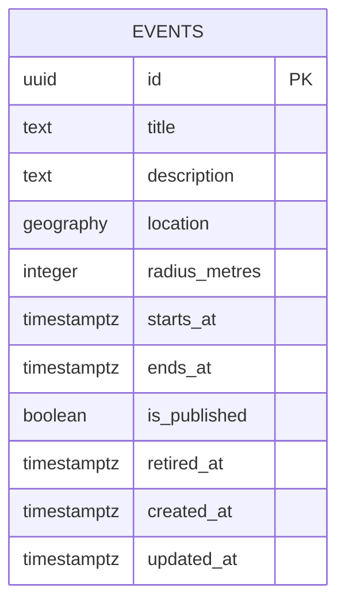

# Event Schema

The Sprint 1 event schema introduced the authoritative event data required for
server-side discovery and location eligibility. Sprint 2 preserves those
columns and extends the relation with the protected Author publication and
retirement lifecycle introduced by issue #77.

The
[challenge, reward, and card persistence design](./challenge-reward-persistence-design.md)
adds the related challenge and reward model. Player discovery continues to use
the existing `is_published` visibility boundary.

## Entity relationship view



## Column contract

| Column          | PostgreSQL type          | Rules                                                       |
| --------------- | ------------------------ | ----------------------------------------------------------- |
| `id`            | `uuid`                   | Primary key; generated by default                           |
| `title`         | `text`                   | Required and not blank                                      |
| `description`   | `text`                   | Optional; not blank when present                            |
| `location`      | `geography(Point, 4326)` | Required, non-empty WGS 84 point                            |
| `radius_metres` | `integer`                | Required and greater than zero                              |
| `starts_at`     | `timestamptz`            | Required                                                    |
| `ends_at`       | `timestamptz`            | Required and later than `starts_at`                         |
| `is_published`  | `boolean`                | Required; defaults to `false`                               |
| `retired_at`    | `timestamptz`            | Null unless the authored event has been permanently retired |
| `created_at`    | `timestamptz`            | Required; defaults to the insertion time                    |
| `updated_at`    | `timestamptz`            | Required; cannot be earlier than `created_at`               |

PostGIS point constructors receive coordinates as longitude then latitude. All
distance values are metres because `location` uses the PostGIS `geography`
type. `events_location_gist_idx` is a GiST index supporting spatial queries.

Availability uses a half-open interval: an event is active when
`starts_at <= now()` and `now() < ends_at`. The row remains stored after its end
timestamp; it is not deleted automatically.

Named check constraints are:

- `events_title_not_blank`
- `events_description_not_blank`
- `events_location_not_empty`
- `events_radius_metres_positive`
- `events_availability_valid`
- `events_timestamps_valid`

## Author publication lifecycle

Issue #77 interprets the event lifecycle from `is_published` and `retired_at`:

| Author state | `is_published` | `retired_at` |
| ------------ | -------------- | ------------ |
| Draft        | `false`        | `null`       |
| Published    | `true`         | `null`       |
| Retired      | `false`        | timestamp    |

Author-created events begin as drafts. A draft may be edited by any active
Author. Publication is an explicit protected operation and requires one
published challenge for the event plus at least one active Common card in the
reward catalogue. Challenge publication independently guarantees at least five
valid published questions.

Published event content is immutable. A published event cannot return to draft;
it must be retired. Retirement clears player publication, records
`retired_at`, and cannot be reversed. A published challenge cannot be retired
while its event remains published.

These transition rules are enforced by the API service and backed by database
constraints and triggers. Player discovery continues to require
`is_published = true`, so retiring an event removes it from discovery without
deleting the row.

## Basic demonstration fixtures

`database/seeds/basic-demo/0001_sprint_1_demo_event.sql` defines the primary
provisional, non-production Great Hall event. Additional lifecycle fixtures are
defined in `database/seeds/basic-demo/0002_basic_demo_event_states.sql`.

| Field      | Fixture value                          |
| ---------- | -------------------------------------- |
| Identifier | `00000000-0000-4000-8000-000000000018` |
| Title      | `Sprint 1 Demo - Wits Great Hall`      |
| Longitude  | `28.03038`                             |
| Latitude   | `-26.19205`                            |
| Radius     | `75` metres                            |
| Starts     | `2026-08-01 00:00:00+02`               |
| Ends       | `2026-08-26 00:00:00+02` exclusive     |
| Published  | `true`                                 |
| Retired    | `no`                                   |

The fixture is available throughout 25 August 2026 and becomes inactive at
midnight on 26 August in South African Standard Time. Its coordinates and
radius are provisional integration values, not approved production event
placement. The Great Hall location can be cross-checked against the
[official Wits Braamfontein campus map](https://www.wits.ac.za/media/wits-university/about-wits/documents/2025-Braamfontein-Campus-map.pdf).

The seeds use upserts on fixed UUIDs and remain repeatable when the
published fixture already contains its documented values. The Sprint 2
lifecycle guard treats published event content as immutable, so the seed is not
an administrative mechanism for rewriting a live published event.

`database/seeds/basic-demo/0003_sprint_1_demo_challenge.sql` adds the associated
deterministic published five-question challenge; its immutable choices and
private answer keys use fixed IDs with conflict-safe inserts.

The server-side distance, availability, and radius rules are documented in the
[event eligibility calculation](./event-eligibility.md).

## Commands and review evidence

Run migrations and seeds from the repository root:

```bash
npm run db:migrate --workspace @wits-world/api
npm run db:seed --workspace @wits-world/api

npm run db:migrate:test --workspace @wits-world/api
npm run db:seed:test --workspace @wits-world/api
```

Run the empty-database integration test:

```bash
npm run test:database --workspace @wits-world/api
```

Query safe review evidence without exposing the connection URL:

```bash
set -a
source apps/api/.env
set +a

psql "$TEST_DATABASE_URL" -c \
  "select id, title, st_y(location::geometry) as latitude, st_x(location::geometry) as longitude, radius_metres, starts_at, ends_at, is_published from public.events where id = '00000000-0000-4000-8000-000000000018';"

psql "$TEST_DATABASE_URL" -c \
  "select indexname, indexdef from pg_indexes where schemaname = 'public' and tablename = 'events';"
```

Do not paste database URLs, passwords, or other secrets into issue evidence.

The preceding document was generated and edited with the assistance of:
Codex-CLI[GPT-5], Codex[GPT-5], Codex[GPT-5.6 Sol].
