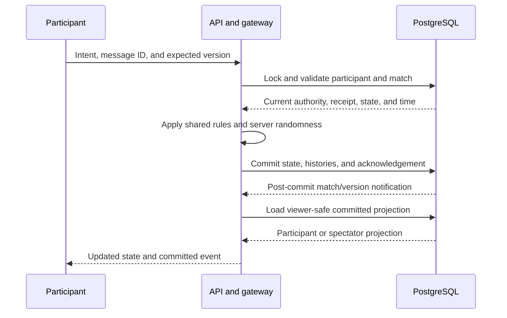

# Live PvP storage

Live battles persist state, deadlines, connection authority, and replay receipts
in PostgreSQL. WebSocket connections deliver viewer-safe projections; gateway
memory does not own gameplay state.

The [live API contract](../architecture/live-pvp-api-contract.md) owns protocol
messages and routes. [Battle rules](../requirements/battle-rules.md) covers
decisions, timeouts, and combat.

## Stored model

| Relations                                 | Responsibility                                                                         |
| ----------------------------------------- | -------------------------------------------------------------------------------------- |
| `live_pvp_matches`                        | Lifecycle, gameplay version, phase, actor, deadline, winner, and terminal reason.      |
| `live_pvp_match_participants`             | 2 engine sides, deck references, timeout counts, connection generations, and outcomes. |
| `live_pvp_match_actions`                  | Immutable spectator-safe events for committed gameplay versions.                       |
| Private deck snapshots and snapshot cards | Full immutable decks, including hidden cards.                                          |
| `private.live_pvp_match_states`           | Full current battle state at the match version.                                        |
| `private.live_pvp_match_transitions`      | Before/after state, authoritative result, server randomness, and accepted generation.  |
| `private.live_pvp_connection_tickets`     | Single-use ticket digests, roles, protocol, expiry, and redemption.                    |
| `private.live_pvp_connection_access`      | Redeemed access, participant generation, closure, and cleanup boundary.                |
| `private.live_pvp_submission_receipts`    | Payload hash and committed acknowledgement for a participant message.                  |
| `private.live_pvp_completion_sources`     | Exactly-once terminal source per participant.                                          |

`public` is a schema name, not permission to read raw tables through the API.
Participants and spectators receive different projections. Full state, hidden
cards, randomness, and security records remain private.

## Gameplay transaction and delivery

A new match starts at version 0 with 2 participants, complete deck snapshots,
and matching private state. Each gameplay transition advances both public match
and private state by 1, appending public and private history.

Active decisions use a **60-second** database deadline. Initial selection can
require both participants; normal and replacement phases identify a current
actor. Connection activity does not extend that deadline.

Mutation and deadline paths lock the match before sampling database time.
Elapsed deadlines are resolved before late intent can act. Automatic selection,
replacement, timeout, resignation, and deletion forfeit are server-owned
transitions with the same persistence guarantees.

State, history, acknowledgement, and any terminal settlement commit together.
Notifications carry match/version references and become visible after commit;
each gateway loads the appropriate projection. Reconnect recovers PostgreSQL
state rather than replaying a gateway's memory.

## Tickets and connection generations

Tickets are server-generated opaque credentials. Only their SHA-256 digest is
stored. Each binds a match, active local player, server-derived role, and protocol
version, expires after **60 seconds**, and can be redeemed once.

Minting and redemption lock player/match lifecycle before checking time.
Redemption also locks the ticket. An expired ticket cannot succeed after waiting
for those locks.

Participant redemption increments `connection_generation` and supersedes older
participant access atomically. Spectators do not advance that generation.
Gameplay version and connection generation are independent: reconnecting does
not count as a battle action.

Submissions must use the current participant generation. Connection-access rows
record authorisation history, not exact socket presence; a crashed gateway can
leave an open row. Presence therefore cannot decide a winner or preserve a turn.

## Message replay and terminal results

Receipts are unique by match, actor, operation, and message UUID. An identical
message returns its committed acknowledgement; a different payload under the
same ID is rejected. Generation checks still apply to reconnecting participants.

Participant events have a matching receipt and accepted generation.
Server-derived events have neither. Deferred integrity checks prevent partial
state/history commits, and ordinary mutations cannot rewrite terminal outcomes.

Live completion records both participant sources but awards no progression
points or activity days. For a ranked match, live completion calls rating
settlement in the same transaction, including its territory decision.
[Ranked storage](ranked-competition-persistence.md) owns those additional records.

## Retention and account deletion

Expired ticket digests and closed/superseded connection access have a **24-hour**
transient retention boundary. The live runtime scheduler invokes retry-safe
cleanup. It removes due closed access before ticket rows still referenced by it.

That cleanup does not remove battle state, snapshots, actions, replay receipts,
or terminal results. These records contain no raw tickets, bearer tokens, email,
Auth0 subjects, IP addresses, or submitted player coordinates.

Account deletion resolves elapsed decisions first, then forfeits any remaining
active match before entering `deletion_pending`. It removes the player's ticket
and connection-access records. Completed shared history retains a profile-free
actor and displays **Deleted player**.

See [Account retention](account-deletion-retention.md) and
[Player battles](../requirements/player-asynchronous-pvp-journey.md).

**AI declaration:** Prepared and updated with assistance from
ChatGPT-Web[GPT-5.6 Sol], Codex[GPT-5.6 Sol], and Codex[GPT-6].
