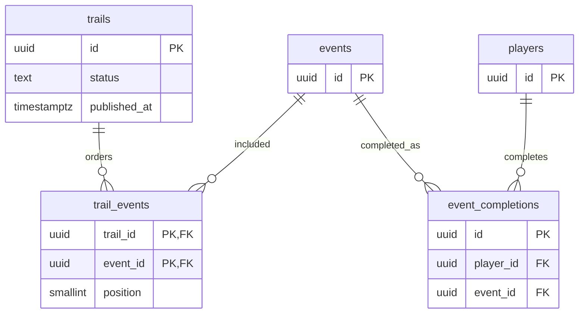

# Trail storage and API

Trails store an ordered list of existing events. Player progress is derived
from event completions, so the database needs no separate mutable progress
cursor or trail reward ledger.

## Stored relationships

`||` means exactly 1 and `o{` means 0 or more. Selected columns are shown.

`trails` stores the title, optional description, `draft`/`published`/`retired`
state, and lifecycle timestamps. `trail_events` has a compound primary key
`(trail_id, event_id)` and a unique `(trail_id, position)` constraint.
Positions are 1-based and limited to **1–50**.

A deferred constraint requires nonempty membership to be contiguous from
position 1 at commit. The service can replace draft membership atomically
without exposing a partially reordered trail.

## Publication and immutability

Draft metadata and membership can change. Publication requires **2–50 unique
events**, all published and not retired. The service checks readiness and
database triggers enforce the final boundary.

Published metadata and order are immutable. Retirement retains the definition
and membership; a published campaign containing the trail must be retired
first. Foreign keys restrict deletion of referenced trails and events.

## Author operations

Trail management is API-only. The routes under `/api/v1` require an active
account with a Player Name and the Author role.

| Operation                       | Route                                  |
| ------------------------------- | -------------------------------------- |
| List                            | `GET /author/trails`                   |
| Create draft                    | `POST /author/trails`                  |
| Replace draft content and order | `PUT /author/trails/:trailId`          |
| Publish                         | `POST /author/trails/:trailId/publish` |
| Retire                          | `POST /author/trails/:trailId/retire`  |

Mutations lock the trail row and save membership, lifecycle changes, and
`author_content_audit` together. This contract has no `expectedVersion` field
or independent-review queue; concurrent replacements are serialised by the
row lock.

The [Author trail guide](../design/author-trails.md) covers preparation and
publication. Endpoint schemas are in the
[API reference](../api-reference.md).

## Derived progress

The player query loads steps in order and joins only that player's
`event_completions`. The service counts the completed sequence from position 1
up to the first missing completion, then derives completed, current, locked,
and unavailable states.

Any finalised challenge counts, including a timeout or score of 0. Out-of-order
completions are retained and count when earlier gaps close. Completing an event
shared by several trails can advance each trail without another completion row.

Campaign scheduling supplies a trail's effective window separately from its
member events. Retired, previously published trails remain visible only to
players with a completion for at least 1 member event. Upcoming and ended
windows remain visible but do not supply active nearby guidance.

See [Trail rules](../requirements/ordered-trails-rules.md) for player behaviour
and [campaign storage](campaign-scheduling-persistence.md) for window resolution.

## Nearby query and location privacy

`POST /api/v1/events/nearby-unvisited` returns active, effectively placed events
that the caller has not completed. It includes an event when it is the current
step in at least 1 active published trail, or has no active-trail membership.

Spatial candidates come from indexed authored event points and assignment-site
points. The query then resolves effective placement and availability and uses
PostGIS distance for filtering and ordering. Stable UUID ordering breaks ties;
the requested search distance and result count are bounded.

The location claim is used for this query without creating movement or trail
history. Nearby results are guidance; event eligibility and challenge start
perform their own access checks.

**AI declaration:** Prepared and updated with assistance from
Codex-CLI[gpt-5.6-sol medium], Codex-CLI[GPT-5], Codex-CLI[GPT-6], and Codex[GPT-6].
