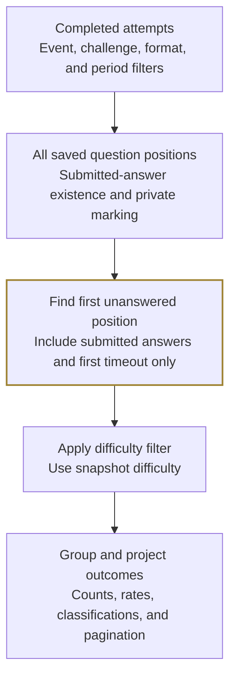

# Question analytics queries

Question reports aggregate completed attempts and their saved answers. The
shared SQL outcome projection supports the exact curation report, advanced
analytics, and event-attention summaries without copying answer history.

[Question reports](question-performance-analytics.md) owns interpretation and
classification. [Author analytics API](../architecture/advanced-analytics-api-contract.md#two-reporting-endpoints)
defines endpoint differences.

## Query stages

`QUESTION_PERFORMANCE_CTES` is shared by the report service and event-attention
query. Only completed attempts enter it. Period filtering uses `completed_at`
with an inclusive start and exclusive end.

Multiple-choice correctness compares the submitted snapshot choice's source
with the private accepted choice. Ordering correctness requires all 4 submitted
snapshot items to match their private positions.

For a timeout, only the lowest unanswered position adds an incorrect/timeout
outcome. Later unanswered snapshots are excluded. The difficulty filter runs
after that position is established; otherwise filtering could incorrectly move
the timeout onto a later question.

Groups include question, event, challenge, format, and `difficulty_snapshot`.
This preserves the difficulty actually seen by the player, rather than using a
later draft value.

## Pagination and disclosure

The curation service returns a bounded page and total group count from one SQL
statement. Ordering uses problematic status, incorrect rate, outcome count, and
question UUID for a stable tie-break. An empty page still returns the total.

Advanced analytics applies its classifications and small-sample suppression to
the shared outcomes. Event attention groups reportable signals by event before
pagination. [Storage and privacy](advanced-analytics.md#small-sample-disclosure)
owns the disclosure rules.

Private keys are used for marking, then excluded from response projections.
Reports return neither player/attempt identity nor submitted answers.

## Supporting indexes

These partial indexes include only `status = 'completed'` attempts:

| Index                                                  | Indexed columns                            |
| ------------------------------------------------------ | ------------------------------------------ |
| `challenge_attempts_completed_event_analytics_idx`     | `event_id, completed_at, id, challenge_id` |
| `challenge_attempts_completed_challenge_analytics_idx` | `challenge_id, completed_at, id`           |
| `challenge_attempts_completed_at_analytics_idx`        | `completed_at, id, event_id, challenge_id` |

The first 2 support selective content/date queries; the last supports date-only
reports. Existing snapshot, answer, and private-key relationships support
the joins.

An all-time unfiltered report reads the full completed population, so PostgreSQL
may reasonably choose a sequential scan. Index availability does not imply every
filter shape uses the same plan or establish a production latency guarantee.

**AI declaration:** Prepared and updated with assistance from
Codex-CLI[GPT-6], ChatGPT-Web[GPT-5.6 Sol], and Codex[GPT-6].
