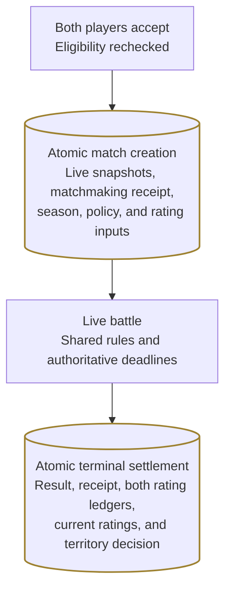

# Ranked competition storage

Ranked storage connects accepted matchmaking proposals to live battles, freezes
rating inputs at match creation, and settles both players' ratings with the
terminal result. Seasons and standings use those committed records.

[Ranked competition](../requirements/ranked-competition-policy.md) owns rating
values, placement rules, and resets. The [ranked API contract](../architecture/ranked-matchmaking-api-contract.md)
defines queue and standings requests.

## Stored model

| Relations                                      | Responsibility                                                               |
| ---------------------------------------------- | ---------------------------------------------------------------------------- |
| `private.ranked_policy_versions`               | Immutable competition constants and policy identity.                         |
| `ranked_seasons`                               | Scheduled, active, closing, and closed season lifecycle.                     |
| `ranked_player_season_ratings`                 | Current seasonal rating, seed, wins, losses, and settled-match count.        |
| `private.ranked_queue_entries`                 | Deck choice, original wait time, search lease, and queue lifecycle.          |
| Private matchmaking proposals and participants | Acceptance window, queue claims, responses, and cooldowns.                   |
| `private.ranked_matchmaking_receipts`          | Accepted proposal's live match, season, and policy.                          |
| `private.ranked_match_rating_inputs`           | Both players' starting ratings, prior match counts, and K factors.           |
| `private.ranked_rating_settlements`            | Exactly-once terminal settlement per ranked match.                           |
| `private.ranked_rating_ledger_entries`         | Immutable per-player pre/post ratings, expected scores, and applied changes. |
| `ranked_season_standing_archives`              | Final established-player competitive facts.                                  |
| `private.ranked_season_close_receipts`         | Reconciled settlement/archive counts at season close.                        |
| Private standings snapshots and rows           | Viewer-bound pagination facts valid for 10 minutes.                          |

## Queue and match creation

Partial unique indexes permit only 1 active/closing season and 1 searching or
proposed queue entry per player. A searching lease is renewed explicitly;
reading queue status does not renew it.

Matchmaking locks candidate entries, rechecks season, lease, account, deck,
restrictions, and active-match state, then creates both claims and the proposal
atomically. Concurrent workers cannot claim one entry for different matches.

Responses compare the current proposal state under locks. Acceptance,
withdrawal, cooldown, and requeue changes commit together. Requeue can preserve
original waiting time without extending the proposal's acceptance deadline.

When both accept, one transaction creates the live match, deck snapshots,
matchmaking receipt, and both rating inputs. Any territory grants are consumed
and snapshotted there as well.

An active queue protects its selected deck from deletion. Once terminal, deleting
the deck clears the optional reference without removing queue history.

## Rating settlement

A matchmaking receipt makes a battle ranked. CPU, async, and casual live results
cannot acquire a rating settlement without that accepted proposal and receipt.
Existing casual battles are not converted retroactively.

Terminal completion locks the match and both rating rows in stable order. It
uses immutable pre-match inputs and the authoritative winner to write both
ledger entries, update current ratings, and save one settlement receipt.

Deferred checks reject missing ledger sides, mismatched terminal results,
invalid calculations, or current ratings not backed by the ledger. A unique
match key makes settlement replay safe. Any failure rolls back the live result,
both ratings, and the associated
[territory decision](contested-campus-territory-persistence.md).

## Season closure

New matches stop when the season enters `closing`. Existing ranked battles
retain their original season and policy and must finish and settle.

The season service then seals territory contributions and final windows,
archives established-player standings, records reconciled close counts, and
marks the season `closed` in one transaction. Incomplete matches, queue state,
settlements, or archives prevent closure.

A due scheduled successor activates only after the previous season closes.
Its **28-day** active period starts at actual activation. Rating seeds use the
previous closed season's soft reset, or the initial value for a new player;
match counts and placement status restart.

Closed season facts, rating inputs, ledger entries, and settlement receipts
remain immutable under ordinary writes.

## Standings, privacy, and deletion

Current standings include active players who completed placements. The caller's
provisional rating remains available privately. Competition rank handles ties;
stable ordering and bounded pagination make traversal deterministic.

Current standings traversals use private **10-minute** viewer-bound snapshots.
They freeze competitive facts while Player Names resolve from current account
state. Closed archives also store competitive facts without copying names.

Queue candidates, decks, proposals, raw location, and trust evidence are not
standings fields. Public-schema tables still require authenticated projections.

Account deletion cancels active queue/proposal state before owned-deck cleanup.
It removes personal ratings, archive rows, and standings-cache entries.
Shared receipts and ledgers retain profile-free actors, preserving the opponent's
result. See [Account retention](account-deletion-retention.md).

Ranked rating is separate from
[permanent progression](player-progression-persistence.md); ranked live results
do not create point awards.

**AI declaration:** Prepared and updated with assistance from
Codex[GPT-5.6 Sol], Codex[GPT-5], ChatGPT-Web[GPT-5.6 Sol], and Codex[GPT-6].
