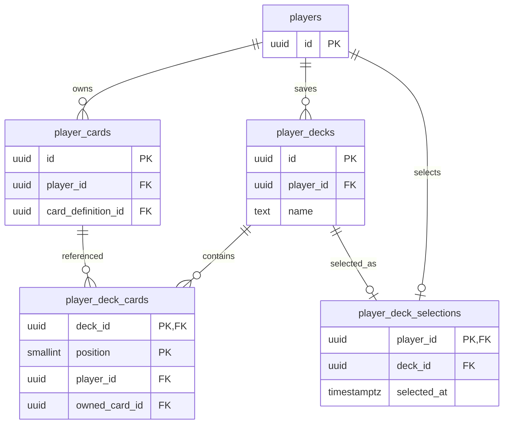

# Deck storage and API

Saved decks store ordered references to exact owned-card copies. The API resolves
ownership and catalogue metadata, validates the selection, and saves changes in
a PostgreSQL transaction. Battle setup creates separate immutable snapshots.

The [Collections and decks guide](../requirements/player-deck-building-journey.md)
covers player controls. [Deck rules](../requirements/basic-game-rules.md#saved-decks)
define composition and rarity costs.

## Stored relationships

`||` means exactly 1, `o|` means 0 or 1, and `o{` means 0 or more.
The diagram shows storage relationships; the service requires 5 membership
rows when creating or updating a valid deck.

| Relation                 | Contract                                                                           |
| ------------------------ | ---------------------------------------------------------------------------------- |
| `player_decks`           | Owner, nonblank name, and creation/update timestamps; `(id, player_id)` is unique. |
| `player_deck_cards`      | Ordered membership at positions 1–5, keyed by `(deck_id, position)`.               |
| `player_deck_selections` | At most 1 selection per player, pointing to that player's deck.                    |

Composite foreign keys require both the deck and owned copy to belong to the
membership row's player. A unique `(deck_id, owned_card_id)` constraint prevents
the same copy appearing twice in one deck.

One copy can appear in several saved decks. Repeating a definition in one deck
requires separate owned copies; there is no definition-level uniqueness rule.

## Validation and transactions

Create and update requests contain a name and ordered `ownedCardIds`. The API
derives the player identity, card category, rarity, and point total. A legal
selection has **5 distinct copies**, comprising **3 Creatures** and **2 Power
cards**, with a combined rarity cost of at most **10**.

The service locks ownership rows in stable UUID order before checking trade
reservations. A reserved copy cannot be added to a deck. Missing copies and
copies belonging to another player receive the same safe invalid-card response.

Updates lock the owned deck row, validate the full replacement, then replace
membership atomically. Concurrent updates commit complete selections, rather
than mixing rows from different requests. There is no `expectedVersion` field
in this contract.

Active selection revalidates the saved composition and updates the player's
single selection row. A missing deck and another player's deck return the same
not-found response.

Deleting a deck cascades membership and selection records. It does not delete
cards from the collection.

## HTTP operations

Routes require an authenticated, active account with completed Player Name setup.

| Operation                   | Route                                 |
| --------------------------- | ------------------------------------- |
| List owned decks            | `GET /api/v1/decks`                   |
| Create                      | `POST /api/v1/decks`                  |
| Replace name and membership | `PUT /api/v1/decks/:deckId`           |
| Delete                      | `DELETE /api/v1/decks/:deckId`        |
| Select                      | `PUT /api/v1/decks/:deckId/selection` |

List responses identify the active selection with `isSelected`.
The [API reference](../api-reference.md) owns request schemas,
response fields, and error codes.

## Battle and ownership boundaries

Saving a deck validates ownership and composition. Match creation separately
validates current card usability and trade reservations, then snapshots the
committed cards, stats, moves, and effects. Later saved-deck or catalogue changes
do not alter that battle.

Cards referenced by any saved deck are protected from evolution and trading,
including cards in inactive decks. A trade reservation also blocks a new battle
commitment. Profile favourites do not reserve cards.

See [CPU storage](cpu-match-persistence-design.md),
[Player battle storage](asynchronous-pvp-persistence.md), and
[Live battle storage](live-pvp-persistence.md) for snapshot lifecycles.

Account deletion removes saved decks, membership, and active selection.
[Account retention](account-deletion-retention.md) defines the wider purge.

**AI declaration:** Prepared and updated with assistance from
ChatGPT-Web[GPT-5.6 Sol], Codex-CLI[GPT-6], and Codex[GPT-6].
