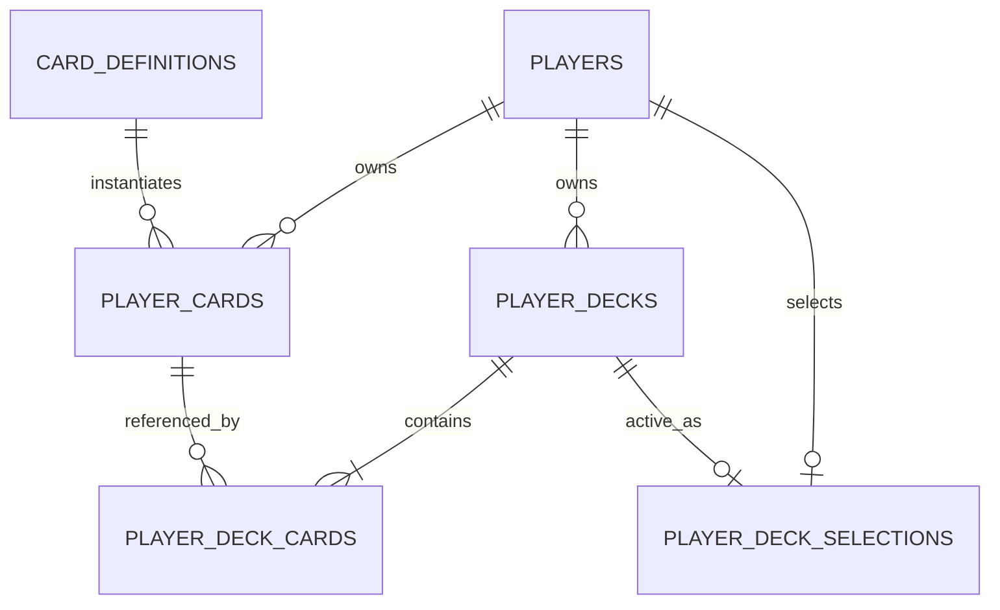

# Deck storage and API

## Status and scope

This document records the Sprint 2 saved-deck persistence and server-authority
boundary implemented by issue #72.

The approved player-visible deck rules are defined in
[Wits Quest Basic Game Rules](../requirements/basic-game-rules.md), with their
decision evidence maintained in the
[Basic-tier decision register](../requirements/basic-tier-decision-register.md).

Issue #72 implements saved deck persistence, validation, CRUD, and active-deck
selection. CPU match persistence and match-owned card/stat snapshots remain the
responsibility of issue #75.

## Basic deck invariants

A valid Basic deck contains exactly five owned card copies:

- three Creature cards;
- two Power cards; and
- no more than ten rarity points.

Rarity points are fixed:

| Rarity    | Points |
| --------- | -----: |
| Common    |      1 |
| Rare      |      2 |
| Epic      |      3 |
| Legendary |      4 |

One owned copy may be referenced by multiple saved decks.

The same owned copy cannot appear twice in one saved deck. Two cards that use
the same card definition are legal in one deck only when they are represented
by two distinct owned-card IDs.

The API derives card ownership, category, and rarity from PostgreSQL. The
browser does not submit authoritative category, rarity, point totals, or player
identity.

## Relationship view

<div className="diagram-scroll" role="region" aria-label="Deck storage and API — diagram 1" tabIndex={0}>



</div>

## `player_decks`

`player_decks` stores:

- `id`;
- `player_id`;
- nonblank `name`;
- `created_at`; and
- `updated_at`.

`UNIQUE (id, player_id)` supplies an ownership-safe composite identity used by
related tables.

A player may create multiple saved decks.

## `player_deck_cards`

Each row represents one exact owned copy included in one saved deck.

The relation stores:

- `deck_id`;
- `player_id`;
- `owned_card_id`;
- position from `1` through `5`; and
- `added_at`.

The composite deck foreign key requires `(deck_id, player_id)` to reference the
same player's deck.

The composite owned-copy foreign key requires `(owned_card_id, player_id)` to
reference a card copy owned by that same player.

`UNIQUE (deck_id, owned_card_id)` prevents the same owned copy from appearing
twice in one deck.

The primary key `(deck_id, position)` prevents two cards from occupying the same
position.

These constraints do not prohibit one owned copy from being referenced by
multiple saved decks.

There is deliberately no deck-level uniqueness rule on `card_definition_id`.
Two separately owned copies of the same definition may therefore coexist in one
deck.

## `player_deck_selections`

`player_deck_selections` stores:

- `player_id`;
- `deck_id`; and
- `selected_at`.

`player_id` is the primary key, so a player has at most one active deck
selection.

The composite `(deck_id, player_id)` foreign key ensures that a player cannot
select another player's deck.

Selecting another owned deck updates the same selection row.

Deleting the selected saved deck cascades the selection and membership rows
without deleting any `player_cards` ownership rows.

## Server-side validation flow

Creating or updating a deck uses the following authority boundary:

```text
Validated bearer token
        |
        v
Authenticated local player
        |
        v
name + ownedCardIds[5]
        |
        v
player_cards scoped by player_id
        |
        v
card_definitions
(category + rarity)
        |
        v
Basic deck validation
  - exactly five copies
  - unique owned copies
  - three Creature
  - two Power
  - rarity points <= 10
        |
        v
transactional deck persistence
```

The browser may choose an order and submit five owned-card IDs. It cannot assert
that a copy belongs to the player or that a card is a particular category or
rarity.

A missing owned-card ID and a copy owned by another player are exposed through
the same safe invalid-card response.

A missing deck and a deck owned by another player are exposed through the same
safe not-found response.

## Transaction behavior

Create, update, delete, and active selection use database transactions.

An update locks the owned `player_decks` row before replacing its membership
rows. Validation completes before the existing membership set is replaced.

Concurrent updates therefore serialize on the saved-deck row. A completed
update represents one complete deck version rather than a mixture of two
concurrent requests.

Active selection revalidates the persisted deck using authoritative card
metadata before changing the selected-deck row.

## HTTP operations

All deck operations require bearer authentication and an active local player.

### List decks

```http
GET /api/v1/decks
```

Returns all saved decks owned by the authenticated player and marks the active
selection using `isSelected`.

### Create deck

```http
POST /api/v1/decks
```

The request contains only:

```json
{
  "name": "Campus Five",
  "ownedCardIds": [
    "owned-copy-uuid-1",
    "owned-copy-uuid-2",
    "owned-copy-uuid-3",
    "owned-copy-uuid-4",
    "owned-copy-uuid-5"
  ]
}
```

Authoritative player identity, ownership, category, rarity, and point totals are
not accepted from the browser.

### Update deck

```http
PUT /api/v1/decks/{deckId}
```

Replaces the saved name and ordered owned-card membership after full server-side
validation.

### Delete deck

```http
DELETE /api/v1/decks/{deckId}
```

Deletes only the saved deck and its membership/selection state. Owned card
copies remain in the player's collection.

### Select deck

```http
PUT /api/v1/decks/{deckId}/selection
```

Revalidates the owned persisted deck and makes it the player's one active
selection.

The runtime OpenAPI document defines request validation, bearer authentication,
response shapes, and safe error responses for these operations.

## Match snapshot boundary

Saved decks are mutable player configuration. Match state is not.

Issue #72 does not create match persistence or match snapshot tables. Instead,
it establishes the source-of-truth boundary that issue #75 consumes.

When issue #75 creates a match, the match-creation transaction must:

1. load the authenticated player's currently selected deck;
2. confirm that the selected deck remains valid;
3. load the authoritative owned-card and card-definition state required for
   battle;
4. copy the selected deck order and required card/stat/move/effect values into
   match-owned snapshot records; and
5. commit those snapshots as the match's immutable starting state.

After that transaction commits, the match must not depend on live
`player_decks`, `player_deck_cards`, `player_cards`, or mutable catalogue values
for its historical starting state.

Consequently:

- editing a saved deck after match creation must not change that match;
- selecting another deck must not change an existing match;
- deleting a saved deck must not change an existing match; and
- later card-catalogue edits must not rewrite an active or completed match.

The concrete match snapshot schema and its immutability constraints are now
implemented by issue #75 and documented in
[CPU match persistence](./cpu-match-persistence-design.md).

## Migration

`0011_create_saved_decks.sql` adds:

- the composite owned-card identity required for ownership-safe deck foreign
  keys;
- `player_decks`;
- `player_deck_cards`; and
- `player_deck_selections`.

The deck persistence integration suite applies this migration to a clean
PostgreSQL database and verifies ownership, membership uniqueness, position
bounds, cross-deck reuse, active selection, deletion behavior, service CRUD,
and concurrent update serialization.

## Trust boundary

The browser may express deck intent only.

It must not determine or submit authoritative:

- player identity;
- card ownership;
- card category;
- card rarity;
- rarity-point totals;
- deck validity; or
- active-match snapshot values.

These values are resolved or validated by the API and PostgreSQL before a
protected deck operation succeeds.

---

This document was planned and generated with assistance from
ChatGPT-Web[GPT-5.6 Sol].

Page title and accessible diagram presentation updated with assistance from
Codex-CLI[GPT-6].
