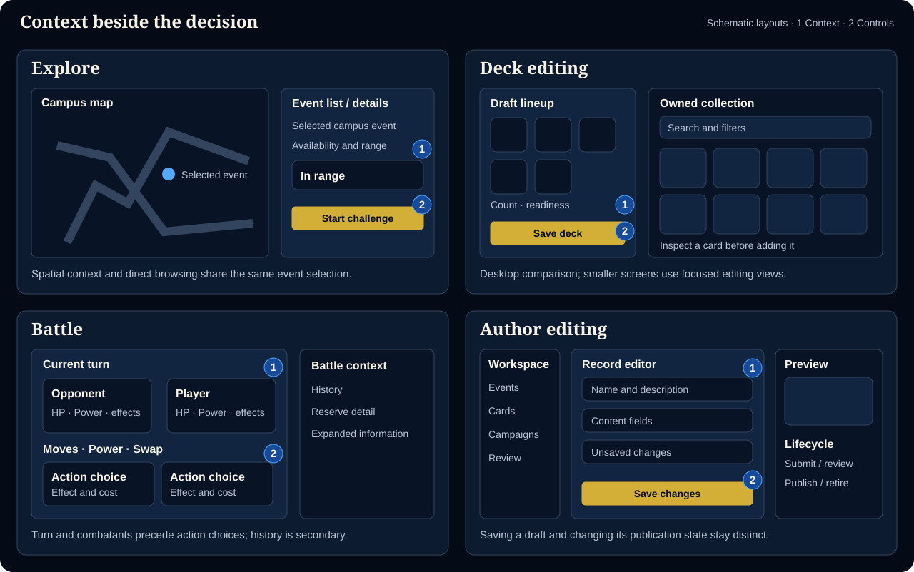

# UI/UX design

Wits World's interface connects campus exploration, card collecting, and battles.
The design puts the information needed for a decision beside its controls, with
secondary detail available when the user wants to inspect it.

## Players and authors

Players often use the game on a phone while moving around campus. Their layouts
prioritise short decisions, touch controls, and focused content. Desktop layouts
add space for card comparisons and battle context.

Authors work with lists, filters, editors, previews, and review history. A separate
console gives these longer tasks their own navigation while retaining access to
the player application. Its desktop layouts support content management; smaller
screens use compact navigation and vertically arranged forms.

## Navigation and hierarchy

Explore, Collection, and Battles group features around the player's task. Decks,
evolution, and trading sit with the collection; battle entry and history sit
with battles. Account settings and profile information have separate destinations.

The main action and its immediate context take priority. Card details, tabs,
expandable sections, and contextual panels expose additional information without
putting every control on the initial screen.

## Layout choices

_Layout illustrations of the current interaction patterns, rather than screenshots.
They show content relationships; spacing and controls adapt to the screen._

### Explore: map and list together

The map provides spatial context; the event list supports direct browsing. On
phones, event information opens in a sheet over the map. Desktop layouts put it
beside the map. Availability and range status belong with the selected event's
challenge action, so the player can assess access before starting.

The list also provides access to event information when the map is unavailable.
Exploration does not depend on manipulating the map.

### Decks: draft and collection together

Desktop editing places the lineup beside the collection for comparison. Smaller
screens use focused deck and collection views, with card count, readiness, and
save state kept in the editing flow.

Inspecting a card does not add it to the draft. Search and filters preserve chosen
copies. The viewed deck and active battle deck are distinguished, so browsing
and editing do not silently change the next match's selection.

### Battles: actions beside their consequences

The current turn, active Creatures, HP, Power, and effects support the next
decision. Moves show effects and costs together. On phones, combatants stack above
the actions; on desktop, history and reserve detail can sit beside the battlefield.

This keeps action selection readable while making the relevant battle context
available. Longer descriptions can grow with the page rather than being clipped
into a fixed-height action area.

### Authoring: editing and publication are separate

Save state and actions belong with the editor. Submission, review, approval, and
publication are separate lifecycle controls. This distinguishes a saved record
from content made available to players and reduces ambiguity about what a button
will change.

## Visual identity

Dark navy surfaces and ivory text provide the base for campus imagery and
collectible artwork. Gold appears in primary actions, branding, and prestigious
card treatments; blue identifies selection, focus, and interactive detail.
Semantic messages pair colour with explicit text.

### Fonts

**Source Serif 4** is used for page titles, card names, reward headings, and
prominent game text. Its serif letterforms give these elements an academic,
editorial character that fits the campus setting. Using it selectively gives
important names and moments emphasis without making every label decorative.

**Source Sans 3** is used for body text, navigation, buttons, forms, status
messages, statistics, and Author workspaces. Its simpler letterforms suit compact
controls and information that needs to be scanned quickly. Keeping these roles
consistent helps users recognise headings, content, and actions across screens.

The **Plain sans-serif** accessibility option also replaces the serif headings
with Source Sans 3 for users who prefer one font throughout the interface.

### Responsive imagery

Campus and achievement artwork use image sizes suited to the displayed area,
screen density, and interface size preference. This keeps images proportional
and detailed as the layout changes without downloading the largest version for
every view. Resizing preserves the original artwork and transparency.

Achievement dialogs retain an available badge preview while the larger image
loads. A missing preview has a stable medal placeholder. Campus artwork is
prepared with the offline shell; achievement artwork is not automatically
prepared for offline use.

## Card presentation

Collection, deck picking, card details, evolution, Author previews, and revealed
battle cards use the same frame structure: a recessed square artwork window and
a lower plate for the name, rarity, and quantity where relevant. Consistent
presentation helps players recognise a card across these contexts.

| Rarity    | Frame treatment                                            |
| --------- | ---------------------------------------------------------- |
| Common    | Ivory and silver metal with restrained engraving           |
| Rare      | Deep blue enamel with metallic engraving and a star crest  |
| Epic      | Violet metalwork with layered lines and orbital detail     |
| Legendary | Layered gold with a dark inset plate and a prominent crest |

Rarity has a written label. When a battle record has no rarity, its frame uses a
neutral finish without guessing a tier. Selection and keyboard focus remain
separate from rarity; quantities and retirement use text.

Artwork fits without cropping or stretching. Compact cards simplify engraving,
while larger views reveal more detail. Missing artwork has a neutral fallback.
Card content is documented in the [Card catalogue](basic-card-roster.md).

For input, focus, and reading preferences, see [Accessibility](design-system.md).
For waiting, errors, and confirmations, see [Interaction states](state-review.md).

AI declaration: Written and revised with assistance from Codex[GPT-6].
