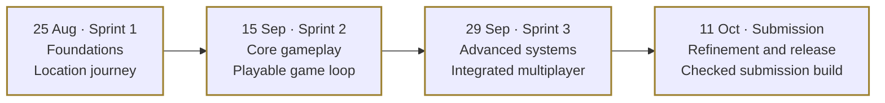

# Delivery roadmap

**Delivery snapshot: 8 October 2026.** Progress below follows the sprint reports
through that date; the [work tracker](work-tracking-and-issue-management.md)
holds current tasks and ownership.

Wits Quest was planned around complete player journeys: discover an event,
complete a challenge, collect cards, build a deck, and battle. The roadmap
established that Basic loop first, then allowed later features to build on its
identity, content, ownership, and persistence foundations.

<a id="milestones" />

## Delivery timeline

The four phases move from a working foundation to a checked submission build.
All target dates are in 2026 and follow the project brief's preliminary timeline.

### Planned outcomes and recorded delivery

| Phase and sprint report                             | Planned outcome                                                                             | Recorded delivery by 8 October                                                                                                                                  |
| --------------------------------------------------- | ------------------------------------------------------------------------------------------- | --------------------------------------------------------------------------------------------------------------------------------------------------------------- |
| [Sprint 1](scrum/sprint-1/report.md)                | Deploy an authenticated location journey and establish architecture, CI, and documentation. | The location slice and core gameplay foundations were implemented; work progressed beyond the initial slice into challenges, rewards, decks, and CPU battles.   |
| [Sprint 2](scrum/sprint-2/report.md)                | Complete remaining Basic work and integrate the planned Intermediate journeys.              | Account lifecycle, trails, progression, evolution, offline challenges, asynchronous battles, and Author extensions were implemented.                            |
| [Sprint 3](scrum/sprint-3/report.md)                | Integrate Advanced systems and evaluate the product with stakeholders and users.            | Live and ranked battles, trust review, event placement, territories, trading, and Advanced analytics were implemented, with reviews and user findings recorded. |
| [Final period — Sprint 4](scrum/sprint-4/report.md) | Refine existing journeys and prepare a stable, verified submission build.                   | Interface, loading, performance, and background-operation improvements were integrated through 8 October. Final release checks remained the next priority.      |

<a id="why-the-work-was-sequenced-this-way" />

## Why this order

The first slice crossed the Web, API, authentication, and PostGIS database.
That exposed integration and deployment blockers before the game depended on
them. Challenges then added marking and saved outcomes; card ownership enabled
collection, legal decks, and battles. Independent Author review supplied the
content lifecycle behind those player journeys.

Later systems reused these foundations. Player battles required durable match
state; ranked competition and territories built on committed results; trading
required atomic ownership changes. This sequencing let interface and service
work proceed against agreed contracts while keeping shared dependencies clear.

<a id="how-the-plan-evolved" />

## Changes to the plan

The [original delivery plan](https://sdp.ms.wits.ac.za/gradient-ascent/Wits-World/src/commit/0a70f5bec1a4d179bb5d4996f29deb9966c1b4ac/docs/planning/delivery-roadmap.md)
prioritised Basic before stretch work. Requirements and product decisions then
changed both scope and timing:

| Original plan                               | Change                                                                   | Reason and supporting record                                                                                                                                                                                                                                                                                                                                                                                         |
| ------------------------------------------- | ------------------------------------------------------------------------ | -------------------------------------------------------------------------------------------------------------------------------------------------------------------------------------------------------------------------------------------------------------------------------------------------------------------------------------------------------------------------------------------------------------------- |
| Password recovery and deletion in Sprint 3. | Account lifecycle work moved earlier, before the planned Sprint 3 phase. | [Sprint 2 planning](scrum/sprint-2/report.md#planning) treated these as remaining Basic requirements, alongside content and release work, rather than optional extensions.                                                                                                                                                                                                                                           |
| Ordered trails as stretch work.             | Trails became part of the Sprint 2 Intermediate increment.               | Intermediate requirements defined the next increment; the [8 September stakeholder review](stakeholder-interactions/2026-09-08-trails-and-card-art-review.md) confirmed trails were required. The implementations already existed at that review.                                                                                                                                                                    |
| A correct answer awards one event card.     | Five-question attempts award zero to two cards according to score.       | The team-confirmed challenge and reward rules replaced the initial planning assumption. The [challenge decision](https://sdp.ms.wits.ac.za/gradient-ascent/Wits-World/issues/46#issuecomment-2732), [reward decision](https://sdp.ms.wits.ac.za/gradient-ascent/Wits-World/issues/49#issuecomment-2748), and [current rules](../requirements/basic-game-rules.md#rewards) record the policy used for implementation. |

The [product overview](../basic-release-reference.md) describes the resulting
capabilities. The [Sprint 2](../requirements/sprint-2-feature-matrix.md) and
[Sprint 3](../requirements/sprint-3-feature-matrix.md) feature matrices provide
the detailed implementation mapping.

**AI declaration:** The original plan used ChatGPT-Web[GPT-5.6 Thinking],
Codex-CLI[GPT-5], Codex[GPT-5], and Codex-CLI[gpt-5.6-sol medium]. This revision
used Codex[GPT-6] for rubric comparison, source review, prose editing, and the
delivery timeline diagram.
