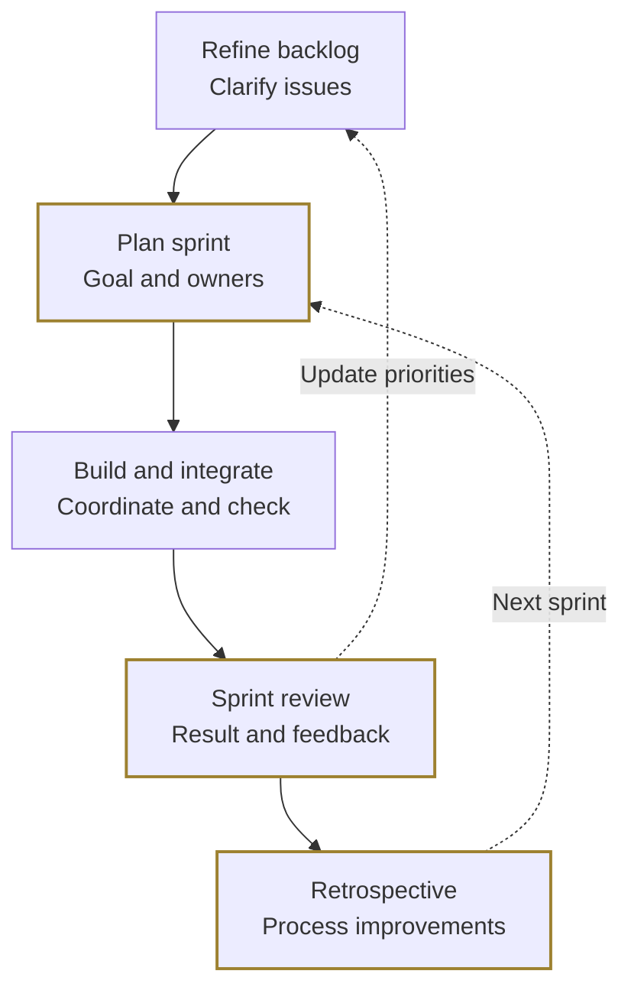
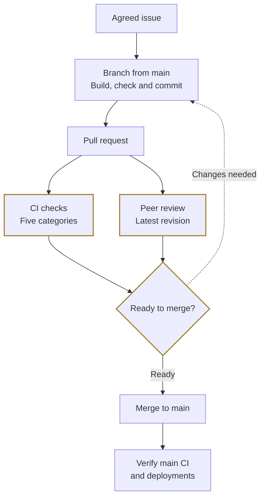

# Methodology and Git

Wits World organises work in sprints, with an issue backlog, regular
coordination, review of the delivered work, and a retrospective. Git branches
and pull requests connect that planning to reviewed changes.

## Why this approach

The semester has a short delivery window and several parallel workstreams:
interface, API, database, and quality. Small increments let the team integrate
these streams early and adjust priorities after feedback. Delivering a complete
player journey also reveals problems that isolated components miss.

## The working records

- **Product backlog:** Gitea issues for features, defects, research, and release work, ordered by priority.
- **Sprint backlog:** The issues selected for a sprint, their owners, and the plan for achieving its goal.
- **Increment:** The integrated improvement that meets the agreed acceptance criteria and [completion rules](#quality-and-completion).

## From planning to delivery

Each sprint turns selected issues into a checked improvement. Feedback and
process lessons shape the next plan.

<div className="diagram-scroll" role="region" aria-label="Sprint planning, delivery, and feedback cycle" tabIndex={0}>



</div>

Issues record progress, blockers, and agreed scope changes throughout the sprint.
Contributors integrate their work and check the complete journey. Unfinished
work and remaining acceptance checks carry forward into the next plan.

## Responsibilities and cadence

The team shares planning, delivery, and process improvement. Issue owners take
responsibility for individual changes; reviewers assess them independently;
stakeholders provide product feedback.

| Coordination role                     | Lead              | Responsibility and handoff                                                                                |
| ------------------------------------- | ----------------- | --------------------------------------------------------------------------------------------------------- |
| Frontend and player/Author UX         | Kevin Ebrahim     | Accessible workflows, authoritative-state presentation and browser/participant checks.                    |
| Backend and security                  | Tyron Van Tonder  | Authentication/authorization, HTTP/realtime services, deadlines, retries and service integration.         |
| Database and cross-stack support      | Uzair Mahomed     | Persistence, migrations, spatial/rating/trade integrity, contracts and targeted frontend/backend support. |
| Quality, content and delivery support | Caleb Perumalsamy | Content review, test/release evidence, operational checks and extra integration work.                     |

These roles guide coordination across the team. Individual issue ownership and
peer review are recorded on the work item and PR. Contributors work together
on integration and changes that span multiple areas.

The team reviews progress and dependencies weekly, with shorter coordination
as needed during the week. These check-ins identify blockers, agree the next
actions, and arrange handoffs. Planning, review, and retrospective provide the
larger checkpoints around each sprint.

The [delivery roadmap](delivery-roadmap.md) shows how successive sprint goals
moved from foundations to gameplay, Advanced features, and final polish.

## Git workflow

Changes reach `main` through a focused branch, automated checks, and peer
review. The issue describes the intended outcome; commits record the changes;
the pull request brings the implementation and verification together.

<div className="diagram-scroll" role="region" aria-label="Issue, branch, CI, peer review, and merge workflow" tabIndex={0}>



</div>

CI and peer review must both support the latest revision before it is merged.
The steps below explain what to do at each stage.

### 1. Agree the work and create a branch

Read the issue's scope, comments, dependencies, and acceptance criteria before
starting. Confirm who owns the change and which decisions need input from
another contributor. Record the working branch and verification approach on
the issue so the rest of the team can follow progress.

Create a short-lived branch from the latest `main`. Use a name that identifies
the purpose, such as `feat/campus-map`, `fix/geolocation-denied-state`, or
`docs/player-guide`. Keep development on that branch and bring in changes from
`main` when needed to resolve integration problems.

### 2. Implement and check the change locally

Keep the change within the agreed scope. Update relevant tests, contracts,
documentation, and operating instructions with the implementation. A new
problem outside that scope becomes a linked follow-up issue.

The shared local checks run from the repository root:

```bash
npm run format:check
npm run lint
npm run type-check
npm test
npm run build
```

Formatting, linting, and type checks catch different classes of mistakes; tests
exercise behaviour, and builds check that the applications can be packaged.
Database and browser changes also need the relevant integration or journey
checks from [Test suites](../testing/automated-verification.md). The normal
`npm test` command does not enable every database or browser suite.

Inspect the diff before committing. Stage the intended files, check the staged
diff, and leave unrelated changes out of the commit. Credentials, private
configuration, and participant data stay outside version control.

### 3. Write clear commits

A commit should represent one coherent change. Its subject starts with an
approved prefix and a concrete description:

| Prefix       | Use                                          | Example                                        |
| ------------ | -------------------------------------------- | ---------------------------------------------- |
| `[feat]`     | Add capability.                              | `[feat] add event eligibility display`         |
| `[fix]`      | Correct a defect.                            | `[fix] handle denied geolocation permission`   |
| `[test]`     | Add or improve verification.                 | `[test] cover stale location recovery`         |
| `[docs]`     | Update documentation.                        | `[docs] explain the player journey`            |
| `[perf]`     | Improve performance.                         | `[perf] reduce Battles landing requests`       |
| `[ci]`       | Update CI or release workflows.              | `[ci] enforce API-first Battles releases`      |
| `[refactor]` | Restructure code while preserving behaviour. | `[refactor] isolate event status presentation` |
| `[chore]`    | Maintain tooling or project configuration.   | `[chore] configure frontend quality checks`    |

Use a specific verb and name the affected behaviour. A subject such as
`[fix] preserve the deck draft after a failed save` is easier to understand
later than `[fix] updates`. Add a body when the reason, tradeoff, or operational
impact needs explanation. Issue references connect the change to its work item.

Every commit containing AI-generated code includes an accurate `Assisted-by`
trailer naming each tool and model that materially contributed. For example:

```text
[fix] preserve the deck draft after a failed save

Keep the edited lineup available so the player can retry the save.
Relates to #<issue>

Assisted-by: <tool>[<model>]
```

Replace the placeholders with the actual issue, tool, and model. The
[AI-use guide](ai-use.md) explains document and PR disclosure alongside commit
attribution.

### 4. Open a pull request to main

Push the branch and open a PR targeting `main`. Complete the repository template
with the problem, approach, linked issue, verification results, and relevant
accessibility, documentation, API, database, and AI impacts. Include responsive
screenshots for interface changes and identify manual checks still required.

Use `Closes #<issue>` when the PR satisfies the whole issue. Partial work uses
`Relates to #<issue>` or `Partially implements #<issue>` and leaves the remaining
criteria visible. Keep the PR focused enough for a teammate to understand and
review the entire change.

### 5. Check the CI results

Gitea Actions runs the pull-request validation workflow for PRs targeting
`main`. It checks five categories:

| Category            | What it checks                                                                            |
| ------------------- | ----------------------------------------------------------------------------------------- |
| Static analysis     | Prettier formatting, ESLint, and TypeScript checks.                                       |
| Tests and coverage  | Web, API including PostGIS paths, documentation, and shared-package tests and coverage.   |
| Database validation | Migrations, persistence, and PostgreSQL/Redis gameplay coordination on isolated services. |
| Browser validation  | The Basic journey and selected Explore, Author, and Account regressions.                  |
| Builds              | Production Web, API, and documentation builds.                                            |

The final **Repository and application validation** job succeeds only when all
five categories succeed. Failed, cancelled, or skipped categories cannot
produce a successful aggregate result.

Check the results for the latest PR revision. If a job fails, inspect its logs,
correct the problem, rerun the relevant local checks, and push the correction.
New commits need their own successful validation. Selected browser gates do
not cover every journey; additional checks follow the change's scope. The
[CI guide](../testing/continuous-integration.md) records the full selections.

### 6. Obtain peer review

A teammate reviews the change against the issue's acceptance criteria and the
PR diff. Review covers behaviour, failure handling, test usefulness,
maintainability, accessibility, security, and any contract or schema effects.
For interface changes, the reviewer also considers the supplied interaction
and responsive evidence.

The author addresses requested changes on the same branch and records the
correction and verification. Unclear feedback is discussed before approval.
Reviewers check the updated diff and CI results before approving the latest
revision. Recorded branch-protection settings require one approval and dismiss
stale approvals after new changes; CI status checks still need explicit review
because the recorded setup does not enforce them at the merge button.

### 7. Check readiness and merge to main

Before merging, the reviewer or authorised merger confirms:

- the PR targets `main` and has no unresolved merge conflicts;
- the PR's agreed scope and acceptance criteria are satisfied, and any unmet
  criteria for the wider issue remain explicitly tracked;
- all five CI categories and the aggregate validation job passed for the latest
  revision;
- peer approval covers that revision and requested changes are resolved; and
- documentation, contract, schema, operational, and AI disclosures are complete.

If integration with a newer `main` changes the branch, repeat the affected
checks and obtain review of the updated result. Contributors do not merge their
own pull requests under the agreed workflow.

Merge through Gitea using the repository's merge-commit workflow. This retains
the branch's commits and its PR relationship in `main` history. Afterward,
confirm the merge is present on `main`, reconcile the issue and board state,
and keep any remaining acceptance work linked. The completed branch can then
be removed.

The main workflow validates the merged revision and deploys affected
applications. Documentation has its own publishing workflow. Check the relevant
main-branch results and deployment health checks before reporting the change as
released. Deployment jobs verify that their revision is still current `main`
before changing production, so an older run may be superseded. The
[CI guide](../testing/continuous-integration.md#main-branch-validation-and-deployment)
explains that release sequence.

## Quality and completion

Work is complete when its acceptance criteria, relevant checks, review,
documentation, and required manual evidence are satisfied and the change is
merged. If a PR completes only part of an issue, the remaining criteria stay
visible in the tracker. [Work and bug tracking](work-tracking-and-issue-management.md)
explains that handoff.

## Sprint records

The [sprint reports](scrum/index.md) record planning, coordination, delivered
work, reviews, and improvements across the project. They link the workflow to
issues, pull requests, and verification results.

The [issue #9 and PR #28 example](work-tracking-and-issue-management.md#workflow-in-practice)
shows the workflow in screenshots: assigned work, implementation checks,
requested correction, approval, and merge.

**AI declaration:** Prepared and edited with assistance from Codex[GPT-5],
ChatGPT-Web[GPT-5.6 Sol], Codex-CLI[GPT-6], and Codex[GPT-6]. The latest revision
used Codex[GPT-6] for rubric comparison, source review, prose editing, and workflow diagrams.
